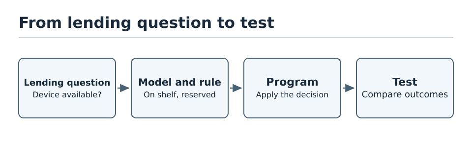

# M1-L1 – How computer science models problems {#L1}

**Course area:** M1 – Orientation and computing systems

**Level:** Entry / bridge (roughly Years 5–6)

**Prior knowledge:** No programming experience required.

**Learning objective:** Distinguish the problem, model, algorithm, program and acceptance criteria in a lending example.

## What is the problem? {#S1}

The school library needs a tablet display that tells users whether a device can be borrowed. The display is simple. The underlying question is which facts the software must know to report “available” reliably. A device can be on the shelf while reserved for someone else.

## How a model is built {#S2}

**Computer science** studies how information can be represented and processed so that people and technical systems can solve problems. It includes programming as well as designing and testing the models that programs use. A **model** shows the features that matter for a particular question. The colour of a tablet may help someone find it. The colour has no bearing on the lending decision.

An **algorithm** specifies unambiguous steps for a class of similar inputs. A **program** expresses the steps in an executable language. A **test** compares the result actually observed with a result that was expected for a reason.

{alt="Arrows connect four boxes for the lending question, features and rule, program, and expected result."}

If a test returns a surprising answer, the cause may be in the model, the algorithm or the implementation. Describing those three levels separately makes the cause easier to find.

## Worked example: Can the tablet be loaned out? {#S3}

The model contains two yes-or-no features, `on shelf` and `reserved`. The algorithm reports “available” when the device is on the shelf and has no reservation. All other cases return “unavailable”. The decision concerns an unscheduled loan to any borrower.

| On shelf | Reserved | Expected outcome |
| --- | --- | --- |
| yes | no | available |
| yes | yes | unavailable |
| no | no | unavailable |
| no | yes | unavailable |

This model has only four input combinations. The table specifies a testable result for each combination. If a program reports “available” in the second row, first check whether it reads the reservation at all. Keep the table as a record of the requirement.

## Self-check {#S4}

### Exercises

1. A tablet is reserved and on the shelf. State the expected output and the decisive test.
2. The library wants to account for reservations when the borrower arrives. What additional feature does the model need? Explain whether the device colour helps.
3. What would change if a damaged device could be left on the shelf?

### Solutions

1. The output is “unavailable”. The test sets both features to “yes” and requires the result “unavailable”. It checks the exact case where being on the shelf and being available differ.
2. The decision needs to know whether the person making the request is authorised to use the reservation. A random booking code with no name field can be enough for the decision in this model. Colour gives no evidence of authorisation.
3. Add a feature such as `working`. Under the new rule the device is available only if it is on the shelf, unreserved and working. Add at least one test for a damaged device that would otherwise be available.

## Common errors and limits {#S5}

“On the shelf” is an observation. “Available” is a judgement derived from observations and rules. Confusing these loses a feature. Even with a correct rule, outdated input can lead to a wrong answer. A real system therefore needs a separate state such as “unknown” when stock information is missing or unconfirmed.

## What to remember {#S6}

A useful model makes its assumptions visible. You can check an algorithm before implementing it by specifying inputs and expected outputs.

## Sources and further reading {#S7}

### Further reading (internal)

- [M1-L2 – Hardware, software and operating systems](M1-L2.md)

### Sources (external)

- [Gesellschaft für Informatik e. V. – Bildungsstandards Informatik für die Sekundarstufe I](https://informatikstandards.de/fileadmin/FA/IBS/user_upload/GI-Bildungsstandards_Informatik_Sek_I__2025__-_blau.pdf) · Lesson reference: §4.1, §5.2 · Distinguish the problem, model, algorithm, program and acceptance criteria in a lending example. · Last accessed: 2026-11-22 · Content verified: 2026-11-22
