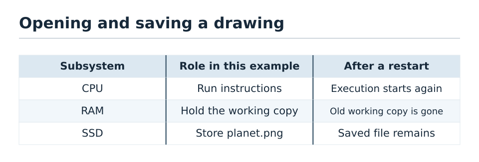

# M1-L2 – Hardware, software and operating systems {#L2}

**Course area:** M1 – Orientation and computing systems

**Level:** Entry / bridge (roughly Years 5–6)

**Prior knowledge:** [M1-L1 – How computer science models problems](M1-L1.md)

**Learning objective:** Relate input, processing, output and storage to the CPU, RAM, SSD and operating system.

## One picture, two places to store it {#S1}

You make a change to a drawing and want to continue working on it the next day. The changed picture appears immediately while you work. Whether it comes back tomorrow depends on which version was saved to persistent storage.

## What the components do {#S2}

A computing system connects **hardware**, the physical components, with **software**, the programs and associated data. A mouse supplies input signals. A program specifies how to respond to those signals. A **CPU** (processor) runs program instructions. It can compare values and perform calculations, among other tasks.

**RAM** holds data and parts of programs currently in use. Ordinary main memory loses its contents without power. An **SSD** can keep files persistently. It is an example of non-volatile storage. The **operating system** manages programs, memory, file access and devices. The drawing application asks the operating system to open a file. A screen and a loudspeaker are examples of devices through which a system outputs results.

{alt="Table showing CPU for instructions, RAM for the open drawing and SSD for planet.png."}

## Worked example: Draw, save and restart {#S3}

1. You open the file `planet.png`. The system reads stored data from the SSD. The drawing application processes a working version in RAM.
2. You add a ring. The application changes the working version and shows the ring on the screen.
3. When you save, a version of the change is written to the file. After a normal restart the application loads this version again.
4. If you restart without saving, this simplified example shows the previous file version without the ring. Some programs keep a recovery copy if it is enabled and was created before the restart.

The CPU executes instructions for all these steps. The SSD keeps the file between sessions. These are two distinct tasks.

## Self-check {#S4}

### Exercises

1. Assign the keyboard, CPU, screen and SSD to the roles of input, processing, output and persistent storage.
2. You see a sketch on screen and have yet to save the last change. What can you say about the version available after a power loss?
3. A large file is saved but cannot fit entirely in the currently available RAM. Describe one way a program could process it.

### Solutions

1. Keyboard: input. CPU: processing. Screen: output. SSD: persistent storage. A touchscreen, for example, combines input and output, so a device can have more than one role.
2. The last persistently saved version normally remains. The latest change that only existed in RAM may be lost. Automatic recovery depends on the program and on whether a recovery copy exists.
3. The program could read and process one part at a time. For example, it checks a text file line by line without keeping the entire file in memory. This works for a task that needs only a small number of previous values.

## Common errors and limits {#S5}

Persistent refers here to keeping data without continuous electrical power. An SSD can still fail and a file can be overwritten accidentally. An application might also have been in the middle of writing a file. The example simplifies these failure cases. For important work, keep a separate backup and check that it can be restored.

## What to remember {#S6}

RAM holds the current working state. Persistent storage keeps files across a restart. The operating system coordinates applications' access to resources and devices.

## Sources and further reading {#S7}

### Further reading (internal)

- [M1-L3 – Precise instructions, flowcharts and blocks](M1-L3.md)

### Sources (external)

- [Gesellschaft für Informatik e. V. – Bildungsstandards Informatik für die Sekundarstufe I](https://informatikstandards.de/fileadmin/FA/IBS/user_upload/GI-Bildungsstandards_Informatik_Sek_I__2025__-_blau.pdf) · Lesson reference: §5.4 · Relate input, processing, output and storage to the CPU, RAM, SSD and operating system. · Last accessed: 2026-11-22 · Content verified: 2026-11-22
