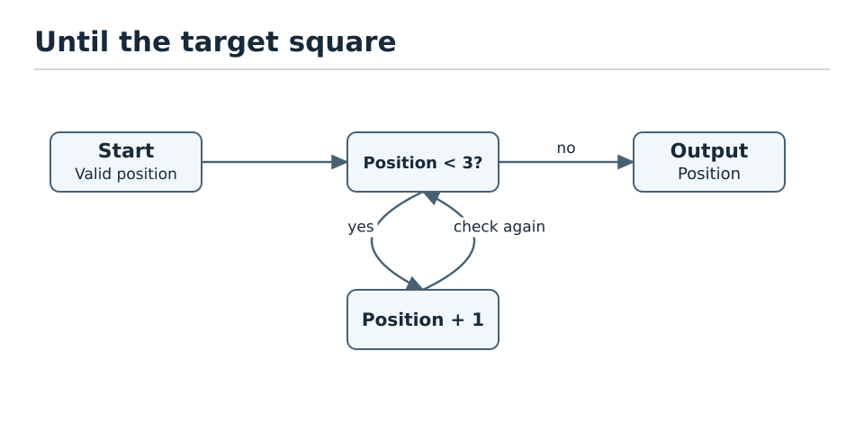

# M1-L3 – Precise instructions, flowcharts and blocks {#L3}

**Course area:** M1 – Orientation and computing systems

**Level:** Entry / bridge (roughly Years 5–6)

**Prior knowledge:** [M1-L1 – How computer science models problems](M1-L1.md)

**Learning objective:** Represent a simple procedure in pseudocode, a flowchart and a sequence of blocks.

## A route a computer can follow {#S1}

A strip of paper has four squares numbered from 0 to 3. A counter starts on square 0 and must reach the target square 3. People often fill in details implicitly when told to “walk to the target”. A program needs checkable state, an unambiguous step rule and a stopping condition.

## Representing the same algorithm {#S2}

**Pseudocode** describes instructions in a simplified language. A **flowchart** shows the same instructions as a sequence of nodes. Arrows show direction and a decision has labelled exits. In a visual programming language, blocks can express the same start, condition and update.

{alt="After a valid start, position less than three leads to the next square and back to the check. Otherwise the position is output."}

The **position** is part of the state, the information stored about the current situation. Before the first iteration, check whether it is between 0 and 3. From a valid position left of the target, each step changes exactly one value: the position increases by one.

## Worked example: Reaching square 3 {#S3}

```text
INPUT position
IF position is not an integer OR position < 0 OR position > 3:
    OUTPUT "invalid"
    END
WHILE position < 3:
    position <- position + 1
OUTPUT position
```

Here is how you would assemble the same rule from blocks:

1. Under **When started**, add **Read input**.
2. Inside **If input is invalid**, put **Output “invalid”** and **Stop**.
3. Inside **Repeat until position = 3**, put **Increase position by 1**.
4. After the loop, add **Output position**.

Starting at 0, the next positions are 1, 2 and 3. At square 3 the condition is false, so repetition ends. The difference `3 − position` is the remaining distance. It starts at 3, decreases by one at every step and cannot become negative inside the loop. This explains why the loop terminates.

Starting at 3 ends the algorithm without a movement. Starting at 4 returns “invalid”. You can simulate the same logic on paper with a counter. Use a movable slip of paper as storage for `position`.

## Self-check {#S4}

### Exercises

1. Start at square 2. Which conditions are checked and when? How many movement steps occur?
2. Change the loop condition to `position <= 3`. Give an input that exposes a defect.
3. The target can now be square 1, 2 or 3. Give the inputs and a suitable rule for a start to the right of the target.

### Solutions

1. The range check accepts 2. `2 < 3` is true, so the counter moves once to square 3. `3 < 3` is false, so the output is 3.
2. For input 3, `3 <= 3` is true. The algorithm sets the position to 4 and outputs a square outside the strip. The original strict comparison preserves the valid end point.
3. The inputs are start and target. Check that both are valid squares. If the start is to the right of the target, move left one square at a time until they match. Alternatively, reject such inputs if the restricted task explicitly allows that.

## Common errors and limits {#S5}

An arrow back to the test alone does not ensure termination. The loop body must move the state towards an end point that can be reached. The strip has no obstacles. For a route with walls, the model also needs to represent which steps are allowed.

## What to remember {#S6}

Pseudocode, a flowchart and blocks are different representations of the same logic. For testing, include an ordinary start, a start on the target and a start outside the allowed range.

## Sources and further reading {#S7}

### Further reading (internal)

- [M1-L4 – Organising files safely](M1-L4.md)

### Sources (external)

- [Gesellschaft für Informatik e. V. – Bildungsstandards Informatik für die Sekundarstufe I](https://informatikstandards.de/fileadmin/FA/IBS/user_upload/GI-Bildungsstandards_Informatik_Sek_I__2025__-_blau.pdf) · Lesson reference: §5.2 · Represent a simple procedure in pseudocode, a flowchart and a sequence of blocks. · Last accessed: 2026-11-22 · Content verified: 2026-11-22
- [Bildungsserver Berlin-Brandenburg · Senatsverwaltung Berlin und MBJS Brandenburg – Rahmenlehrplan Teil C – Informatik, Wahlpflichtfach, Jahrgangsstufen 7–10](https://bildungsserver.berlin-brandenburg.de/fileadmin/bbb/unterricht/rahmenlehrplaene/Rahmenlehrplanprojekt/amtliche_Fassung/Teil_C_Informatik_2015_11_10.pdf) · Lesson reference: §3.5 · Represent a simple procedure in pseudocode, a flowchart and a sequence of blocks. · Last accessed: 2026-11-22 · Content verified: 2026-11-22
