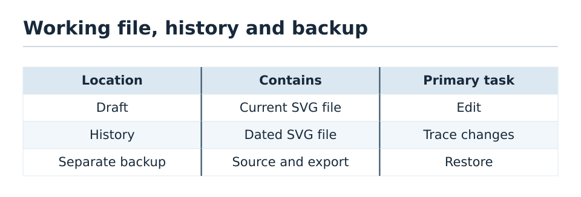

# M1-L4 – Organising files safely {#L4}

**Course area:** M1 – Orientation and computing systems

**Level:** Entry / bridge (roughly Years 5–6)

**Prior knowledge:** [M1-L2 – Hardware, software and operating systems](M1-L2.md)

**Learning objective:** Distinguish relative paths, file formats, versions and separate backups.

## The file exists. Which version is it? {#S1}

Your team is working on a poster. Three files are called “final”. Just before the presentation nobody knows which one was approved and where the editable source is. A reliable file layout answers both questions.

## Paths, file formats and backups {#S2}

A **path** gives a location in a folder structure. A relative path needs a starting point. From the project folder `schulfest/`, `export/plakat.pdf` goes into the `export` folder to the file `plakat.pdf`. From the project folder's parent, the relative path is `schulfest/export/plakat.pdf`.

A **file extension** is part of the name and often suggests the format. The format describes how the contents are stored. Renaming a text file to `.pdf` does not make it a valid PDF. An editable source and a format exported for viewing serve different purposes.

{alt="The working source and history are in the project, with a separate backup that can be restored for testing."}

**Versioning** keeps a traceable record of earlier states. A **backup** is a copy held separately for recovery. A version folder and a working file on the same drive can be lost together. A backup of an older version can still be useful if you know its date and can restore it.

## Worked example: Preparing a handover {#S3}

| Location relative to the project | Contents | Purpose |
| --- | --- | --- |
| `entwurf/plakat.svg` | current editable vector file | further editing |
| `export/plakat.pdf` | approved version | viewing or printing |
| `verlauf/plakat-2026-11-20.svg` | draft from 20 November | check an earlier version |

After approving the draft and export, the team makes a separate copy. To test it, a member restores both files into a test folder. They open the PDF and check the expected version date. Another team member opens the SVG in an editor and checks that it remains editable.

## Self-check {#S4}

### Exercises

1. You are in `verlauf`. What is the relative path that goes up one level and then to the export?
2. A team member copied only the target file `plakat.pdf`. What can still be done if the project folder is lost, and what is missing?
3. Why should you test an actual restore if the backup already lists the file?

### Solutions

1. `../export/plakat.pdf`. `..` moves to the project folder, from which the path goes into `export`.
2. If the copy is intact, the published version can be viewed or distributed again. The editable source and recorded earlier versions are missing.
3. A list only shows that an entry exists. Opening the restored file can reveal a damaged copy. A version check detects a wrong version that happens to look similar.

## Common errors and limits {#S5}

Synchronisation between devices can propagate deletions. It serves as a backup only if an independent restore remains possible. Absolute paths often cannot be moved to another computer. Relative links still work after handover if the folder structure is preserved.

## What to remember {#S6}

Name the active source and the delivery format clearly. State the starting point for a relative path and test a separate backup by restoring files.

## Sources and further reading {#S7}

### Further reading (internal)

- [M2-L1 – Data, meaning and data quality](M2-L1.md)

### Sources (external)

- [Gesellschaft für Informatik e. V. – Bildungsstandards Informatik für die Sekundarstufe I](https://informatikstandards.de/fileadmin/FA/IBS/user_upload/GI-Bildungsstandards_Informatik_Sek_I__2025__-_blau.pdf) · Lesson reference: §5.4 · Distinguish relative paths, file formats, versions and separate backups. · Last accessed: 2026-11-22 · Content verified: 2026-11-22
- [Bildungsserver Berlin-Brandenburg · Senatsverwaltung Berlin und MBJS Brandenburg – Rahmenlehrplan Teil C – Informatik, Wahlpflichtfach, Jahrgangsstufen 7–10](https://bildungsserver.berlin-brandenburg.de/fileadmin/bbb/unterricht/rahmenlehrplaene/Rahmenlehrplanprojekt/amtliche_Fassung/Teil_C_Informatik_2015_11_10.pdf) · Lesson reference: §3.2 · Distinguish relative paths, file formats, versions and separate backups. · Last accessed: 2026-11-22 · Content verified: 2026-11-22
