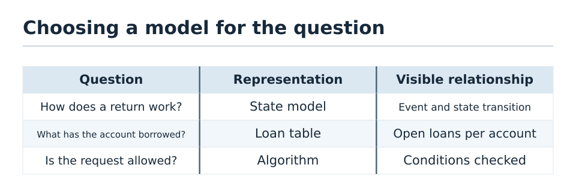

# M10-L1 – Task verbs and reasoned choice of models {#L1}

**Course area:** M10 – Abitur preparation and final project

**Level:** Upper secondary (basic level)

**Prior knowledge:** [M5-L3 – SQL joins, groups and missing values](M5-L3.md), [M7-L2 – States and finite automata](M7-L2.md)

**Learning objective:** Describe, model and evaluate an application in response to distinct task verbs.

## Introduction {#S1}

The school media club lends out cameras. In an exam you may be asked to describe its lending rule and later to justify a choice of model. Both tasks use the same situation. The first asks for a clear account, while the second asks for a decision based on criteria. Before writing, check which type of response the task verb requires.

## From the question to the model {#S2}

To **describe**, give an organised account of the facts. To **model**, decide which parts of the situation to represent, how to represent them and which rules apply. To **evaluate**, choose suitable criteria, examine the alternatives against them and reach a reasoned judgement.

The demand areas cover recall and practised procedures (I), independent application in comparable situations (II), and independent design or evaluation in more complex new situations (III). The classification of a subtask also depends on what has been taught, the support provided and the degree of independence required.

{alt="A state model shows transitions for questions about event sequences. A table links accounts to open loans. An algorithm checks the conditions for a single loan request."}

A device **state model** shows what events trigger transitions. A **relational model** shows which data belong together and supports questions across several records. An **algorithm** can use those data to decide a specific request. Choose the representation that expresses the relationships required by the question most clearly and completely.

## Tracing a loan request {#S3}

The rule is that a free device can be checked out to an account with fewer than two open loans. A device is free when no open loan refers to it. A recorded return time closes a loan.

| Loan | Device | Account | Return time |
| --- | --- | --- | --- |
| 31 | CAM-1 | A | missing |
| 32 | CAM-2 | A | missing |
| 33 | CAM-3 | B | recorded |

Account A requests CAM-3. Row 33 is closed, so the device is free. Rows 31 and 32 count towards A's current total. The count is 2, so the request is rejected. A state diagram with the states “free” and “on loan” shows that CAM-3 is available for lending. However, the transition also needs the count obtained from the account data to make the decision.

## Self-check {#S4}

### Exercises

1. **Describe** the state of CAM-1 and CAM-3 using the table. Give the evidence for each. (4 points)
2. **Model** the decision for account B and CAM-3. Give a suitable expression and the result. (4 points)
3. **Evaluate** the suitability of the device state model alone and the loan table for two goals. These are explaining how a device is returned and checking the account limit. (4 points)

### Solutions

1. CAM-1 is on loan (1) because row 31 is open (1). CAM-3 is free (1) because row 33 is closed and no other open row refers to CAM-3 (1).
2. The requirement is `device is free AND number of open loans < 2` (2). B's count is 0 (1) and CAM-3 is free. The request is allowed (1).
3. The state model shows a return as a transition from “on loan” to “free” (1), making it suitable for explaining the process (1). The table contains all open loans and their linked accounts (1). That makes it possible to check the account limit, which the device model alone cannot do (1).

## Common mistakes and limits {#S5}

A judgement without a criterion is hard to verify. State a criterion such as “make transitions understandable” or “count open loans per account”. Past loans do not count as open loans. The exercise also assumes that only one request is processed at a time. Concurrent requests require a shared way of enforcing the rules. The 12 points form a practice rubric. Your examination follows the rules of your state and exam year.

## Summary {#S6}

Task verbs indicate the type of answer required. Choose a model that makes the decisive features of the question visible, and explain which criteria it meets.

## Sources and further reading {#S7}

### Further reading (internal)

- [M10-L2 – Exam practice: analysing an unfamiliar algorithm](M10-L2.md)

### Sources (external)

- [Kultusministerkonferenz (KMK) – Einheitliche Prüfungsanforderungen in der Abiturprüfung Informatik (EPA)](https://www.kmk.org/fileadmin/Dateien/veroeffentlichungen_beschluesse/1989/1989_12_01_EPA_Informatik.pdf) · Lesson reference: §§2–3 · Describe, model and evaluate an application in response to distinct task verbs. · Last accessed: 2026-11-22 · Content verified: 2026-11-22
- [Gesellschaft für Informatik e. V. – Bildungsstandards Informatik für die Sekundarstufe II](https://informatikstandards.de/fileadmin/GI/Projekte/Informatikstandards/Dokumente/Bildungsstandards_SII.pdf) · Lesson reference: §2.2 · Describe, model and evaluate an application in response to distinct task verbs. · Last accessed: 2026-11-22 · Content verified: 2026-11-22
