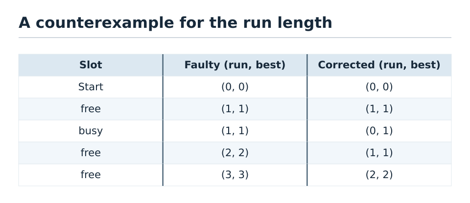

# M10-L2 – Exam practice: analysing an unfamiliar algorithm {#L2}

**Course area:** M10 – Abitur preparation and final project

**Level:** Upper secondary (basic level)

**Prior knowledge:** [M6-L3 – Sorting, correctness and cost](M6-L3.md), [M10-L1 – Task verbs and reasoned choice of models](M10-L1.md)

**Learning objective:** Trace unfamiliar pseudocode, state an invariant and correct a defect.

## Introduction {#S1}

A lending service reserves equipment in consecutive time slots. A procedure takes a sequence of free and occupied slots and should find the length of the longest uninterrupted free stretch. The procedure's name tells you little. Work out what it actually does by following its assignments.

## Reading unfamiliar pseudocode {#S2}

The input contains only `free` and `busy`. Both counters start at 0. The expected result is a length, so an empty input should return 0. In the pseudocode `←` means assignment and `max(a, b)` gives the larger of the two values.

```text
run ← 0
best ← 0
FOR EACH slot IN slots:
    IF slot = free:
        run ← run + 1
    best ← max(best, run)
RETURN best
```

`run` is supposed to hold the length of the free stretch at the end of the input processed so far. `best` should hold the maximum over all stretches seen so far. An **invariant** describes what must be true of these values after each loop iteration. State it precisely enough to tell from one row of a trace table when it stops holding.

{alt="For free, busy, free, free the faulty version returns 3. In the busy row, run incorrectly stays at 1. The corrected version resets run there to 0 and returns 2."}

## Locating a defect by tracing the values {#S3}

For `[free, busy, free, free]` the expected result is 2. After the first `free`, both values are 1. At `busy`, `run` stays at 1 even though the inspected portion now ends with an occupied slot. After the remaining two free slots, the procedure returns 3. To fix it, add an `ELSE` branch to the distinction for `free` that resets `run` to 0. The pairs for `(run, best)` in the same sequence are now `(1, 1)`, `(0, 1)`, `(1, 1)` and `(2, 2)`.

```python
def longest_free_run(slots):
    run = 0
    best = 0
    for slot in slots:
        if slot == "free":
            run += 1
        else:
            run = 0
        best = max(best, run)
    return best

assert longest_free_run(["free", "busy", "free", "free"]) == 2
assert longest_free_run(["free", "busy", "free"]) == 1
assert longest_free_run([]) == 0
assert longest_free_run(["busy", "busy"]) == 0
```

## Self-check {#S4}

### Exercises

1. **Trace** the defective version for `[free, busy, free]`. Record the three intermediate pairs and compare the returned result with the expected value. (4 points)
2. **Explain**, using the first error in the trace, why two separate stretches are counted together. Give a precise correction. (4 points)
3. **Justify** why the correction is right for any valid sequence. Give the amount of work in terms of the sequence length. (6 points)

### Solutions

1. The pairs are `(1, 1)`, `(1, 1)` and `(2, 2)` (1 each). The return value is 2 and the expected value is 1 (1).
2. After `busy`, `run` is still 1 (1). The next `free` is therefore added to the earlier stretch (1). The `ELSE` branch (1) resets `run` to 0 (1).
3. Both lengths are 0 for an empty processed sequence (1). At `free` the ending stretch grows by 1 (1). At `busy` it becomes empty (1). A newly found maximum can only come from a stretch ending at the current position, so `max` retains the previous maximum or updates it correctly (1). After processing the entire input, `best` is the answer (1). Each value takes a fixed amount of work, so total work grows linearly (1).

## Common mistakes and limits {#S5}

Test mixed sequences. A sequence of only free slots appears to confirm the defective version. A counterexample disproves a correctness claim. Several passing examples still leave room for a general justification. The solution returns only the length. To find the start position and choose the earliest stretch in a tie, you would need to track additional values. The 14 points are for self-assessment.

## Summary {#S6}

Compare the actual trace values with the property that should hold. The first failure shows where to inspect the code. Once the procedure has been corrected, the invariant explains why the result is right for other inputs too.

## Sources and further reading {#S7}

### Further reading (internal)

- [M10-L3 – Exam practice: transfer and reasoned judgement](M10-L3.md)

### Sources (external)

- [Kultusministerkonferenz (KMK) – Einheitliche Prüfungsanforderungen in der Abiturprüfung Informatik (EPA)](https://www.kmk.org/fileadmin/Dateien/veroeffentlichungen_beschluesse/1989/1989_12_01_EPA_Informatik.pdf) · Lesson reference: §§2–4 · Trace unfamiliar pseudocode, state an invariant and correct a defect. · Last accessed: 2026-11-22 · Content verified: 2026-11-22
- [Gesellschaft für Informatik e. V. – Bildungsstandards Informatik für die Sekundarstufe II](https://informatikstandards.de/fileadmin/GI/Projekte/Informatikstandards/Dokumente/Bildungsstandards_SII.pdf) · Lesson reference: §4 · Trace unfamiliar pseudocode, state an invariant and correct a defect. · Last accessed: 2026-11-22 · Content verified: 2026-11-22
- [Ministerium für Bildung Rheinland-Pfalz, Rundschreiben zur Abiturprüfungsordnung – Rundschreiben zur Abiturprüfungsordnung – Informatik](https://mss.rlp.de/fileadmin/mss/Downloads/Rundschreiben-AbiPrO-2026.pdf) · Lesson reference: §4.11 · Trace unfamiliar pseudocode, state an invariant and correct a defect. · Last accessed: 2026-11-22 · Content verified: 2026-11-22
