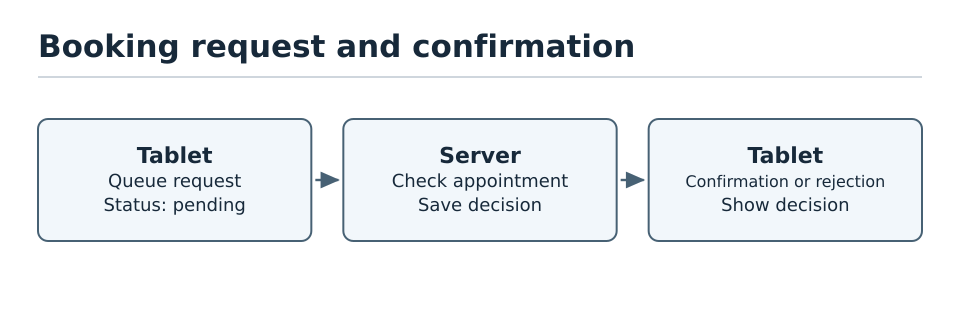

# M10-L3 – Exam practice: transfer and reasoned judgement {#L3}

**Course area:** M10 – Abitur preparation and final project

**Level:** Upper secondary (advanced level)

**Prior knowledge:** [M7-L5 – Growth rates, P and NP](M7-L5.md), [M8-L3 – Concurrency and consistent updates](M8-L3.md), [M10-L2 – Exam practice: analysing an unfamiliar algorithm](M10-L2.md)

**Learning objective:** Solve and evaluate a new networked data problem with transfer and error analysis.

## Introduction {#S1}

A repair workshop has one appointment left. Two tablets show it as free. Either device can queue a booking when the network goes down. The workshop should end up with at most one confirmed booking. That requirement differs from “each tablet responds immediately”.

## Data, states and responsibilities {#S2}

Model an appointment with `slot_id` and a request with `request_id`, `slot_id` and `decision`. A unique request identifier refers to the same booking request even if the tablet sends it again. The tablets hold “pending” as a local state. Only the server can authoritatively change an appointment from “free” to “reserved”. A display query shows what was last known.

{alt="The tablet holds an identified request as pending. The server checks availability for the shared slot and stores the reservation if approved. The application then shows confirmation or rejection."}

The central rule allows at most one confirmed booking per appointment. The server must check and reserve the appointment together so that a second request cannot confirm a place that still appears free in between. On success the request decision and the reservation are committed durably together. After a timeout, the server returns its saved decision for the same request identifier and data. An identical retry therefore creates no new booking. The server treats changed data under the same identifier as a conflicting request.

## Two requests and a lost response {#S3}

Appointment `R4` is free. Tablet A queues request `701` offline. Tablet B sends `702` online. The server processes `702`, reserves `R4` and stores “confirmed”. The response is lost, so B initially shows “pending”. A then sends its queued request. The server finds `R4` reserved and stores “rejected” for `701`. B sends `702` again. The server reads the stored decision and sends confirmation to B again. The booking table contains exactly one confirmed booking for `R4`.

## Self-check {#S4}

### Exercises

1. **Design** a server state for the appointment and the minimal request fields. State which condition is checked and what must be saved together. (5 points)
2. **Analyse** a faulty variant. Each tablet may confirm a booking itself after seeing “free”. Construct an event sequence with two confirmations and design a test for a lost server response. (6 points)
3. **Evaluate** the proposal “confirm immediately, including offline”. Use availability of the interface and consistency of bookings as your criteria. Apply your judgement to a school cafeteria with exactly one last portion of each dish. (5 points)

### Solutions

1. An appointment has an identifier and a state of “free” or “reserved” (1). Each request needs a unique identifier and a link to an appointment (1). The decision is stored by request (1). The server checks for “free” (1) and commits the reservation and decision atomically (1).
2. A and B read “free” before either one records a booking (1). A confirms (1) and B also confirms using its stale copy (1). To test recovery, discard the response after a successful commit (1). Resend the same request with the same data (1). Expect the same decision and exactly one confirmed booking (1).
3. An offline queue allows input during a network outage (1). Immediate confirmation on both devices can promise the last appointment twice (1). Without a prior exclusive allocation, the display should say “pending” until the central decision (1). In the cafeteria the last portion corresponds to the scarce appointment (1). The two orders must be decided against the same stock (1).

## Common mistakes and limits {#S5}

A timeout does not prove the server saved nothing. The assumption of shared capacity matters. With capacity divided into exclusive allocations in advance, another solution would be possible, but it could temporarily leave places held by another device unused. Time slots and fictional identifiers are enough for the practice model. A public display does not need names. The 16 points form a practice rubric.

## Summary {#S6}

Distinguish local knowledge from authoritative decisions. Design data and states together. Check the rule with an event sequence specifically chosen to expose the fault.

## Sources and further reading {#S7}

### Further reading (internal)

- [M10-L4 – Project report and oral examination](M10-L4.md)

### Sources (external)

- [Kultusministerkonferenz (KMK) – Einheitliche Prüfungsanforderungen in der Abiturprüfung Informatik (EPA)](https://www.kmk.org/fileadmin/Dateien/veroeffentlichungen_beschluesse/1989/1989_12_01_EPA_Informatik.pdf) · Lesson reference: §§2–4 · Solve and evaluate a new networked data problem with transfer and error analysis. · Last accessed: 2026-11-22 · Content verified: 2026-11-22
- [Gesellschaft für Informatik e. V. – Bildungsstandards Informatik für die Sekundarstufe II](https://informatikstandards.de/fileadmin/GI/Projekte/Informatikstandards/Dokumente/Bildungsstandards_SII.pdf) · Lesson reference: §4 · Solve and evaluate a new networked data problem with transfer and error analysis. · Last accessed: 2026-11-22 · Content verified: 2026-11-22
