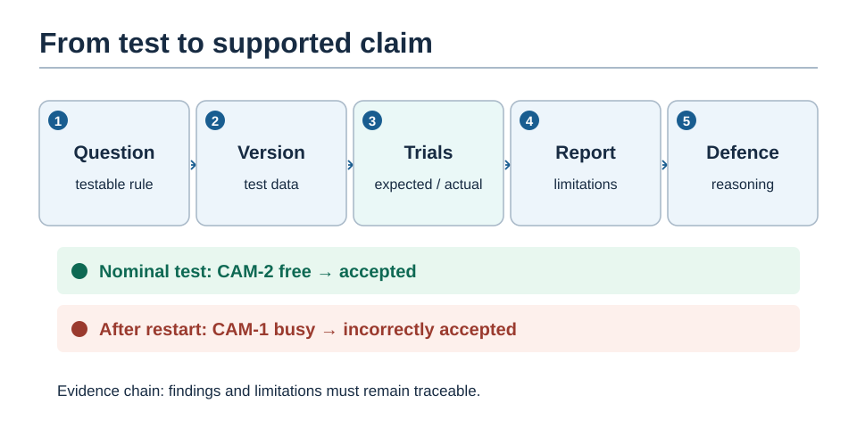

# M10-L4 – Project report and oral examination {#L4}

**Course area:** M10 – Abitur preparation and final project

**Level:** Upper secondary (basic level)

**Prior knowledge:** [M8-L4 – Team project: a testable lending system](M8-L4.md), [M10-L1 – Task verbs and reasoned choice of models](M10-L1.md)

**Learning objective:** Present project decisions, evidence and limitations in writing and orally.

## Introduction {#S1}

A lending prototype displays “loan allowed” for a free camera. The project report must establish which rule was demonstrated and under what conditions the evidence applies. In an oral examination you should be able to explain those conditions in response to a question or apply your model to a changed situation.

## Connecting a claim to evidence that can be checked {#S2}

Begin with a question you can test on the prototype. For each important decision, report the alternative you considered, the criterion you used and the supporting evidence. For each test, give the initial state, the action and the expected and observed results. If they differ, explain the consequence and identify the next test or development step needed.

{alt="Five steps connect the question, the archive with data and test results, the findings, the report with limits of validity, and the oral presentation."}

The diagram calls a test under ordinary operating conditions a **nominal test**. Here that test is lending a free camera. The **computational archive** is the project folder containing the program version, test data and results used. These materials let someone repeat the trial and check the claim.

## Preparing a short demonstration {#S3}

A fictional school media club wants at most one open loan per camera. The small prototype keeps a dictionary in memory. Initially, only `CAM-1` is on loan to account `A`. Assume a fixed set of known cameras and one running program instance that processes requests sequentially.

```python
def lend(active_loans, camera, account):
    if camera in active_loans:
        return False
    active_loans[camera] = account
    return True

active_loans = {"CAM-1": "A"}
assert lend(active_loans, "CAM-2", "B") is True
assert lend(active_loans, "CAM-1", "C") is False
assert active_loans == {"CAM-1": "A", "CAM-2": "B"}

after_restart = {}
assert lend(after_restart, "CAM-1", "C") is True
```

| Trial | Expected if loans are tracked continuously | Observed |
| --- | --- | --- |
| Lend free camera CAM-2 to B | allow | allowed |
| Lend occupied camera CAM-1 to C | reject | rejected |
| Lend CAM-1 to C after simulated restart | reject | allowed |

The last row records what is **actually observed**. The functional requirement remains unmet in that case. A demonstration only needs these three steps and a brief statement of the limitation. Afterwards, explain why persistent storage would change the initial state and which test would need repeating.

## Self-check {#S4}

### Exercises

1. Write a result paragraph for the report with a claim, two pieces of evidence and one limitation. (4 points)
2. Plan a three-minute practice presentation. State what you would show and how you would explain the failed case. (4 points)
3. Answer the follow-up questions “Why is a running list of names insufficient?” and “How would you accept the next version?” (4 points)

### Solutions

1. With sequential processing, the single instance limits open loans per camera (1). It accepts the CAM-2 request (1) and rejects the CAM-1 request before restart (1). A restart loses the state because the data is held only in memory (1).
2. Minute 1 covers the rule and the model linking a camera identifier to an account (1). Minute 2 shows one valid and one rejected request with expected and observed results (1). Minute 3 simulates a restart (1) and states how it limits the claim (1).
3. The names alone do not uniquely identify the device (1). Each open loan needs a link to the camera identifier (1). A new version loads the most recently saved state (1). The restart test must then reject the same CAM-1 request (1).

## Common mistakes and limits {#S5}

Distinguish the demonstration, the prototype and a system in operation. A test that passes in a single instance does not support a judgement about several devices operating together. If a follow-up question is unclear, clarify the assumption and relate your answer to data or behaviour. The time and points above are for practice. Binding examination formats depend on the state, school and examination year.

## Summary {#S6}

Support a project decision with evidence that others can reproduce. Name the limitations in the report and explain which change and test follow from them when discussing the project.

## Sources and further reading {#S7}

### Sources (external)

- [Kultusministerkonferenz (KMK) – Einheitliche Prüfungsanforderungen in der Abiturprüfung Informatik (EPA)](https://www.kmk.org/fileadmin/Dateien/veroeffentlichungen_beschluesse/1989/1989_12_01_EPA_Informatik.pdf) · Lesson reference: §4 · Present project decisions, evidence and limitations in writing and orally. · Last accessed: 2026-11-22 · Content verified: 2026-11-22
- [Gesellschaft für Informatik e. V. – Bildungsstandards Informatik für die Sekundarstufe II](https://informatikstandards.de/fileadmin/GI/Projekte/Informatikstandards/Dokumente/Bildungsstandards_SII.pdf) · Lesson reference: §4 · Present project decisions, evidence and limitations in writing and orally. · Last accessed: 2026-11-22 · Content verified: 2026-11-22
