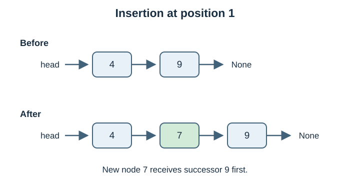

# M11-L1 – Singly linked lists {#L1}

**Course area:** M11 – Linked structures and graph search

**Level:** Upper secondary (basic level)

**Prior knowledge:** [M6-L1](M6-L1.md); [M6-L4](M6-L4.md)

**Curriculum context:** Basic-level extension based on Bavaria’s Grade 12 curriculum; not a nationwide uniform requirement.

## Learning objectives {#S1}

Model a singly linked list as a sequence of objects, distinguish data from references, implement recursive search, insertion, removal and length, and explain their cost. Test empty lists, changes of head and invalid positions.

## Nodes and the list invariant {#S2}

A node stores a payload and a reference to its successor. The head variable `head` refers to the first node; `None` denotes an empty list or the end of the chain. In our model the chain reachable from `head` is finite and acyclic. A node storing 4 with a successor storing 9 represents the sequence [4, 9], not two adjacent memory addresses. References connect objects independently of their physical locations. Separating payload from linkage allows us to store book records instead of numbers later.

An empty list is also the base case of a recursive structure: a nonempty list consists of its head and a remainder, which is itself a list.

## Insertion and removal {#S3}

Inserting at position 1 in [4, 9] first creates a new node with value 7 and successor 9. The node storing 4 then points to the new node. Overwriting the old reference before preserving it could lose the rest of the chain. Positions start at 0; for length n, n is a valid insertion position. Removing the first matching value 4 makes its former successor the new head. The caller must retain the returned head. Duplicate values are allowed; removal affects only the first match.

{alt="Before head → 4 → 9 → None; after head → 4 → 7 → 9 → None."}

## Recursive operations in Python {#S4}

The class represents the object structure; functions implement the list operations. `insert_at` returns the possibly changed head. An invalid index raises an exception. `remove_first` returns the unchanged chain if the value is absent. Copy the whole block and execute it in Python 3. Assertions fail if a result is incorrect.

```python
class Node:
    def __init__(self, value, next_node=None):
        self.value = value
        self.next = next_node


def contains(node, value):
    if node is None:
        return False
    return node.value == value or contains(node.next, value)


def length(node):
    return 0 if node is None else 1 + length(node.next)


def insert_at(node, index, value):
    if index < 0:
        raise IndexError(index)
    if index == 0:
        return Node(value, node)
    if node is None:
        raise IndexError(index)
    node.next = insert_at(node.next, index - 1, value)
    return node


def remove_first(node, value):
    if node is None:
        return None
    if node.value == value:
        return node.next
    node.next = remove_first(node.next, value)
    return node


def values(node):
    result = []
    while node is not None:
        result.append(node.value)
        node = node.next
    return result


head = None
head = insert_at(head, 0, 4)
head = insert_at(head, 1, 9)
head = insert_at(head, 1, 7)
assert values(head) == [4, 7, 9]
assert contains(head, 7) and length(head) == 3
head = remove_first(head, 4)
assert values(head) == [7, 9]
```

## Why the procedures work {#S5}

For `contains`, an empty list is the unsuccessful base case. Otherwise the head matches, or the search moves to the shorter remainder. For `insert_at`, position 0 creates the new chain immediately. At position i > 0, insertion occurs at position i−1 in the remainder; its returned head is reconnected. The same idea applies to `remove_first`: a match returns the remainder; otherwise the head is retained and the remainder is processed. `length` adds one per node. Decreasing remaining length guarantees termination for finite acyclic lists; cyclic references violate the invariant.

An object-oriented alternative could use an abstract list component with two implementations: an empty list and a data node with a remaining list. This Composite design allows recursive methods without an explicit `None` terminator. Our small design uses `None` instead; it is not a complete implementation of the pattern.

## Cost, testing and alternatives {#S6}

For n nodes, an unsuccessful search needs n value comparisons, or O(n) time. Access to position i costs O(i+1); insertion at the head takes O(1) time. Given a known predecessor node, reference changes also take O(1) time. In this implementation deep recursive calls require O(n) extra stack space and may reach Python’s recursion limit. An iterative search requires only O(1) extra space. By contrast, a Python list provides direct indexed access and may shift many references when inserting in the middle. It is not a singly linked list.

Test `None`, position 0, position n, position n+1, duplicate values and removal of an absent value. For testing, `values` converts the linked structure into a Python list; a large program should not make the list itself depend on that inspection operation.

## Self-assessment {#S7}

### Exercises

1. Draw [4, 9] and insert 7 at position 1. Which references change?
2. What do `length(None)` and `contains(None, 4)` return?
3. Remove value 2 once from [2, 2, 5]. What remains?
4. How many comparisons does an unsuccessful search need in a 20-node list?
5. Why is `head = insert_at(head, 0, 8)` necessary when the list is empty?

::: {.lc-solutions data-lc-section="S7"}
1. The new node 7 points to 9, then node 4 points to 7; the head remains unchanged.
2. 0 and False.
3. [2, 5]; only the first match is removed.
4. 20; each node is checked once.
5. The returned value is the reference to the new head. Without assignment, `head` remains `None`.
:::

## Sources {#S8}

- [LehrplanPLUS Bayern – Informatik 12 (gA)](https://www.lehrplanplus.bayern.de/fachlehrplan/gymnasium/12/informatik/grundlegend) · Inf12 Lernbereich 2 · Last accessed: 2026-11-24 · Content verified: 2026-11-24
- [Runestone – Implementing an Unordered List](https://runestone.academy/ns/books/published/pythonds3/BasicDS/ImplementinganUnorderedListLinkedLists.html) · 3.21 · Last accessed: 2026-11-24 · Content verified: 2026-11-24
