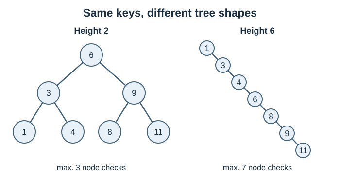

# M11-L2 – Binary search trees and traversal {#L2}

**Course area:** M11 – Linked structures and graph search

**Level:** Upper secondary (basic level)

**Prior knowledge:** [M11-L1](M11-L1.md); [M6-L5](M6-L5.md)

**Curriculum context:** Basic-level extension based on Bavaria’s Grade 12 curriculum; not a nationwide uniform requirement.

## Learning objectives {#S1}

Distinguish a binary tree from a binary search tree, state its ordering invariant, implement insertion and search, and apply preorder, inorder and postorder. Compare the number of key checks with a linked list and explain the effect of tree height.

## Tree structure and ordering {#S2}

A binary tree has nodes with at most two ordered child positions, left and right. The root has no parent; a leaf has no children. Height h is the maximum number of edges on a path from the root to a leaf; a single node has height 0. For a search tree with distinct keys, at each node every key in the left subtree is smaller and every key in the right subtree is larger. This rule concerns all descendants, not just immediate children. Payloads may be stored separately from keys. An arbitrary binary tree need not be a search tree.

## Insertion, search and tree shape {#S3}

The sequence 6, 3, 9, 1, 4, 8, 11 creates a tree of height 2. To find 8, compare with 6, 9 and 8. Searching for 5 follows 6 → 3 → 4 → empty. Insertion makes the same decisions and replaces an empty reference by a new node. This model ignores duplicate keys; other applications may update a count or payload.

Inserting the sorted sequence 1, 3, 4, 6, 8, 9, 11 instead creates a right-only chain of height 6. None of these insertion rules balances the tree automatically.

{alt="Left: perfect tree rooted at 6, height 2; right: sorted insertion produces a right chain, height 6."}

## Implementation and traversal {#S4}

As with linked lists, `insert` returns a possibly new subtree root. `search` is iterative here; a recursive call could process the same smaller subtree at each step. In `walk`, the position of the visit relative to the two recursive calls determines the order. `order` must be pre, in or post. The accumulator `result` avoids repeatedly copying partial lists.

```python
class TreeNode:
    def __init__(self, key):
        self.key = key
        self.left = None
        self.right = None


def insert(node, key):
    if node is None:
        return TreeNode(key)
    if key < node.key:
        node.left = insert(node.left, key)
    elif key > node.key:
        node.right = insert(node.right, key)
    return node


def search(node, key):
    while node is not None:
        if key == node.key:
            return True
        node = node.left if key < node.key else node.right
    return False


def walk(node, order, result):
    if node is None:
        return
    if order == "pre":
        result.append(node.key)
    walk(node.left, order, result)
    if order == "in":
        result.append(node.key)
    walk(node.right, order, result)
    if order == "post":
        result.append(node.key)


root = None
for key in [6, 3, 9, 1, 4, 8, 11]:
    root = insert(root, key)
for order, expected in [
    ("pre", [6, 3, 1, 4, 9, 8, 11]),
    ("in", [1, 3, 4, 6, 8, 9, 11]),
    ("post", [1, 4, 3, 8, 11, 9, 6]),
]:
    result = []
    walk(root, order, result)
    assert result == expected
assert search(root, 8) and not search(root, 5)
```

## Correctness and applications {#S5}

The ordering invariant excludes an entire subtree at each comparison. Reconnecting the new subtree root at the same child position preserves the bounds imposed by its ancestors. An empty subtree is the base case. Inorder visits left, node, right; by the invariant its output is strictly increasing. Preorder visits the node before its subtrees, for example to present a hierarchy. Postorder visits it after both subtrees, for instance to evaluate an expression tree from its operands. Preorder alone cannot reconstruct an arbitrary binary tree without structural information.

As in [M11-L1](M11-L1.md), a Composite design could model empty and nonempty subtrees through a shared interface; here `None` represents empty subtrees.

## Cost and limitations {#S6}

Counting one abstract three-way key comparison per examined node, at most h+1 nodes need to be checked. A perfect binary tree of height h has $2^{h+1}-1$ nodes. In an appropriately balanced structure h grows logarithmically with n, so search and insertion cost O(log n). A degenerate chain can require n checks in the worst case, like a linked list. The code does not count individual Python comparison operators, which may execute more than once per node. Each full traversal visits n nodes, needs O(n) time and uses O(h+1) call stack space in addition to the output. For large datasets, self-balancing trees or other index structures may be appropriate. An ordinary search tree does not promise logarithmic worst-case time.

## Self-assessment {#S7}

### Exercises

1. Insert 5 into the example tree. Where does it go?
2. Give the inorder and preorder sequences of the example tree.
3. A tree has root 6, left child 3 and the latter’s right child 7. Is it a search tree?
4. Compare maximum node checks for the two illustrated trees and a seven-node list.
5. Why can inserting sorted keys into an ordinary search tree be undesirable?

::: {.lc-solutions data-lc-section="S7"}
1. Right child of 4; path 6 → 3 → 4 → right.
2. Inorder: 1, 3, 4, 6, 8, 9, 11; preorder: 6, 3, 1, 4, 9, 8, 11.
3. No. 7 belongs to the left subtree of 6 but is not smaller than 6.
4. 3 in the perfect tree, 7 in the right chain and up to 7 in the list.
5. Each new key goes to the right of the former maximum. Height grows linearly, so worst-case search becomes linear.
:::

## Sources {#S8}

- [LehrplanPLUS Bayern – Informatik 12 (gA)](https://www.lehrplanplus.bayern.de/fachlehrplan/gymnasium/12/informatik/grundlegend) · Inf12 Lernbereich 3 · Last accessed: 2026-11-24 · Content verified: 2026-11-24
- [Runestone – Tree Traversals](https://runestone.academy/ns/books/published/pythonds3/Trees/TreeTraversals.html) · 6.8 · Last accessed: 2026-11-24 · Content verified: 2026-11-24
- [Runestone – Search Tree Analysis](https://runestone.academy/ns/books/published/pythonds3/Trees/SearchTreeAnalysis.html) · 6.15 · Last accessed: 2026-11-24 · Content verified: 2026-11-24
