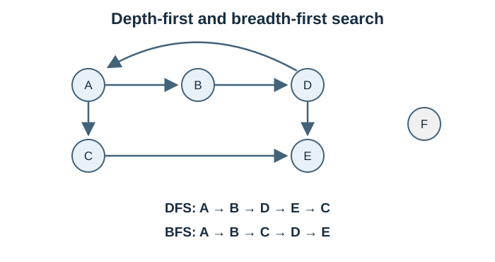

# M11-L3 – Depth-first search and reachable vertices {#L3}

**Course area:** M11 – Linked structures and graph search

**Level:** Upper secondary (basic level)

**Prior knowledge:** [M6-L4](M6-L4.md); [M6-L5](M6-L5.md)

**Curriculum context:** Basic-level extension based on Bavaria’s Grade 12 curriculum; not a nationwide uniform requirement.

## Learning objectives {#S1}

Represent directed graphs using adjacency lists, perform depth-first search (DFS) with a visited set, explain backtracking to pending neighbors, and compare DFS with breadth-first search (BFS). Select reachable vertices, handle cycles safely and justify the cost.

## Graph and reachability {#S2}

A directed graph consists of a vertex set V and directed edge set E. Edge A → B allows a step from A to B, but not automatically back. A vertex is reachable from start s if a directed path exists from s to it; s itself is reachable along a path of length zero. We store each vertex’s outgoing neighbors in a fixed order. Every neighbor must also occur as a key, even if its own list is empty. Our example has edges A → B, A → C, B → D, C → E, D → A and D → E; F is isolated.

## Depth-first search step by step {#S3}

Start at A and mark A immediately. Its first neighbor is B, then D. D has A as a neighbor, but A is already marked; D visits E instead. E has no neighbors. Recursive calls return one at a time until A processes its next pending neighbor C. C points to the already visited E. The visitation order is A, B, D, E, C. F is not reached. Edge D → A creates a cycle without trapping the algorithm in an infinite loop.

{alt="Directed graph with cycle A–B–D–A and isolated F. DFS A B D E C; BFS A B C D E."}

## Recursive and iterative implementation {#S4}

In this Python 3 example the start and all neighbors must be valid keys. Vertices are strings; `None` is not a vertex. The explicit stack version keeps an iterator over pending neighbors at each active level, exactly reproducing the recursive order. The BFS queue marks vertices when they are enqueued.

```python
from collections import deque

graph = {
    "A": ["B", "C"], "B": ["D"], "C": ["E"],
    "D": ["A", "E"], "E": [], "F": []
}


def dfs(graph, start):
    seen, order = set(), []
    def visit(v):
        seen.add(v)
        order.append(v)
        for w in graph[v]:
            if w not in seen:
                visit(w)
    visit(start)
    return order


def dfs_stack(graph, start):
    seen, order = {start}, [start]
    stack = [iter(graph[start])]
    while stack:
        w = next(stack[-1], None)
        if w is None:
            stack.pop()
        elif w not in seen:
            seen.add(w)
            order.append(w)
            stack.append(iter(graph[w]))
    return order


def bfs(graph, start):
    seen, order = {start}, []
    queue = deque([start])
    while queue:
        v = queue.popleft()
        order.append(v)
        for w in graph[v]:
            if w not in seen:
                seen.add(w)
                queue.append(w)
    return order


assert dfs(graph, "A") == ["A", "B", "D", "E", "C"]
assert dfs_stack(graph, "A") == dfs(graph, "A")
assert bfs(graph, "A") == ["A", "B", "C", "D", "E"]
```

## Correctness and cost {#S5}

Each newly marked vertex is discovered along an edge from a reachable vertex, and is therefore reachable. If a reachable vertex remained unvisited after termination, a path from the start would contain a first edge from a visited to an unvisited vertex; that edge would have been examined when processing the visited vertex. This is a contradiction. The visited set prevents repeat visits; a finite number of vertices and edges ensures termination. For V_r reachable vertices and E_r edges outgoing from them, expected time is O(V_r+E_r), assuming average constant-time set and dictionary access. Both DFS versions use O(V_r) extra space including the visited set and stack, excluding the input graph. Recursion can exceed Python’s call-depth limit; the explicit stack avoids that limit.

## Comparison with breadth-first search and applications {#S6}

BFS processes neighbors first and here returns A, B, C, D, E. In an unweighted graph BFS discovers vertices in nondecreasing distance (number of edges) from the start. With predecessor information, BFS can reconstruct shortest paths; DFS does not guarantee a shortest path. DFS is useful, for instance, to enumerate all linked pages reachable from a starting page. `selected = [v for v in dfs(graph, "A") if v in {"C", "F"}]` returns only C: determine reachability first, then check the property. Filtering too early during traversal could skip necessary intermediate vertices. Both search orders depend on adjacency order. To traverse all components, one can start from each still unvisited vertex with a shared visited set. In directed graphs, an edge to an already visited neighbor is not alone proof of a cycle; additional state information is needed.

## Self-assessment {#S7}

### Exercises

1. Which vertices does DFS visit from A and in what order?
2. Which vertices are reachable from C?
3. What happens if the visited set is omitted in this example?
4. What order does BFS produce from A? Which method guarantees minimum distance for unweighted edges?
5. Change A’s neighbors to [C, B]. Give the new DFS order and the set of reachable vertices.

::: {.lc-solutions data-lc-section="S7"}
1. A, B, D, E, C.
2. C and E.
3. A → B → D → A repeats; the recursive program may eventually raise a recursion error.
4. A, B, C, D, E; BFS guarantees minimum edge-count distance upon first discovery.
5. A, C, E, B, D; the same set {A, B, C, D, E}.
:::

## Sources {#S8}

- [LehrplanPLUS Bayern – Informatik 12 (gA)](https://www.lehrplanplus.bayern.de/fachlehrplan/gymnasium/12/informatik/grundlegend) · Inf12 Lernbereich 1 · Last accessed: 2026-11-24 · Content verified: 2026-11-24
- [Cornell CS 2110 – Graph Traversals](https://courses.cs.cornell.edu/cs2110/2025fa/lectures/lec22/) · DFS, BFS, Complexity Analysis · Last accessed: 2026-11-24 · Content verified: 2026-11-24
