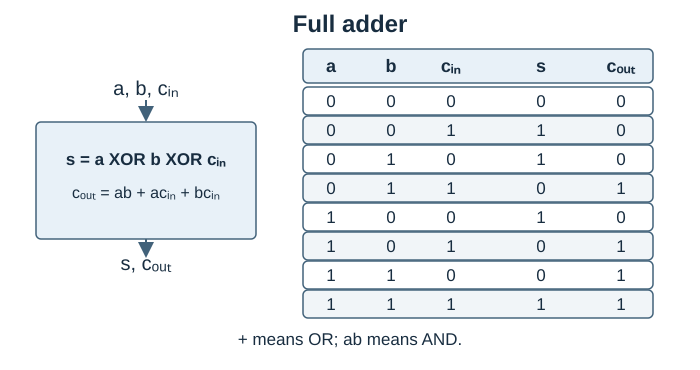

# M12-L1 – Binary addition, two’s complement and overflow {#L1}

**Course area:** M12 – Computer arithmetic and register machines

**Level:** Upper secondary (advanced level)

**Prior knowledge:** [M2-L2](M2-L2.md); [M7-L1](M7-L1.md)

**Curriculum context:** Advanced-level extension based on Bavaria’s Grade 12 curriculum; not a nationwide uniform requirement.

## Learning objectives {#S1}

Compute with fixed-width binary words, interpret them as unsigned and two’s-complement values, design half and full adders from truth tables, and distinguish carry from signed overflow. Verify calculations by simulation.

## Bit patterns and numerical ranges {#S2}

An n-bit word has 2^n possible patterns. Its unsigned value is the sum of the set positional weights 2^i, ranging from 0 to 2^n−1. In two’s complement only the most significant bit has negative weight −2^(n−1). The range is therefore −2^(n−1) through 2^(n−1)−1. With four bits, 1010 means unsigned 10 but signed −8+2=−6. The bit pattern alone does not determine its interpretation. To represent −3, invert 0011 to 1100 and add 1 to obtain 1101. In general a representable integer x is encoded as x modulo 2^n. The smallest signed value has no positive counterpart at the same width; inverting 1000 and adding 1 leaves it unchanged. Sign extension repeats the top bit, e.g. 1101 → 111101 (still −3).

## Addition and overflow {#S3}

A fixed-width adder retains only the low n bits, giving the sum modulo 2^n. For example, 0111+0011=1010. Unsigned 7+3=10 is correct; signed arithmetic has produced −6 instead of 10. Signed overflow occurs exactly when both operands have the same sign but the result has the other sign. Equivalently it is the XOR of the carry into and out of the top bit. The outgoing carry C indicates unsigned overflow instead. For 1111+0001=1|0000, C=1 but V=0: −1+1=0 is correct. For 1000+1111=1|0111, C=1 and V=1: −8−1 is outside the range. Addition of opposite signs never causes signed overflow. Programs must account for whether their language reports overflow, wraps or follows other rules; Python integers do not have this fixed machine-word width.

## From half adder to full adder {#S4}

A half adder processes a and b: sum s=a XOR b and carry c=a AND b. A full adder also processes incoming carry c_in. Its outputs are s=a XOR b XOR c_in and c_out=(a AND b) OR ((a XOR b) AND c_in). Each row in the figure specifies a complete input assignment. To construct a disjunctive normal form (DNF), choose all rows with output 1, create an AND term of the appropriate (possibly negated) inputs for each row, then combine the terms using OR. For s the input rows are 001, 010, 100 and 111; for c_out they are 011, 101, 110 and 111. The DNF for c_out simplifies to (a AND b) OR (a AND c_in) OR (b AND c_in).

{alt="Full adder with three inputs, two outputs and all eight truth-table rows."}

NAND(a,b)=NOT(a AND b). Thus NOT(a)=NAND(a,a), AND(a,b)=NAND(t,t) where t=NAND(a,b), and OR(a,b)=NAND(NAND(a,a),NAND(b,b)). Since NOT, AND and OR can express any DNF, NAND alone is sufficient. A CMOS NAND can implement the output with two series nMOS transistors towards ground and two parallel pMOS transistors towards the supply: only when both inputs are high is the output actively pulled low. This is an idealized logic description, not circuit-sizing guidance.

## Python simulation {#S5}

A ripple-carry adder connects each stage’s carry output to the next stage’s carry input. Start with the least significant bit and c=0. The function returns the result word, C and V. Python bitwise operators simulate gates; the loop limits the result to n bits.

```python
def signed(word, n):
    return word - (1 << n) if word & (1 << (n - 1)) else word


def full_adder(a, b, c):
    return a ^ b ^ c, (a & b) | ((a ^ b) & c)


def add_words(a, b, n):
    if n < 1 or not (0 <= a < 2**n and 0 <= b < 2**n):
        raise ValueError("invalid word or width")
    result, carry = 0, 0
    for i in range(n):
        incoming = carry
        bit, carry = full_adder((a >> i) & 1, (b >> i) & 1, carry)
        result |= bit << i
    return result, carry, incoming ^ carry


assert add_words(7, 3, 4) == (10, 0, 1)
assert add_words(15, 1, 4) == (0, 1, 0)
assert signed(10, 4) == -6
```

## Limitations and applications {#S6}

A physical adder takes time: a carry may propagate through all stages. The longest chain grows with word width in a ripple-carry design; alternative circuits compute carries in parallel or in groups. A wider range prevents only some overflows, not all. An unsigned 8-bit display counter may wrap from 255 to 0. If the display should remain at 255, a saturation rule is needed instead. Test boundaries, zero, negative values and cases where C differs from V.

## Self-assessment {#S7}

### Exercises

1. Interpret 1011 as unsigned and as four-bit two’s complement.
2. Encode −5 with four bits and sign-extend to six bits.
3. Calculate 0101+0100 with four bits. Give the result, C and V.
4. Find s and c_out for a=1, b=0, c_in=1. Write its DNF term for c_out.
5. Why does the carry in 1110+0010 not prove signed overflow?

::: {.lc-solutions data-lc-section="S7"}
1. 11 and −5.
2. 1011; 111011.
3. 1001, C=0, V=1. Unsigned 9, signed −7 instead of 9.
4. s=0, c_out=1; a AND NOT(b) AND c_in.
5. C=1, result 0000; −2+2=0 and V=0.
:::

## Sources {#S8}

- [LehrplanPLUS Bayern – Informatik 12 (eA)](https://www.lehrplanplus.bayern.de/fachlehrplan/gymnasium/12/informatik/erhoeht) · Inf12 Lernbereich 4 · Last accessed: 2026-11-24 · Content verified: 2026-11-24
- [Universität Marburg – Technical Computer Science, Part 2, Chapter 2](https://www.mathematik.uni-marburg.de/~thormae/lectures/ti1/ti_2_2_eng_web.html) · Two’s Complement; overflow · Last accessed: 2026-11-24 · Content verified: 2026-11-24
- [University of Iowa – CS:2630, Chapter 8](https://homepage.cs.uiowa.edu/~dwjones/assem/notes/08arith.shtml) · Full adder and switching theory · Last accessed: 2026-11-24 · Content verified: 2026-11-24
