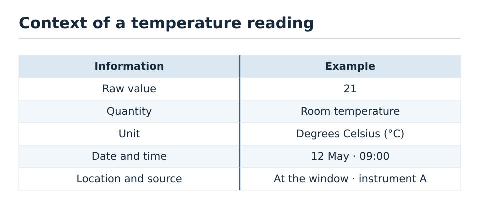

# M2-L1 – Data, meaning and data quality {#L1}

**Course area:** M2 – Data, encoding and representation

**Level:** Lower secondary (core)

**Prior knowledge:** [M1-L1 – How computer science models problems](M1-L1.md)

**Learning objective:** Interpret raw values in terms of unit, origin and time and identify data quality problems.

## Introduction {#S1}

A school weather club receives the values `21`, `69.8` and a blank field for the same room. The stored symbols alone tell us little about whether two thermometers disagree or one reading is missing. A value becomes meaningful when we know its context.

## What a reading means {#S2}

**Data** are recorded values or symbols. **Information** comes from interpreting them in context. The entry `21` could refer to a temperature, a room number or a count. A measurement log therefore includes **metadata**. They tell us, for example, which instrument took a reading, when and where it was taken and what its unit is. A column heading can specify the purpose and unit of an entire column.

{alt="The raw value 21 denotes room temperature in degrees Celsius. It was recorded by instrument A at the window at 09:00 on 12 May."}

It helps to distinguish several types of data quality when checking a log. **Completeness** concerns missing information. **Plausibility** asks whether a value fits the expected range and the situation. **Consistency** concerns contradictions within the data, such as two different values for the same log entry. These checks alone cannot establish measurement **accuracy**. That requires evidence, for example a comparison with a suitable reference instrument.

## Cleaning up a measurement log {#S3}

The table contains fictional room temperature reports. Instruments A and B measure at the same location. The times refer to the same day. The reading of instrument A at 09:05 was imported from its memory and from a transcription. The club says both rows refer to the same measurement.

| Time | Source | Recorded value | Unit |
| --- | --- | ---: | --- |
| 09:00 | Instrument A | 21 | °C |
| 09:00 | Instrument B | 69.8 | °F |
| 09:05 | Instrument A, memory | 22 | °C |
| 09:05 | Instrument A, transcription | 32 | °C |
| 09:05 | Instrument B | missing | °F |

The conversion for instrument B is $(69.8 - 32) \cdot 5/9 = 21$. At 09:00 both instruments therefore reported 21 °C. These are two observations because two instruments took readings. The reading from instrument A at 09:05 stays marked as conflicting until it can be checked against the original instrument log. The absent report from B stays marked as missing. A cleaned copy uses a single column for degrees Celsius while preserving the source, raw value and processing status.

## Self-check {#S4}

### Exercises

1. One thermometer reports `0 °C`. The other reading is missing. What mean temperature can you find for both instruments?
2. Both rows from instrument A at 09:05 look plausible. What information could resolve the conflict?
3. An export file contains only `09:00,21`. Add at least three details that would let someone check and interpret the value.

### Solutions

1. The mean across both instruments is unknown. `0 °C` is an observation. The second value is missing. The mean of the available observations is 0 °C and covers exactly one reading.
2. Compare the two imports with the original instrument log for the same measurement. If you can verify the original value, use it and document the discrepancy in the transcription. Otherwise, the conflict remains unresolved.
3. For example, add the date, the quantity “room temperature”, the unit °C, the room or measurement location and the instrument identifier. The date identifies the day of measurement. The location and instrument identifier make it easier to verify the source.

## Common mistakes and limits {#S5}

A blank entry does not count as zero. Two similar readings also do not establish accuracy. For example, poor placement may affect both instruments in the same way. A justified cleaning process preserves the original and records whether it converted, excluded or confirmed any values.

## Summary {#S6}

A reading needs context. Check the unit, time and source before comparing values. Keep missing or conflicting data visible and document changes you can substantiate.

## Sources and further reading {#S7}

### Further reading (internal)

- [M2-L2 – Bits, bytes and binary numbers](M2-L2.md)

### Sources (external)

- [Gesellschaft für Informatik e. V. – Bildungsstandards Informatik für die Sekundarstufe I](https://informatikstandards.de/fileadmin/FA/IBS/user_upload/GI-Bildungsstandards_Informatik_Sek_I__2025__-_blau.pdf) · Lesson reference: §5.1 · Interpret raw values in terms of unit, origin and time and identify data quality problems. · Last accessed: 2026-11-22 · Content verified: 2026-11-22
- [Bildungsserver Berlin-Brandenburg · Senatsverwaltung Berlin und MBJS Brandenburg – Rahmenlehrplan Teil C – Informatik, Wahlpflichtfach, Jahrgangsstufen 7–10](https://bildungsserver.berlin-brandenburg.de/fileadmin/bbb/unterricht/rahmenlehrplaene/Rahmenlehrplanprojekt/amtliche_Fassung/Teil_C_Informatik_2015_11_10.pdf) · Lesson reference: §3.4 · Interpret raw values in terms of unit, origin and time and identify data quality problems. · Last accessed: 2026-11-22 · Content verified: 2026-11-22
