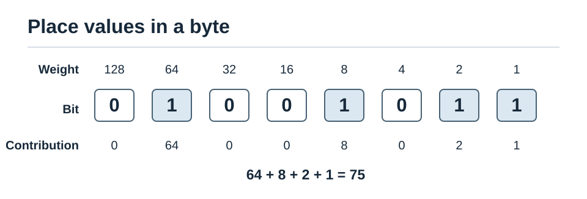

# M2-L2 – Bits, bytes and binary numbers {#L2}

**Course area:** M2 – Data, encoding and representation

**Level:** Lower secondary (core)

**Prior knowledge:** [M2-L1 – Data, meaning and data quality](M2-L1.md)

**Learning objective:** Convert place values, bit patterns and storage units reliably.

## Introduction {#S1}

A display has eight lamps. A lamp that is on stands for 1, and one that is off stands for 0. With the lamps in a fixed order, the display can show numbers. Everyone who reads it needs to agree on what each position means.

## Bits, place values and units {#S2}

A **bit** is a binary position that can have the value 0 or 1. A **byte** consists of eight bits. In an unsigned binary number, the rightmost position has a weight of 1. Each position further to the left has twice the weight of the preceding one. From left to right the eight weights are 128, 64, 32, 16, 8, 4, 2 and 1.

{alt="From left to right the weights above the bits 0, 1, 0, 0, 1, 0, 1, 1 are 128, 64, 32, 16, 8, 4, 2 and 1. The contributing weights are 64, 8, 2 and 1."}

When a bit is set to 1, its weight contributes to the sum. A bit with value 0 contributes nothing. The pattern `00000000` therefore gives 0, and `11111111` gives 255. A byte has $2^8=256$ possible patterns. Depending on the agreed format, the same patterns can also represent other things, such as part of a character or a brightness level.

File sizes often use larger units. `1 kB` is 1000 bytes. `1 KiB` is 1024 bytes. The binary unit is based on the tenth power of 2, so $2^{10}=1024$. The uppercase `B` in both symbols stands for byte.

## Converting both ways {#S3}

The pattern `01001011` has ones at weights 64, 8, 2 and 1. Add those weights to get $64 + 8 + 2 + 1 = 75$.

To go the other way, break down 75 using the byte weights. 128 does not fit into 75, so the first bit is 0. Subtract 64 to leave 11. Neither 32 nor 16 fits. Subtract 8 to leave 3. Now 4 does not fit. Subtract 2 to leave 1. Finally subtract 1. In the original order of weights, this gives `01001011` again.

A file of exactly 2048 bytes has a size of `2 KiB` or `2.048 kB`. Since there are eight bits in a byte, the 1024 bytes in `1 KiB` equal exactly 8192 bits.

## Self-check {#S4}

### Exercises

1. Convert `00110100` to decimal. Show the weights you used.
2. Write 130 as an unsigned binary number in one byte. Explain why 256 no longer fits into one byte in this representation.
3. Compare two files of `3 kB` and `3 KiB`. How many bytes apart are they if those sizes are exact?

### Solutions

1. The ones are at weights 32, 16 and 4. $32 + 16 + 4 = 52$.
2. $130=128+2$. The pattern is `10000010`. The greatest number with eight unsigned positions is $128+64+32+16+8+4+2+1=255$. The next weight would be 256, which requires a ninth bit.
3. `3 kB` is 3000 bytes and `3 KiB` is 3072 bytes. The second file is 72 bytes larger.

## Common mistakes and limits {#S5}

Do not automatically read the leftmost bit of a byte as a sign. First establish which representation is in use. Leading zeros do not change the value here, but they make a fixed width clear. If a size label is ambiguous, compare the exact byte counts where possible. Some programs use `kB` inconsistently or display rounded values.

## Summary {#S6}

In an unsigned binary number, add the weights of all the ones. A byte consists of eight bits. Distinguish bytes, kilobytes and kibibytes when comparing sizes.

## Sources and further reading {#S7}

### Further reading (internal)

- [M2-L3 – Characters, Unicode and file formats](M2-L3.md)

### Sources (external)

- [Gesellschaft für Informatik e. V. – Bildungsstandards Informatik für die Sekundarstufe I](https://informatikstandards.de/fileadmin/FA/IBS/user_upload/GI-Bildungsstandards_Informatik_Sek_I__2025__-_blau.pdf) · Lesson reference: §5.1 · Convert place values, bit patterns and storage units reliably. · Last accessed: 2026-11-22 · Content verified: 2026-11-22
- [Bildungsserver Berlin-Brandenburg · Senatsverwaltung Berlin und MBJS Brandenburg – Rahmenlehrplan Teil C – Informatik, Wahlpflichtfach, Jahrgangsstufen 7–10](https://bildungsserver.berlin-brandenburg.de/fileadmin/bbb/unterricht/rahmenlehrplaene/Rahmenlehrplanprojekt/amtliche_Fassung/Teil_C_Informatik_2015_11_10.pdf) · Lesson reference: §3.4 · Convert place values, bit patterns and storage units reliably. · Last accessed: 2026-11-22 · Content verified: 2026-11-22
