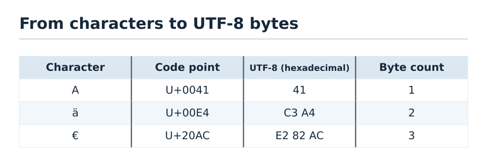

# M2-L3 – Characters, Unicode and file formats {#L3}

**Course area:** M2 – Data, encoding and representation

**Level:** Lower secondary (core)

**Prior knowledge:** [M2-L2 – Bits, bytes and binary numbers](M2-L2.md)

**Learning objective:** Distinguish code points, UTF-8 byte sequences and file formats.

## Introduction {#S1}

The weather club saves the text `Aä€` in a file. The text appears as three visible characters, yet the file may need six bytes for them. To explain the difference, we will trace the characters through numeric values to the bytes stored in the file.

## Characters, code points and byte sequences {#S2}

**Unicode** assigns **code points** to abstract characters. A code point is a number. We often write it in hexadecimal with the prefix `U+`. Hexadecimal uses digits 0–9 and A–F for values from 0 to 15. `U+0041` denotes the capital Latin letter A.

**UTF-8** is an encoding that maps each encodable code point to a sequence of one to four bytes. We also show numbers such as `41` in a byte sequence in hexadecimal. The string `Aä€` contains three code points. In UTF-8, `ä` takes two bytes and the euro sign takes three. A visible character can also be formed from several code points.

{alt="A corresponds to U+0041 and byte 41. The letter ä corresponds to U+00E4 and bytes C3 A4. The euro sign corresponds to U+20AC and bytes E2 82 AC."}

A **file format** specifies how the contents of a file are organised. A CSV file stores tables as text, for example with commas separating fields. UTF-8 maps the text to bytes. It does not assign a meaning to lines or table fields. A PNG image has a different structure and is not a CSV table in a different character encoding.

## Converting text to bytes and reading it back {#S3}

The code points for `Aä€` are `U+0041`, `U+00E4` and `U+20AC`. UTF-8 produces the sequences `41`, `C3 A4` and `E2 82 AC` in that order. Without additional characters, that is $1+2+3=6$ bytes. The following block helps when reading a Python program. `encode` converts text to bytes and `decode` reads those bytes back as text with the specified encoding.

```python
label = "Aä€"
encoded = label.encode("utf-8")
assert [ord(char) for char in label] == [0x0041, 0x00E4, 0x20AC]
assert encoded.hex(" ").upper() == "41 C3 A4 E2 82 AC"
assert len(encoded) == 6
assert encoded.decode("utf-8") == label
```

`ord` gives the code point of a single character in a Python string. In code, `0x` marks a number written in hexadecimal. The checks using `assert` produce no output if all actual and expected values agree.

## Self-check {#S4}

### Exercises

1. How many UTF-8 bytes does `AA€` require without additional characters? Explain.
2. Compare `é` as the precomposed code point `U+00E9` with `e` (`U+0065`) followed by a combining acute accent `U+0301`. Their byte sequences are `C3 A9` and `65 CC 81`. How many code points and bytes does each version contain?
3. A file is named `messung.png`. A text editor opens it and shows the header `time,reading` with `09:00,21` on the next line. Which exchange format do you suspect, and what else should you check?

### Solutions

1. Each `A` needs one byte and `€` needs three. The total is $1+1+3=5$ bytes.
2. The first version has one code point and two bytes. The second has two code points and three bytes. Both can appear as the same single `é` on screen.
3. The rows suggest a CSV table with a comma delimiter. Check whether the remaining lines follow the expected table structure and whether the encoding is read correctly. The filename alone does not determine the format.

## Common mistakes and limits {#S5}

Software can display the wrong characters if it uses an incorrect character encoding. In an actual file, line endings, additional characters and any file marker also count towards the file size. The six-byte calculation applies to the example text without additions. A plain code point count is too coarse to count visible characters in arbitrary text.

## Summary {#S6}

Code points identify characters in Unicode. UTF-8 specifies their byte sequences. The file format determines the structure of stored contents.

## Sources and further reading {#S7}

### Further reading (internal)

- [M2-L4 – From a measured signal to a table](M2-L4.md)

### Sources (external)

- [Gesellschaft für Informatik e. V. – Bildungsstandards Informatik für die Sekundarstufe I](https://informatikstandards.de/fileadmin/FA/IBS/user_upload/GI-Bildungsstandards_Informatik_Sek_I__2025__-_blau.pdf) · Lesson reference: §5.1 · Distinguish code points, UTF-8 byte sequences and file formats. · Last accessed: 2026-11-22 · Content verified: 2026-11-22
- [Bildungsserver Berlin-Brandenburg · Senatsverwaltung Berlin und MBJS Brandenburg – Rahmenlehrplan Teil C – Informatik, Wahlpflichtfach, Jahrgangsstufen 7–10](https://bildungsserver.berlin-brandenburg.de/fileadmin/bbb/unterricht/rahmenlehrplaene/Rahmenlehrplanprojekt/amtliche_Fassung/Teil_C_Informatik_2015_11_10.pdf) · Lesson reference: §3.4 · Distinguish code points, UTF-8 byte sequences and file formats. · Last accessed: 2026-11-22 · Content verified: 2026-11-22
- [Python Software Foundation – Unicode HOWTO](https://docs.python.org/3.13/howto/unicode.html) · Lesson reference: Introduction · Distinguish code points, UTF-8 byte sequences and file formats. · Last accessed: 2026-11-22 · Content verified: 2026-11-22
- [The Unicode Consortium – The Unicode Standard 17.0.0, Chapter 3: Conformance](https://www.unicode.org/versions/Unicode17.0.0/core-spec/chapter-3/) · Lesson reference: §3.9, D92, Tables 3-6 and 3-7 · Distinguish code points, UTF-8 byte sequences and file formats. · Last accessed: 2026-11-22 · Content verified: 2026-11-22
