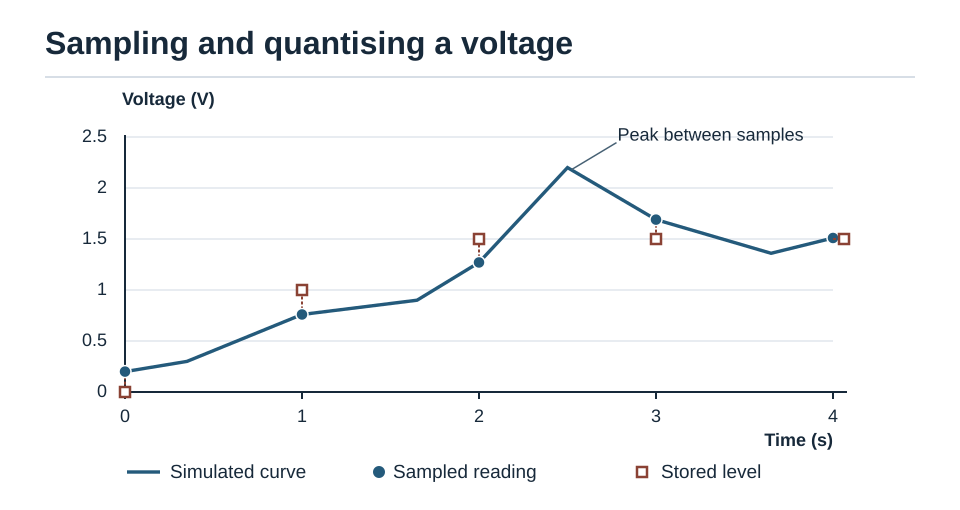

# M2-L4 – From a measured signal to a table {#L4}

**Course area:** M2 – Data, encoding and representation

**Level:** Lower secondary (core)

**Prior knowledge:** [M2-L2 – Bits, bytes and binary numbers](M2-L2.md)

**Learning objective:** Explain sampling, quantisation and a tabular data flow.

## Introduction {#S1}

A light sensor produces a voltage that changes over an experiment. The club records a value once a second and uses steps of 0.5 V. Several entries can look identical in the resulting table even though the voltage changed between them.

## Sampling and quantisation {#S2}

A **signal** here describes a voltage as a function of time. In **sampling**, we choose times and read the signal at those instants. At regular one-second intervals, the sampling rate is one sample per second, or 1 Hz. A rapid change between two sample times can go unnoticed.

In **quantisation**, we assign each sampled value to a level on a fixed scale. This simplified example uses non-negative voltages rounded to the nearest level, with levels 0.5 V apart. A value halfway between two levels goes to the higher one. The **code** is the level number. Code 3 with a level spacing of 0.5 V represents a stored level of 1.5 V.

{alt="At 0 to 4 seconds the sample points are 0.20, 0.76, 1.27, 1.69 and 1.51 V. Squares mark the levels 0, 1, 1.5, 1.5 and 1.5 V. The curve reaches an unsampled peak of 2.2 V at 2.5 seconds."}

A table row can hold a time, code, unit and source. To interpret the level number later, we also need the mapping from code to voltage, for example in the measurement log header.

## Recording a simulated series {#S3}

This fictional series uses readings in whole millivolts. This makes it possible to calculate even exact ties between levels unambiguously. Add 250 mV and use integer division by 500 mV to obtain the nearest level number. At 1270 mV the addition gives 1520 mV. The integer division gives code 3, which represents 1500 mV.

| Time (s) | Reading (mV) | Code | Stored level (mV) |
| ---: | ---: | ---: | ---: |
| 0 | 200 | 0 | 0 |
| 1 | 760 | 2 | 1000 |
| 2 | 1270 | 3 | 1500 |
| 3 | 1690 | 3 | 1500 |
| 4 | 1510 | 3 | 1500 |

```python
samples_mv = [200, 760, 1270, 1690, 1510]
codes = [(value + 250) // 500 for value in samples_mv]
levels_mv = [code * 500 for code in codes]
assert codes == [0, 2, 3, 3, 3]
assert sum(levels_mv) == 5500
assert max(levels_mv) == 1500
```

For these non-negative values, `//` gives the number of whole groups. The stored levels have a mean of $5500/5=1100$ mV. The largest stored level is 1500 mV. It is neither the largest reading nor the largest value on the original curve.

## Self-check {#S4}

### Exercises

1. Find the code and stored level for 1249 mV and 1250 mV.
2. Calculate the mean of the five readings and compare it with the mean of the stored levels.
3. Could the signal have exceeded 1690 mV between 2 s and 3 s? What changes if the interval between samples is shorter?

### Solutions

1. 1249 mV is closer to 1000 mV and gives code 2. 1250 mV is exactly halfway. The rounding rule gives 1500 mV and code 3.
2. The readings sum to 5430 mV, so their mean is 1086 mV. The mean of the levels is 14 mV higher in this example.
3. Yes. The diagram shows such a peak. Shorter intervals yield more values per second. That makes a brief change more likely to be sampled. It does not change the resolution of the voltage levels.

## Common mistakes and limits {#S5}

More samples and finer voltage levels address different kinds of inaccuracy. Our model rounds existing readings and includes neither measurement error nor upper saturation. The readings in millivolts are inputs to the model. They do not state the accuracy of an actual sensor.

## Summary {#S6}

Sampling determines the instants captured. Quantisation determines the level assigned to a value. Record the time interval, unit and level rule so that others can analyse the table meaningfully.

## Sources and further reading {#S7}

### Further reading (internal)

- [M3-L1 – Variables, values and data types](M3-L1.md)

### Sources (external)

- [Gesellschaft für Informatik e. V. – Bildungsstandards Informatik für die Sekundarstufe I](https://informatikstandards.de/fileadmin/FA/IBS/user_upload/GI-Bildungsstandards_Informatik_Sek_I__2025__-_blau.pdf) · Lesson reference: §5.1 · Explain sampling, quantisation and a tabular data flow. · Last accessed: 2026-11-22 · Content verified: 2026-11-22
- [Bildungsserver Berlin-Brandenburg · Senatsverwaltung Berlin und MBJS Brandenburg – Rahmenlehrplan Teil C – Informatik, Wahlpflichtfach, Jahrgangsstufen 7–10](https://bildungsserver.berlin-brandenburg.de/fileadmin/bbb/unterricht/rahmenlehrplaene/Rahmenlehrplanprojekt/amtliche_Fassung/Teil_C_Informatik_2015_11_10.pdf) · Lesson reference: §3.4 · Explain sampling, quantisation and a tabular data flow. · Last accessed: 2026-11-22 · Content verified: 2026-11-22
- [MathWorks – Analog Input Subsystem](https://www.mathworks.com/help/daq/analog-input-subsystem.html) · Lesson reference: Convert Analog Signals to Digital Data · Explain sampling, quantisation and a tabular data flow. · Last accessed: 2026-11-22 · Content verified: 2026-11-22
