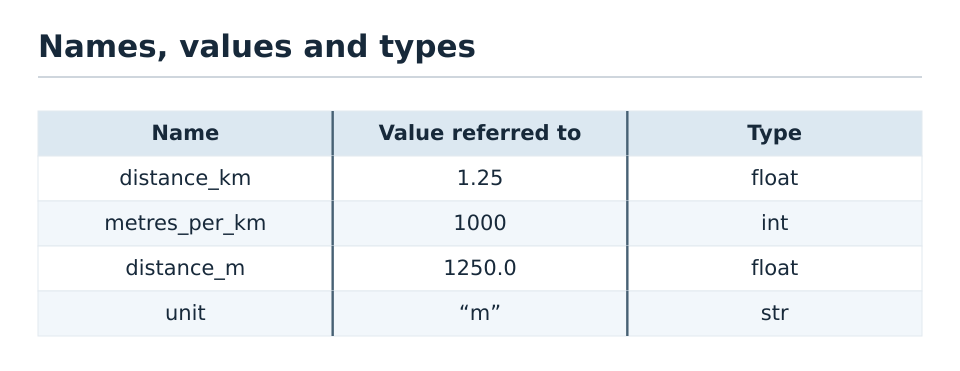

# M3-L1 – Variables, values and data types {#L1}

**Course area:** M3 – Programming algorithms

**Level:** Lower secondary (core)

**Prior knowledge:** [M2-L3 – Characters, Unicode and file formats](M2-L3.md)

**Learning objective:** Write a reproducible Python program with assignments, types and output.

## Introduction {#S1}

A school travel app shows a distance of 1.25 km. A map of the same route uses metres. The wrong units can turn a correct calculation into an incorrect display. We will write a short program that keeps the input and result separate and makes the conversion easy to check.

## Names, values and types {#S2}

An **assignment** with `=` binds a name to a value. Python evaluates the right-hand side first. In `distance_m = distance_km * 1000`, Python reads the value bound to `distance_km`, multiplies it by 1000 and binds the new name to the result. The names indicate the units. To Python they are ordinary names with no built-in conversion rule.

| Type | Example | Meaning |
| --- | --- | --- |
| `int` | `1000` | Integer |
| `float` | `1.25` | Floating-point number |
| `str` | `"km"` | String |
| `bool` | `True` | Boolean value, with `False` as the alternative |

The type belongs to the value and affects which operations are possible. `+` adds two numbers and joins two strings. A string containing digits such as `"1.25"` can be converted explicitly to a floating-point number using `float("1.25")`. Python uses a point as the decimal separator in numeric literals.

{alt="distance_km refers to 1.25 of type float, metres_per_km to 1000 of type int, distance_m to 1250.0 of type float, and unit to the string m."}

## Converting kilometres to metres {#S3}

Save the block as `distance.py` and run it with `python distance.py` or `python3 distance.py`, depending on the name of your Python 3 command. The block needs no extra packages or input. `print` writes the value and unit separated by a space.

```python
distance_km = 1.25
metres_per_km = 1000
distance_m = distance_km * metres_per_km
unit = "m"
print(distance_m, unit)
assert distance_m == 1250.0
```

The output is `1250.0 m`. The calculation uses $1.25 \cdot 1000 = 1250$. The result has type `float`, so Python prints the decimal place here. The `assert` line checks equality with the expected numeric value. When the condition holds, `assert` produces no output.

## Self-check {#S4}

### Exercises

1. Change `distance_km` to `0.75`. What output and expected value are needed?
2. A distance arrives as the text `"1.25"`. What happens when it is multiplied by `1000`? How can you calculate the distance instead?

### Solutions

1. $0.75 \cdot 1000 = 750$. The output is `750.0 m`. Change the check to `assert distance_m == 750.0`.
2. Multiplication repeats the string 1000 times. `float("1.25") * 1000` uses the numeric value and gives `1250.0`.

## Common mistakes and limits {#S5}

`distance_km = 1,25` produces a pair of values in Python, namely `(1, 25)`. Write `1.25` in your program. `"1.25" + 1` raises a `TypeError` because Python does not define addition for this combination of types. Many decimal numbers have only approximate representations as `float` values. The chosen values `1.25` and `0.75` can be represented exactly in binary. Later comparisons of measurements may require tolerances justified by the application.

## Summary {#S6}

An assignment gives a value a name. The value determines which operations are allowed. Meaningful names, a visible unit and a known test value make a conversion easy to trace.

## Sources and further reading {#S7}

### Further reading (internal)

- [M3-L2 – Conditions and branches](M3-L2.md)

### Sources (external)

- [Gesellschaft für Informatik e. V. – Bildungsstandards Informatik für die Sekundarstufe I](https://informatikstandards.de/fileadmin/FA/IBS/user_upload/GI-Bildungsstandards_Informatik_Sek_I__2025__-_blau.pdf) · Lesson reference: §5.2 · Write a reproducible Python program with assignments, types and output. · Last accessed: 2026-11-22 · Content verified: 2026-11-22
- [Python Software Foundation – Python Tutorial – An Informal Introduction to Python](https://docs.python.org/3.13/tutorial/introduction.html) · Lesson reference: §3.1 · Write a reproducible Python program with assignments, types and output. · Last accessed: 2026-11-22 · Content verified: 2026-11-22
