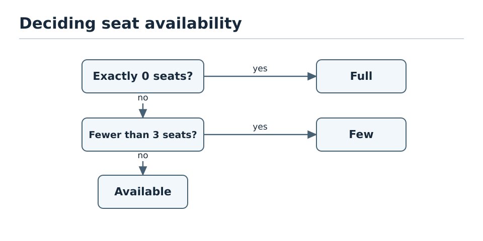

# M3-L2 – Conditions and branches {#L2}

**Course area:** M3 – Programming algorithms

**Level:** Lower secondary (core)

**Prior knowledge:** [M3-L1 – Variables, values and data types](M3-L1.md)

**Learning objective:** Use comparisons and Boolean expressions to choose between cases.

## Introduction {#S1}

The box office for a school play has a count of available seats. With zero seats the display should say “full”. With one or two seats it should say “few”. From three seats onwards it should say “available”. The count can only be a non-negative integer. How can we translate all three cases into a program without leaving a gap?

## Conditions ask questions about a value {#S2}

A **comparison** produces a Boolean value. `seats == 0` checks equality. `seats < 3` asks whether the value is below 3. In Python `=` assigns a value and `==` checks equality. With `and` both parts must be true. For `or` one true part is enough. `not` reverses a Boolean value.

`if` checks the first condition. Python checks an `elif` only if no earlier branch was selected. If no condition holds, an `else` branch is executed when present. A line ending with a colon starts the branch. Lines with the same indentation belong to that branch, using four spaces here.

{alt="If no seats are available, the result is full. Otherwise a check for fewer than three leads to few if true and available if false."}

## Displaying seat availability {#S3}

Start with two free seats. `seats == 0` is false. `seats < 3` is true. The second assignment sets the display value. The final `print` is outside the conditional statement, so the other inputs reach it too.

```python
seats = 2
if seats == 0:
    status = "full"
elif seats < 3:
    status = "few"
else:
    status = "available"
print(status)
assert status == "few"
```

| Available seats | `seats == 0` | `seats < 3` check | Output |
| --- | --- | --- | --- |
| 0 | true | skipped | `full` |
| 2 | false | true | `few` |
| 3 | false | false | `available` |

The output strings are labels for the three cases. Because the first test already handles zero, the second test does not need to repeat the lower bound of 1 here. As a standalone question, `seats >= 1 and seats < 3` would be more precise.

## Self-check {#S4}

### Exercises

1. Trace the inputs 0, 1, 2 and 3. For each value, identify which branch is chosen.
2. A student tests `seats < 3` first and tests for zero in the `elif`. Which input shows a difference?
3. Add a first condition that displays an error for negative counts. Explain why the condition belongs at the start.

### Solutions

1. 0 takes the `if` branch and gives `full`. 1 and 2 take the `elif` branch and give `few`. 3 takes the `else` branch and gives `available`.
2. For 0, `seats < 3` is true. Python immediately selects `few` and skips the other branch.
3. Check for an invalid count with `if seats < 0:` and make the previous first test `elif seats == 0:`. Otherwise, a value such as −1 would be treated as “few”.

## Common mistakes and limits {#S5}

A second independent `if` can be true even after the first one has run. An `if`, `elif` and `else` chain runs at most one branch. The table deliberately includes values near the boundaries. Testing with 10 seats alone would miss a fault that occurs at exactly 3. Text values such as `"3"` must be read separately and converted to an appropriate numeric type before numeric comparisons.

## Summary {#S6}

Write the rule in words first and check its boundaries. Comparisons produce Boolean values. The order of the conditions determines which branch runs.

## Sources and further reading {#S7}

### Further reading (internal)

- [M3-L3 – Loops and tracing](M3-L3.md)

### Sources (external)

- [Gesellschaft für Informatik e. V. – Bildungsstandards Informatik für die Sekundarstufe I](https://informatikstandards.de/fileadmin/FA/IBS/user_upload/GI-Bildungsstandards_Informatik_Sek_I__2025__-_blau.pdf) · Lesson reference: §5.2 · Use comparisons and Boolean expressions to choose between cases. · Last accessed: 2026-11-22 · Content verified: 2026-11-22
- [Python Software Foundation – Python Tutorial – More Control Flow Tools](https://docs.python.org/3.13/tutorial/controlflow.html) · Lesson reference: §4.1 · Use comparisons and Boolean expressions to choose between cases. · Last accessed: 2026-11-22 · Content verified: 2026-11-22
