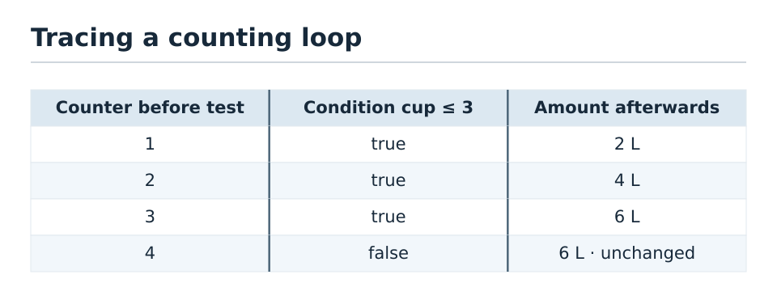

# M3-L3 – Loops and tracing {#L3}

**Course area:** M3 – Programming algorithms

**Level:** Lower secondary (core)

**Prior knowledge:** [M3-L2 – Conditions and branches](M3-L2.md)

**Learning objective:** Trace iteration using for, while, state changes and stopping conditions.

## Introduction {#S1}

A collection station fills three containers with 2 litres of water each. After every container, the amount filled so far is recorded. We could write out three almost identical instructions. A loop describes the same action once and makes it clear when it repeats.

## Repetition and progress through states {#S2}

A **for loop** in Python goes through the elements of a sequence. `range(1, 4)` yields 1, 2 and 3 in order. It includes the lower bound and excludes the upper bound. The loop sets the value of `cup` on each iteration.

A **while loop** checks its condition before each iteration. If it is false on the first check, the loop body does not run at all. A counting loop needs an initial value and a change that moves it towards the stopping point. A **trace table** records the relevant values after each iteration. It helps spot missing updates and off-by-one errors.

{alt="The condition is true at counter values 1, 2 and 3. The amount after those iterations rises to 2, 4 and 6 litres. At counter value 4 the condition fails and the amount stays at 6 litres."}

## Recording three containers {#S3}

The initial value of `total_l` is 0. For `total_l = total_l + 2`, Python reads the previous value, adds 2 and assigns the result back. The variable accumulates the partial amounts. In the `while` block, the counter starts at 1 and increases by 1 after every iteration. At 4 the condition `cup <= 3` is false. Both loops produce the pairs (1, 2), (2, 4) and (3, 6).

```python
total_l = 0
for cup in range(1, 4):
    total_l = total_l + 2
    print(cup, total_l)
assert total_l == 6

total_l = 0
cup = 1
while cup <= 3:
    total_l = total_l + 2
    print(cup, total_l)
    cup = cup + 1
assert cup == 4
assert total_l == 6
```

```text
1 2
2 4
3 6
1 2
2 4
3 6
```

## Self-check {#S4}

### Exercises

1. Make a trace table using `range(1, 5)` with the same amount of 2 litres per container. List all running totals.
2. A version starts with `cup = 1` and uses `while cup < 3:`. What is missing from the output? How would you change the condition?
3. What happens with `while cup <= 3:` if the loop body never changes `cup`?

### Solutions

1. The values for `cup` are 1, 2, 3 and 4. The corresponding totals are 2, 4, 6 and 8 litres.
2. The third iteration with 6 litres is missing because `3 < 3` is false. With `cup <= 3` the third iteration is included.
3. `cup` stays at 1 and `cup <= 3` remains true. Under these assumptions the loop does not stop on its own.

## Common mistakes and limits {#S5}

The counter and the running total serve different purposes. Setting the counter to `total_l` would skip containers. When the number of iterations is known, `for` with `range` supplies the counter values. `while` is suitable when a condition is the natural focus of the problem. If progress is unclear, check on paper whether the possible iterations keep moving towards a point where the condition becomes false.

## Summary {#S6}

A `for` loop goes through values, while a `while` loop checks a condition. A short trace table shows intermediate states, the last iteration actually executed and the final value.

## Sources and further reading {#S7}

### Further reading (internal)

- [M3-L4 – Lists, functions and decomposition](M3-L4.md)

### Sources (external)

- [Gesellschaft für Informatik e. V. – Bildungsstandards Informatik für die Sekundarstufe I](https://informatikstandards.de/fileadmin/FA/IBS/user_upload/GI-Bildungsstandards_Informatik_Sek_I__2025__-_blau.pdf) · Lesson reference: §5.2 · Trace iteration using for, while, state changes and stopping conditions. · Last accessed: 2026-11-22 · Content verified: 2026-11-22
- [Python Software Foundation – Python Tutorial – More Control Flow Tools](https://docs.python.org/3.13/tutorial/controlflow.html) · Lesson reference: §§4.2–4.4 · Trace iteration using for, while, state changes and stopping conditions. · Last accessed: 2026-11-22 · Content verified: 2026-11-22
