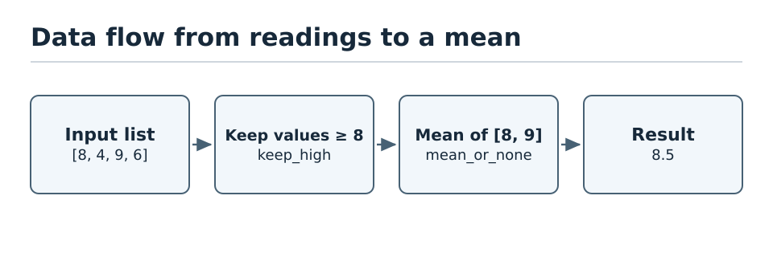

# M3-L4 – Lists, functions and decomposition {#L4}

**Course area:** M3 – Programming algorithms

**Level:** Lower secondary (core)

**Prior knowledge:** [M3-L3 – Loops and tracing](M3-L3.md)

**Learning objective:** Process a list through smaller functions with return values.

## Introduction {#S1}

A school weather club records a set of readings. For one report, only readings of 8 or more are relevant. The report should show the mean of that selection. If the log contains no qualifying values, it should show no apparent mean. We can separate selection from evaluation.

## Lists and manageable subtasks {#S2}

A **list** stores values in order and can be empty. The first value of `[8, 4, 9, 6]` is at index `0`. With `for reading in readings` we can read the values in sequence. `append` adds a value to the end of a list. When selecting values, we build a new list while iterating over the original.

A **function** takes arguments when called and provides a result through `return`. In `def keep_high(readings, floor):`, `readings` and `floor` are the parameter names. They refer to the values passed at the call. We give each function a clear purpose. `keep_high` retains every value at or above a lower bound in its original order. `mean_or_none` computes the arithmetic mean of a non-empty list and returns `None` for an empty list. Here `None` represents the absence of a computable result.

{alt="The list 8, 4, 9, 6 is filtered with a lower bound of 8. The resulting list 8, 9 goes to the second function, which returns 8.5 as the mean."}

## Connecting two functions {#S3}

The values 8 and 9 satisfy `reading >= floor`. The values 4 and 6 are left out. The mean of the selection is $(8+9)/2=8.5$. The second function uses `sum` for the total and `len` for the number of values.

```python
def keep_high(readings, floor):
    selected = []
    for reading in readings:
        if reading >= floor:
            selected.append(reading)
    return selected

def mean_or_none(readings):
    if len(readings) == 0:
        return None
    return sum(readings) / len(readings)

readings = [8, 4, 9, 6]
selected = keep_high(readings, 8)
mean = mean_or_none(selected)
print(selected)
print(mean)
assert selected == [8, 9]
assert mean == 8.5
assert readings == [8, 4, 9, 6]
assert mean_or_none(keep_high(readings, 10)) is None
```

The output is `[8, 9]` followed by `8.5` on the next line. The last check sets the lower bound to 10. The selection is empty and the second function returns `None`. `is None` tests for that exact special Python value.

## Self-check {#S4}

### Exercises

1. Which values are retained when the lower bound is 6? Calculate their mean.
2. What does each function produce for an empty input list?
3. Why would `return 0` be ambiguous for an empty list?

### Solutions

1. The result is `[8, 9, 6]` in that order. Their mean is $23/3$, or about 7.67.
2. `keep_high([], 8)` returns `[]`. `mean_or_none([])` returns `None`. Division by zero is avoided.
3. The mean of `[-1, 1]` actually is `0.0`. `None` allows a missing mean to be distinguished from a calculated value of zero.

## Common mistakes and limits {#S5}

`print(selected)` shows the list. `return selected` provides it to the calling code for further calculation. `append` modifies the list directly. Therefore `selected = selected.append(reading)` rebinds the name to the return value `None`. The functions assume the list contains numbers. Text or missing readings need an input rule before they can be evaluated.

## Summary {#S6}

Lists hold ordered data. Separate functions let you test the selection independently of the mean calculation. Handling an empty list explicitly gives the result a clear meaning.

## Sources and further reading {#S7}

### Further reading (internal)

- [M3-L5 – Test cases and debugging](M3-L5.md)

### Sources (external)

- [Gesellschaft für Informatik e. V. – Bildungsstandards Informatik für die Sekundarstufe I](https://informatikstandards.de/fileadmin/FA/IBS/user_upload/GI-Bildungsstandards_Informatik_Sek_I__2025__-_blau.pdf) · Lesson reference: §5.1 · Process a list through smaller functions with return values. · Last accessed: 2026-11-22 · Content verified: 2026-11-22
- [Python Software Foundation – Python Tutorial – More Control Flow Tools](https://docs.python.org/3.13/tutorial/controlflow.html) · Lesson reference: §4.8 · Process a list through smaller functions with return values. · Last accessed: 2026-11-22 · Content verified: 2026-11-22
- [Python Software Foundation – Python Tutorial – Data Structures](https://docs.python.org/3.13/tutorial/datastructures.html) · Lesson reference: §5.1 · Process a list through smaller functions with return values. · Last accessed: 2026-11-22 · Content verified: 2026-11-22
