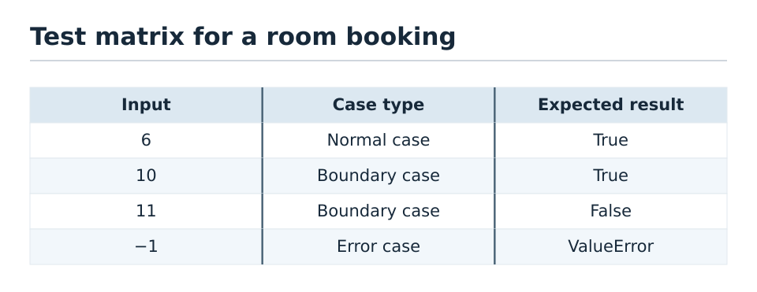

# M3-L5 – Test cases and debugging {#L5}

**Course area:** M3 – Programming algorithms

**Level:** Lower secondary (core)

**Prior knowledge:** [M3-L4 – Lists, functions and decomposition](M3-L4.md)

**Learning objective:** Test normal, boundary and invalid cases and isolate a defect.

## Introduction {#S1}

A group room has space for at most ten people. A booking program accepts a group of eight but rejects a group of exactly ten. The program runs without crashing. Its result is wrong because one part of the requirement was translated into the wrong comparison.

## Expected results, comparisons and causes {#S2}

A **test case** pairs an input with an expected result. Write the requirement first. For a non-negative integer group size, the function returns `True` up to and including 10 and `False` for larger values. A negative group size is outside the agreed range and raises `ValueError`.

A **normal case** checks typical behaviour, such as a group of 6. A **boundary case** tests the edge of a range or the values immediately next to it, here 10 and 11. An **error case** checks the response to invalid input. A **regression test** keeps a fixed defect covered by a permanent test case, so it can be detected again after later changes.

{alt="A group of 6 expects True. The boundary cases 10 and 11 expect True and False, respectively. The invalid input minus 1 expects ValueError."}

## Reproducing and fixing a defect {#S3}

The incorrect return statement is `return people < 10`. With `people = 10` it gives `False` even though the room has space. Trace the same comparison for 6 and 11. Both results happen to match the requirement. The value 10 narrows down the cause. Correct the comparison to `people <= 10`.

```python
def group_fits(people):
    if people < 0:
        raise ValueError("group size must be non-negative")
    return people <= 10

assert group_fits(6) is True
assert group_fits(10) is True
assert group_fits(11) is False

try:
    group_fits(-1)
except ValueError:
    pass
else:
    raise AssertionError("expected ValueError for a negative group size")
```

`raise` deliberately reports an exception. `try` runs the negative-input test. If `ValueError` occurs, that is the expected behaviour and `pass` has no effect. If no exception occurs, `else` reports the failing test by raising `AssertionError`. If all checks pass, this program produces no output.

## Self-check {#S4}

### Exercises

1. Which test fails if you use `< 10` again? Why is a test with 11 insufficient?
2. Add a normal case above the boundary and a test for the lowest valid input in the specification.
3. The function mistakenly returns `False` for every negative group size. Which test reports the mistake?

### Solutions

1. `assert group_fits(10) is True` fails. Both `11 < 10` and `11 <= 10` give `False`.
2. Use, for example, `assert group_fits(20) is False` and `assert group_fits(0) is True`. Under the agreed rule, 0 is valid.
3. `group_fits(-1)` does not raise the expected exception. The `else` branch therefore raises `AssertionError`.

## Common mistakes and limits {#S5}

Derive the expected result from the rule. If the test uses the same comparison as the program to calculate that result, it may miss a mistake that both share. The checks cover selected cases. They do not prove correctness for all inputs. The function assumes integers and does not validate text or other types here. Use `assert` for these learning checks. Python can disable them with `-O`, so the required input validation is a separate branch inside the function itself.

## Summary {#S6}

Record which inputs are valid and what they should produce. A test right at the boundary helps locate a defect. Keep it as a regression test after making the correction.

## Sources and further reading {#S7}

### Further reading (internal)

- [M4-L1 – Networks, packets and protocols](M4-L1.md)

### Sources (external)

- [Gesellschaft für Informatik e. V. – Bildungsstandards Informatik für die Sekundarstufe I](https://informatikstandards.de/fileadmin/FA/IBS/user_upload/GI-Bildungsstandards_Informatik_Sek_I__2025__-_blau.pdf) · Lesson reference: §5.2 · Test normal, boundary and invalid cases and isolate a defect. · Last accessed: 2026-11-22 · Content verified: 2026-11-22
- [Python Software Foundation – unittest – Unit testing framework](https://docs.python.org/3.13/library/unittest.html) · Lesson reference: Basic example · Test normal, boundary and invalid cases and isolate a defect. · Last accessed: 2026-11-22 · Content verified: 2026-11-22
