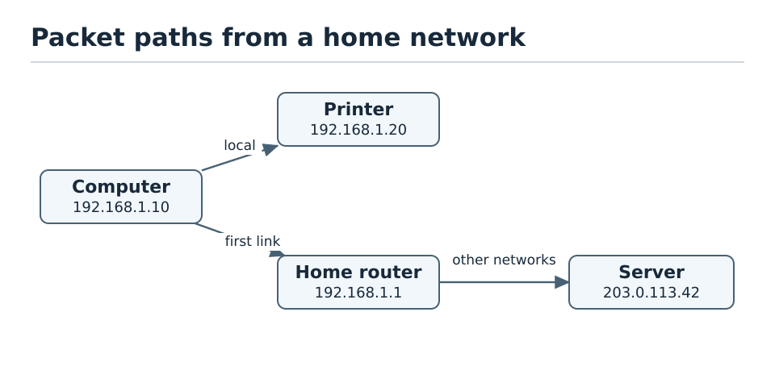

# M4-L1 – Networks, packets and protocols {#L1}

**Course area:** M4 – Networks, the Web and information security

**Level:** Lower secondary (core)

**Prior knowledge:** [M1-L2 – Hardware, software and operating systems](M1-L2.md)

**Learning objective:** Explain addressing, packet forwarding and network layers with a home network example.

## A destination nearby and one far away {#S1}

Your computer prints a page in the next room and then opens a timetable hosted on a remote server. Both actions move data through a network. The first stays inside the home network. The second leaves it through the router. What decision leads to these two routes?

## Addresses, packets and layers {#S2}

A **network** connects devices so that they can exchange data. An **IP address** is an address used for delivery at the network layer. A device can have several interfaces and several addresses. We use one IPv4 address per network interface shown.

A **packet** is a unit of data in transit. An IP packet includes the destination IP address and the data to be carried. For the next link, the packet is put inside a local transmission unit such as an Ethernet frame. A **protocol** specifies how participating devices encode, interpret and exchange data. Each layer handles a particular part of the rules:

- The application specifies what the message means, such as a request for a document.
- The transport layer can direct data to the right application. TCP offers an ordered stream of bytes and retransmits lost data when necessary.
- IP handles addressing and delivery across interconnected networks. It provides no guarantee that an individual packet will arrive.
- The local connection, such as Ethernet or Wi-Fi, carries data across the next link.

A **router** connects networks. It reads the destination address and consults its routing table to decide where to send the packet next. If the destination belongs to the same network, the computer can use the local link to reach that device directly.

{alt="A computer sends locally to the printer or through the home router and other networks to the server."}

## Explaining two packet paths {#S3}

Consider a simplified home network with the prefix `192.168.1.0/24`. With this prefix, the first 24 of the 32 bits identify the network. In the usual dotted notation, the first three numbers must match here.

| Device | IPv4 address |
| --- | --- |
| Computer | `192.168.1.10` |
| Printer | `192.168.1.20` |
| Home router on the local network | `192.168.1.1` |
| Remote server in the model | `203.0.113.42` |

1. The printer's first three numbers match the computer's. The computer uses the local connection to send to the printer.
2. The server's first three numbers differ. With no more specific route available, the computer uses its **default router** at `192.168.1.1`. At the IP layer, the destination remains `203.0.113.42`. The router is the next recipient addressed on the local link.
3. Later routers select their own next links. A reply also needs a route and can return through a different sequence of routers.

The server address is reserved for documentation examples. You can act out the process using cards for the computer, router and destination.

## Self-check {#S4}

### Exercises

1. Classify `192.168.1.99` and `192.168.2.20` as local or remote in the model above.
2. A device says, “I'm sending this to the router.” The IP packet still contains the server address. Explain how the two statements fit together.

### Solutions

1. `192.168.1.99` is local because the network part `192.168.1` matches under `/24`. From the computer's perspective, `192.168.2.20` belongs to another network because the third number differs.
2. The router receives the local transmission on this link. The IP destination identifies the server. The router uses it when deciding where to send the packet next.

## Assumptions, errors and limitations {#S5}

The rule about the first three numbers applies to the `/24` prefix shown. Other prefixes might end part way through one of the decimal groups and require comparing individual bits. The home network is simplified: a Wi-Fi access point or switch may be part of the local path. A typical home router can also use NAT to rewrite the outgoing source address. The address comparison in the model is enough to decide whether the destination is local.

## Summary {#S6}

Packets carry data, and protocols establish communication rules. The IP address and prefix help determine whether the destination is reachable through the local connection or a router must handle the next link.

## Sources and further reading {#S7}

### Further reading (internal)

- [M4-L2 – Internet, DNS and the Web](M4-L2.md)

### Sources (external)

- [Gesellschaft für Informatik e. V. – Bildungsstandards Informatik für die Sekundarstufe I](https://informatikstandards.de/fileadmin/FA/IBS/user_upload/GI-Bildungsstandards_Informatik_Sek_I__2025__-_blau.pdf) · Lesson reference: §5.4 · Explain addressing, packet forwarding and network layers with a home network example. · Last accessed: 2026-11-22 · Content verified: 2026-11-22
- [Bildungsserver Berlin-Brandenburg · Senatsverwaltung Berlin und MBJS Brandenburg – Rahmenlehrplan Teil C – Informatik, Wahlpflichtfach, Jahrgangsstufen 7–10](https://bildungsserver.berlin-brandenburg.de/fileadmin/bbb/unterricht/rahmenlehrplaene/Rahmenlehrplanprojekt/amtliche_Fassung/Teil_C_Informatik_2015_11_10.pdf) · Lesson reference: §3.3 · Explain addressing, packet forwarding and network layers with a home network example. · Last accessed: 2026-11-22 · Content verified: 2026-11-22
- [MDN Web Docs – How does the Internet work?](https://developer.mozilla.org/en-US/docs/Learn_web_development/Howto/Web_mechanics/How_does_the_Internet_work) · Lesson reference: Infrastructure · Explain addressing, packet forwarding and network layers with a home network example. · Last accessed: 2026-11-22 · Content verified: 2026-11-22
