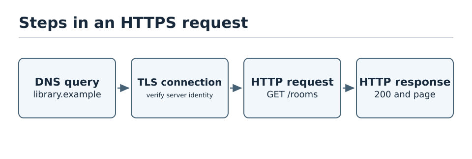

# M4-L2 – Internet, DNS and the Web {#L2}

**Course area:** M4 – Networks, the Web and information security

**Level:** Lower secondary (core)

**Prior knowledge:** [M4-L1 – Networks, packets and protocols](M4-L1.md)

**Learning objective:** Distinguish DNS resolution, client-server roles and HTTP exchanges.

## From a name to a displayed page {#S1}

You type an address into the browser. A web page appears shortly afterwards. Another time, you see “404”. Which step determines whether a server can be located, and which determines whether that server has the requested page?

## Three separate jobs {#S2}

The **Internet** connects networks through which many different services can be reached. The **World Wide Web** is one of those services: resources such as documents and images are identified by URLs and retrieved using HTTP.

The example URL `https://library.example/rooms` has three parts that matter here: `https` is the scheme, `library.example` is the host name and `/rooms` is the resource path. The browser in our example is the **client** that sends a request. The **server** handles it and responds.

The **Domain Name System** (DNS) is a distributed naming system. One of its functions is to provide IP addresses for a host name. A computer usually asks a DNS resolver. The resolver may use a cached answer or ask other DNS servers. A web path is outside the scope of the name query. One host name can have several addresses, and several names can share one address.

**HTTP** defines how the client requests a resource and how the server responds. **HTTPS** is HTTP over a protected connection. A server can report success or return an error status. Name resolution answers a different question: which address can the client use to open a connection?

{alt="DNS resolves library.example. The browser and service then establish a protected connection. The service answers GET /rooms with 200 and the page."}

## Acting out a web request {#S3}

We use a fictional service at `library.example`. In the model, the resolver returns `203.0.113.42`. The domain and IP address are reserved for examples. You can perform the following exchange on paper:

1. The browser separates the host name from the path. The resolver gets a query for `library.example` and returns `203.0.113.42` in the example.
2. For HTTPS, the browser establishes a protected connection to the intended host. In simplified terms, it checks, among other things, the certificate evidence for that host.
3. The browser sends an HTTP request with the method `GET`, the path `/rooms` and the host name. `GET` is intended to retrieve a representation.
4. The service sends status `200` and the page in our example. For `GET /garden`, the same service returns `404` in the model because that resource is unavailable there.

| Observation | What it tells you |
| --- | --- |
| DNS returns an address | The name was resolved in the model. |
| Server responds with `200` | The HTTP request succeeded. |
| Server responds with `404` | An HTTP service reports that it found no current representation or declines to disclose that one exists. |

## Self-check {#S4}

### Exercises

1. What string does the resolver look up as the host name for `https://library.example/events`? What path goes into the HTTP request?
2. The browser reports a name resolution failure for a new URL. Has the intended service sent it an HTTP `404` status? Explain.

### Solutions

1. The name is `library.example` and the path is `/events`. The resolver has no need for the path. The HTTP service handles it later.
2. No. In the simplified process, the destination address is unavailable and there is no HTTP response from the service. `404` would be a status in an HTTP response that had actually arrived.

## Assumptions, errors and limitations {#S5}

Retrieving a document can trigger more requests for images, scripts or fonts. Browsers and resolvers cache responses, allowing some steps to be skipped on later requests. An error after successful name resolution can occur during connection setup or certificate verification. It is still outside the HTTP exchange. A `404` response also leaves open whether the intended origin server responded itself: an intermediary HTTP service can return it.

## Summary {#S6}

DNS helps associate a host name with an address. During a web request, HTTP handles communication about resources and their status. The separate jobs help you identify where a failure occurred.

## Sources and further reading {#S7}

### Further reading (internal)

- [M4-L3 – Protecting data and securing accounts](M4-L3.md)

### Sources (external)

- [Gesellschaft für Informatik e. V. – Bildungsstandards Informatik für die Sekundarstufe I](https://informatikstandards.de/fileadmin/FA/IBS/user_upload/GI-Bildungsstandards_Informatik_Sek_I__2025__-_blau.pdf) · Lesson reference: §5.4 · Distinguish DNS resolution, client-server roles and HTTP exchanges. · Last accessed: 2026-11-22 · Content verified: 2026-11-22
- [MDN Web Docs – Overview of HTTP](https://developer.mozilla.org/en-US/docs/Web/HTTP/Guides/Overview) · Lesson reference: Client-server structure · Distinguish DNS resolution, client-server roles and HTTP exchanges. · Last accessed: 2026-11-22 · Content verified: 2026-11-22
- [IETF – RFC 9110: HTTP Semantics](https://www.rfc-editor.org/rfc/rfc9110.html) · Lesson reference: §15.5.5 · Distinguish DNS resolution, client-server roles and HTTP exchanges. · Last accessed: 2026-11-22 · Content verified: 2026-11-22
