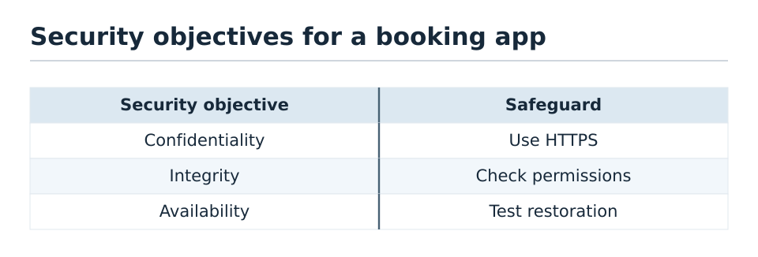

# M4-L3 – Protecting data and securing accounts {#L3}

**Course area:** M4 – Networks, the Web and information security

**Level:** Lower secondary (core)

**Prior knowledge:** [M4-L2 – Internet, DNS and the Web](M4-L2.md)

**Learning objective:** Apply security goals, data minimisation, multi-factor authentication and secure transmission to a case.

## An app for the rehearsal room {#S1}

A school wants to make a rehearsal room bookable. Groups should be able to see available slots and change their own bookings. The school needs to decide what data to collect, who may see it and what happens if the service fails. Three security objectives help with those decisions.

## Security objectives and safeguards {#S2}

**Confidentiality** means that only authorised people or systems learn the data. **Integrity** here means that data stays complete and is changed only as intended. **Availability** means that authorised people can access the service or data when needed. A measure can support more than one objective, and an objective often needs several measures.

{alt="Confidentiality: HTTPS. Integrity: check permissions. Availability: test restoration."}

Start before implementation with **data minimisation**: a booking might need a time slot and a group identifier. A home address would be unnecessary for this task without a justified additional need. Decide when an old booking record has served its purpose and can be deleted.

Account security distinguishes **authentication** from **authorisation**. Signing in checks the evidence for a claimed identity. For each protected action, the service then checks whether the account has the required permission. **Multi-factor authentication** requires evidence from different categories: something I know (such as a password), something I possess (such as a security key), or a personal characteristic that can be checked. Two passwords both belong to the knowledge category.

## Assessing protection needs {#S3}

Consider the fictional rehearsal room app. The schedule shows free and occupied times without private contact details. A group leader may change their own bookings. A designated account manages the opening hours.

| Situation | Affected security objective | Suitable safeguard |
| --- | --- | --- |
| Someone reads sign-in information in transit. | Confidentiality | A protected HTTPS connection with a valid certificate. |
| A signed-in user changes another group's booking. | Integrity | When a change is requested, the server checks permission for that particular booking. |
| The data storage system fails. | Availability | Tested restoration from backups and a fallback plan for outages. |

The school introduces a further factor for the account with elevated permissions, such as an appropriate security key. Each role receives only the access it needs. For example, an account managing opening hours does not need to see private information irrelevant to that function.

## Self-check {#S4}

### Exercises

1. An app asks for a second password in addition to the first. Does this meet the idea of using different factors? Give a possible addition.
2. In the fictional service, a booking is inaccurate after an unauthorised change. At the same time the service is unreachable because of a fault. Match the two observations to security objectives and suggest a measure for each.

### Solutions

1. Both items are evidence of knowledge. An appropriate registered security key adds a possession factor in this example.
2. The unauthorised change affects integrity. A server-side permission check can prevent it. The outage affects availability. Tested restoration and a fallback plan help resume operation.

## Assumptions, errors and limitations {#S5}

HTTPS protects the connection to its endpoint. The service can still read the data it receives and must protect what it stores. Multiple factors do not remove the need for permission checks on individual actions. A backup serves its purpose when responsibility, retention and restoration are clear. Secure defaults and a procedure for lost keys belong in account management.

## Summary {#S6}

First describe the purpose of the data and the harm that could occur. Then choose appropriate measures for confidentiality, integrity and availability. Data minimisation reduces the amount of data that needs protection in the first place.

## Sources and further reading {#S7}

### Further reading (internal)

- [M4-L4 – Encryption, signatures and trust](M4-L4.md)

### Sources (external)

- [Gesellschaft für Informatik e. V. – Bildungsstandards Informatik für die Sekundarstufe I](https://informatikstandards.de/fileadmin/FA/IBS/user_upload/GI-Bildungsstandards_Informatik_Sek_I__2025__-_blau.pdf) · Lesson reference: §§5.4–5.5 · Apply security goals, data minimisation, multi-factor authentication and secure transmission to a case. · Last accessed: 2026-11-22 · Content verified: 2026-11-22
- [Bildungsserver Berlin-Brandenburg · Senatsverwaltung Berlin und MBJS Brandenburg – Rahmenlehrplan Teil C – Informatik, Wahlpflichtfach, Jahrgangsstufen 7–10](https://bildungsserver.berlin-brandenburg.de/fileadmin/bbb/unterricht/rahmenlehrplaene/Rahmenlehrplanprojekt/amtliche_Fassung/Teil_C_Informatik_2015_11_10.pdf) · Lesson reference: §3.3 · Apply security goals, data minimisation, multi-factor authentication and secure transmission to a case. · Last accessed: 2026-11-22 · Content verified: 2026-11-22
