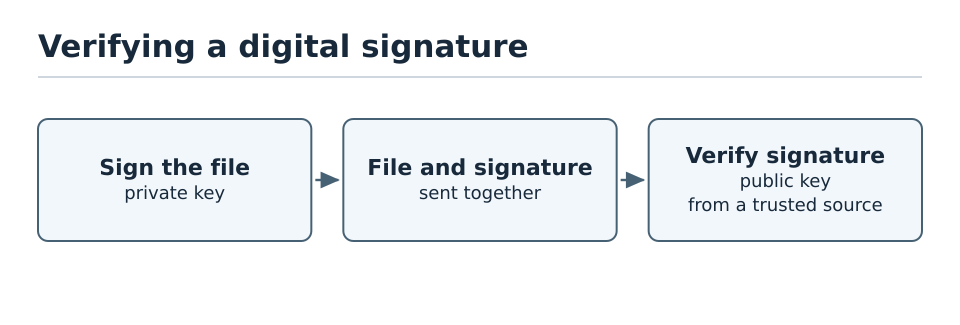

# M4-L4 – Encryption, signatures and trust {#L4}

**Course area:** M4 – Networks, the Web and information security

**Level:** Upper secondary (advanced level)

**Prior knowledge:** [M4-L3 – Protecting data and securing accounts](M4-L3.md)

**Learning objective:** Distinguish symmetric and asymmetric cryptography, hashing, signatures and certificates.

## A confidential request and a public floor plan {#S1}

A school library accepts confidential requests. It makes its floor plan available to everyone. Unauthorised people should be unable to read a request. For the plan, the important question is whether the file really came from the library and has remained unchanged. The two tasks require different cryptographic tools.

## Keys, digests and trust relationships {#S2}

A **key** is an input to a cryptographic algorithm. In **symmetric encryption**, authorised endpoints use a shared secret to encrypt and decrypt. Modern authenticated encryption can also detect changes. The shared secret has to be established and protected appropriately.

**Asymmetric algorithms** work with a public key and a private key. A key pair serves a particular function depending on the algorithm. Suitable algorithms protect data for the holder of a private key or help establish a shared secret for a session. With a **digital signature**, the sender creates a signature using a private signing key. The recipient can use the corresponding public key to check whether the signature matches the data received.

{alt="The sender signs with the private key and sends file and signature. The recipient checks both with the public key obtained through a trusted channel."}

A **cryptographic hash function** produces a fixed-length digest from data. A small change can alter the digest considerably. A digest by itself does not prove origin. Anyone who can replace both the file and the digest can compute a matching digest for the replacement file.

Within a trust system, a **certificate** links identity information to a public key. With HTTPS, a browser checks, among other things, that the server name matches, the certificate is within its validity period, the signatures lead to a recognised trust anchor and the server proves control of the corresponding private key during connection setup.

## Two cases, step by step {#S3}

1. **Confidential request.** In the model, the browser contacts the intended library service over HTTPS. The endpoints establish key material. After the server's credentials have been checked, symmetric session key material protects the application data. The browser checks the intended server, and the service separately handles any user sign-in it needs.
2. **Public floor plan.** The library signs the file with its private signing key. The reader obtains the corresponding public key through a trusted channel and uses it to check the file and signature. If the file changes, the old signature will normally fail verification. The plan remains readable. The meaning of a successful check also depends on who the public key actually belongs to.

## Self-check {#S4}

### Exercises

1. You receive a floor plan and a matching digest. Both came from the same unknown message. What can recomputing the digest confirm, and what remains open?
2. A file passes signature verification using a library key you previously obtained through a trusted channel. Can it still be publicly readable? Explain what the signature does.

### Solutions

1. You can check that the supplied data yields the supplied digest. The origin remains open because someone could have replaced both values together.
2. Yes. The check connects the unchanged data to the corresponding signing key. The signature does not encrypt the plan or make its contents confidential.

## Assumptions, errors and limitations {#S5}

This model describes what modern algorithms do. Developing cryptography requires a separate level of expertise. A reliably attributed key and correctly verified connection setup are essential assumptions. A valid certificate says nothing about the accuracy of a page's content. A validly signed file can be out of date. If the private key may have been lost, check the key status and validity period.

## Summary {#S6}

Encryption protects contents, a signature supports integrity and origin verification, and a hash provides a digest. Trust in a verified signature depends on being able to link the public key to the expected sender.

## Sources and further reading {#S7}

### Further reading (internal)

- [M5-L1 – Tables, keys and relationships](M5-L1.md)

### Sources (external)

- [Gesellschaft für Informatik e. V. – Bildungsstandards Informatik für die Sekundarstufe II](https://informatikstandards.de/fileadmin/GI/Projekte/Informatikstandards/Dokumente/Bildungsstandards_SII.pdf) · Lesson reference: §3.2.4 · Distinguish symmetric and asymmetric cryptography, hashing, signatures and certificates. · Last accessed: 2026-11-22 · Content verified: 2026-11-22
- [Bayern – Staatsinstitut für Schulqualität und Bildungsforschung (ISB) – LehrplanPLUS Gymnasium 11 – spät beginnende Informatik](https://www.lehrplanplus.bayern.de/fachlehrplan/gymnasium/11/informatik/mug_swg_sg) · Lesson reference: Inf11 LB2 · Distinguish symmetric and asymmetric cryptography, hashing, signatures and certificates. · Last accessed: 2026-11-22 · Content verified: 2026-11-22
