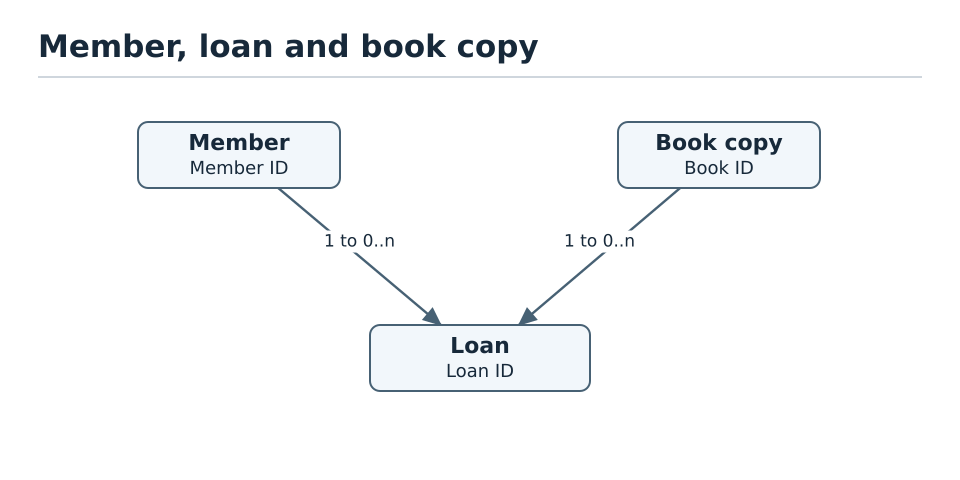

# M5-L1 – Tables, keys and relationships {#L1}

**Course area:** M5 – Databases and data models

**Level:** Lower secondary (core)

**Prior knowledge:** [M2-L4 – From a measured signal to a table](M2-L4.md)

**Learning objective:** Explain entities, attributes, keys and cardinalities in a lending model.

## Which copy is out on loan? {#S1}

The library has two copies of the same book. One is on the shelf and the other is on loan. If a table refers to both copies by their title alone, the library cannot assign a return to a particular copy. The data model needs separate identifiers for this task.

## Entities, attributes and keys {#S2}

An **entity** is something we treat as an individual object in the model, such as a specific copy. An **entity type** groups objects described in the same way. An **attribute** is a feature such as the title or the page count. In a table model, an entity type often corresponds to a table, an entity to a row and an attribute to a column.

A **primary key** uniquely identifies a row. It can consist of one or more columns. Several copies may have the same title, so an assigned copy ID is more suitable. A **foreign key** refers to a uniquely identifiable row in a table, often through that row's primary key.

**Cardinality** describes how many entities on one side of a relationship can be linked to an entity on the other. A member can borrow many copies on different dates. The same copy can be borrowed by several members over time. The direct relationship across the whole history is therefore **many-to-many** (n:m). A separate loan row represents each individual event.

{alt="A member and a book copy each have zero to many loans. Each loan belongs to exactly one member and one copy."}

## An example with a loan history {#S3}

We model each physical copy in its own book row. The example identifiers have no meaning outside the model.

| Member ID | Display name |
| --- | --- |
| 7 | Kim |
| 8 | Noor |

| Book ID | Title |
| --- | --- |
| 1 | Moss |
| 2 | Orbit |
| 3 | Signals |
| 4 | Atlas |

| Loan ID | Member ID | Book ID | Date |
| --- | --- | --- | --- |
| 10 | 7 | 1 | 2026-03-03 |
| 11 | 7 | 2 | 2026-03-04 |
| 12 | 8 | 1 | 2026-04-02 |

1. For loan 10, we use member ID 7 to find the display name Kim and book ID 1 to find the title Moss. The key of the loan is 10.
2. Loans 10 and 11 both belong to Kim. A member can have several loan rows.
3. Loans 10 and 12 both concern the same copy of Moss on different dates. A table that allows one book per member could not represent the full history.

Every loan points to exactly one member and one copy. In the other direction, a member or a copy can be associated with zero, one or several loan rows.

## Self-check {#S4}

### Exercises

1. The library adds another row with the title `Orbit`. May its book ID be 2? Which values may be shared?
2. Why is the pair of member ID and book ID alone unsuitable as the loan's primary key for this history?

### Solutions

1. Book ID 2 is already in use in the example. The additional copy gets a new book ID. The title may be the same.
2. A member may borrow the same copy on different dates. The pair would then recur. A separate loan ID distinguishes the individual events.

## Assumptions, errors and limitations {#S5}

The book row in this example identifies a physical copy, including a title that may recur. A larger library might place bibliographic data in a separate edition table. Key references check whether the book and member exist. By themselves, they cannot ensure that two loan periods for the same copy do not overlap. That requires additional rules and return dates.

## Summary {#S6}

A primary key identifies a row, and a foreign key links to a row. A separate relationship table supports repeated events and can store details such as the date of each event.

## Sources and further reading {#S7}

### Further reading (internal)

- [M5-L2 – SQL queries: filtering and sorting](M5-L2.md)

### Sources (external)

- [Gesellschaft für Informatik e. V. – Bildungsstandards Informatik für die Sekundarstufe I](https://informatikstandards.de/fileadmin/FA/IBS/user_upload/GI-Bildungsstandards_Informatik_Sek_I__2025__-_blau.pdf) · Lesson reference: §5.1 · Explain entities, attributes, keys and cardinalities in a lending model. · Last accessed: 2026-11-22 · Content verified: 2026-11-22
- [Bildungsserver Berlin-Brandenburg · Senatsverwaltung Berlin und MBJS Brandenburg – Rahmenlehrplan Teil C – Informatik, Wahlpflichtfach, Jahrgangsstufen 7–10](https://bildungsserver.berlin-brandenburg.de/fileadmin/bbb/unterricht/rahmenlehrplaene/Rahmenlehrplanprojekt/amtliche_Fassung/Teil_C_Informatik_2015_11_10.pdf) · Lesson reference: §3.7 · Explain entities, attributes, keys and cardinalities in a lending model. · Last accessed: 2026-11-22 · Content verified: 2026-11-22
- [Bayern – Staatsinstitut für Schulqualität und Bildungsforschung (ISB) – LehrplanPLUS Gymnasium 10 – Informatik](https://www.lehrplanplus.bayern.de/fachlehrplan/gymnasium/10/informatik) · Lesson reference: Inf10 LB1 · Explain entities, attributes, keys and cardinalities in a lending model. · Last accessed: 2026-11-22 · Content verified: 2026-11-22
