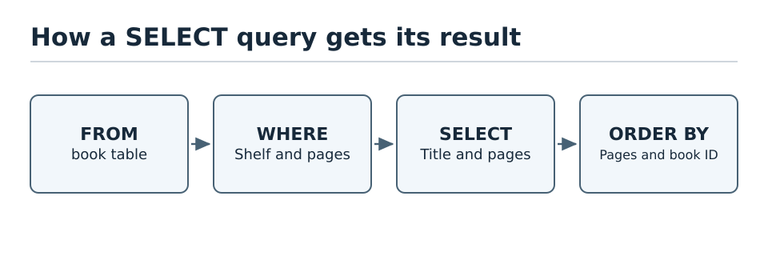

# M5-L2 – SQL queries: filtering and sorting {#L2}

**Course area:** M5 – Databases and data models

**Level:** Lower secondary (core)

**Prior knowledge:** [M5-L1 – Tables, keys and relationships](M5-L1.md)

**Learning objective:** Run SQLite queries using SELECT, WHERE and ORDER BY.

## Finding the right books in a large collection {#S1}

A reading group wants science books of at least 100 pages, with the longest books first. The library records the title, shelf and page count for each copy. Which SQL query returns exactly the list it needs?

## What the parts of SELECT mean {#S2}

**SQL** is a language used, among other things, to query relational databases. A query describes which rows and columns should be in the result. The database system chooses the steps needed to compute that result.

- `FROM` specifies the source table.
- `WHERE` tests a condition for each row. The row is kept if the condition is true.
- `SELECT` lists the columns or expressions to show in the result. This selection is called **projection**.
- `ORDER BY` controls the order of the result rows. `ASC` sorts in ascending order and `DESC` in descending order. Additional sort columns resolve ties from left to right.

The query is written with `SELECT` first. When explaining its result it is often easier to start with `FROM` and `WHERE`.

{alt="The query starts logically with the book table, filters by shelf and page count, projects title and pages, then orders by page count and book ID."}

## Checking rows on paper and querying in SQLite {#S3}

Create the four sample records in a fresh SQLite database. If the SQLite command line is installed, start it with `sqlite3 :memory:`. Run all SQL blocks in this lesson in the same session and start a new session for a new lesson. The titles, shelf names and page counts are fictional. Our assumption here is that all books in the table have a positive page count.

```sql
CREATE TABLE book (
    book_id INTEGER PRIMARY KEY,
    title TEXT NOT NULL,
    shelf TEXT NOT NULL,
    pages INTEGER NOT NULL CHECK (pages > 0)
);
INSERT INTO book VALUES
    (1, 'Moss', 'science', 120),
    (2, 'Orbit', 'fiction', 180),
    (3, 'Signals', 'science', 110),
    (4, 'Atlas', 'science', 120);
```

1. Check the shelf. `Orbit` is on the `fiction` shelf and is excluded.
2. `Moss`, `Signals` and `Atlas` all also satisfy `pages >= 100`.
3. Show the titles and page counts. `Moss` and `Atlas` each have 120 pages, so ascending book ID breaks their tie. `Signals` follows with 110 pages.

```sql
SELECT title, pages
FROM book
WHERE shelf = 'science' AND pages >= 100
ORDER BY pages DESC, book_id ASC;
```

| title | pages |
| --- | ---: |
| Moss | 120 |
| Atlas | 120 |
| Signals | 110 |

Using `book_id` to determine the order does not make it a visible result column.

## Self-check {#S4}

### Exercises

1. Write a query for the titles of science books with exactly 120 pages. Sort them by title in ascending order. Give the result.
2. Suppose `book_id ASC` is removed from the example query. Which row is still certain to come last? What ordering information is missing?

### Solutions

1. The query filters on `shelf = 'science'` and `pages = 120`. Sorting by title gives `Atlas`, then `Moss`.

2. `Signals` is still last because it has 110 pages. The remaining sort key does not determine the order of the two rows with 120 pages.

**Query for exercise 1**

```sql
SELECT title
FROM book
WHERE shelf = 'science' AND pages = 120
ORDER BY title ASC;
```

| title |
| --- |
| Atlas |
| Moss |

## Assumptions, errors and limitations {#S5}

Without `ORDER BY`, the output may appear in a familiar order. The query does not guarantee that order. In this example, text values go in single quotes. Text ordering depends on the database's comparison rules. When writing more complex conditions, use parentheses to make it clear which subconditions go together.

## Summary {#S6}

`WHERE` determines which rows remain. `SELECT` determines which values appear. `ORDER BY` with a unique final sort key gives a defined order in the sample data.

## Sources and further reading {#S7}

### Further reading (internal)

- [M5-L3 – SQL joins, groups and missing values](M5-L3.md)

### Sources (external)

- [Gesellschaft für Informatik e. V. – Bildungsstandards Informatik für die Sekundarstufe I](https://informatikstandards.de/fileadmin/FA/IBS/user_upload/GI-Bildungsstandards_Informatik_Sek_I__2025__-_blau.pdf) · Lesson reference: §5.1 · Run SQLite queries using SELECT, WHERE and ORDER BY. · Last accessed: 2026-11-22 · Content verified: 2026-11-22
- [SQLite – SELECT](https://www.sqlite.org/lang_select.html) · Lesson reference: Simple SELECT processing · Run SQLite queries using SELECT, WHERE and ORDER BY. · Last accessed: 2026-11-22 · Content verified: 2026-11-22
