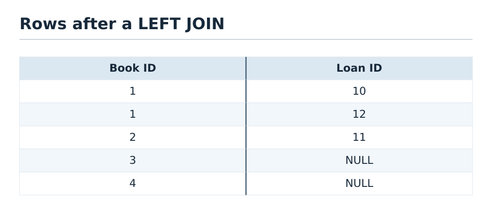

# M5-L3 – SQL joins, groups and missing values {#L3}

**Course area:** M5 – Databases and data models

**Level:** Upper secondary (basic level)

**Prior knowledge:** [M5-L2 – SQL queries: filtering and sorting](M5-L2.md)

**Learning objective:** Explain JOIN, GROUP BY and NULL through verified queries.

## Counting copies with no loans as well {#S1}

The library wants to know how many times each copy has been borrowed. Some copies have no entries in the loan table. Counting only there would make those copies disappear from the list. How can we keep them and show a count of zero?

## Joining and grouping rows {#S2}

A **join** combines rows from two tables according to a condition. `ON book.book_id = loan.book_id` associates a book row with every loan having that book ID. An **INNER JOIN** returns matching pairs. A **LEFT JOIN** also keeps every left-hand row without a match. In such a row, the right-hand columns are filled with `NULL`.

In SQL, `NULL` represents a missing or unknown value. A count of zero is the number `0`. The comparison `= NULL` does not return a true result. Use `IS NULL` to test whether a value is missing.

`GROUP BY` collects the joined rows into groups. `COUNT(*)` counts the rows in a group. `COUNT(loan.loan_id)` counts rows in the group that have a loan ID. The loan ID is a primary key, so a real loan row always has one.

{alt="Book 1 appears with loan IDs 10 and 12, book 2 with 11, and books 3 and 4 each with NULL."}

## Calculating the number of loans for each copy {#S3}

Run the following blocks in a fresh SQLite database. For this count, we only need the book ID, title and loan ID.

```sql
PRAGMA foreign_keys = ON;
CREATE TABLE book (
    book_id INTEGER PRIMARY KEY,
    title TEXT NOT NULL
);
CREATE TABLE loan (
    loan_id INTEGER PRIMARY KEY,
    book_id INTEGER NOT NULL REFERENCES book(book_id)
);
INSERT INTO book VALUES
    (1, 'Moss'), (2, 'Orbit'), (3, 'Signals'), (4, 'Atlas');
INSERT INTO loan VALUES (10, 1), (11, 2), (12, 1);
```

1. The join produces two rows for book 1, with loan IDs 10 and 12. It produces one row for book 2, with ID 11.
2. Book 3 and book 4 each produce one row with a missing loan ID.
3. Group by book ID and title so copies with the same title stay separate. Compare the two counts.

```sql
SELECT b.book_id, b.title, COUNT(*) AS joined_rows,
       COUNT(l.loan_id) AS loans
FROM book AS b
LEFT JOIN loan AS l ON b.book_id = l.book_id
GROUP BY b.book_id, b.title
ORDER BY b.book_id;
```

| book_id | title | joined_rows | loans |
| ---: | --- | ---: | ---: |
| 1 | Moss | 2 | 2 |
| 2 | Orbit | 1 | 1 |
| 3 | Signals | 1 | 0 |
| 4 | Atlas | 1 | 0 |

## Self-check {#S4}

### Exercises

1. How many rows would the grouped result have with an INNER JOIN? Which books would be missing?
2. Find every book without a loan by using a LEFT JOIN and `IS NULL`. Return each book ID and title, sorted by ID.

### Solutions

1. There would be two groups for Moss and Orbit. Signals and Atlas have no matching rows, so they would be absent.
2. After the join, test the loan ID using `IS NULL`. The two resulting rows are books 3 and 4.

**Query for exercise 2**

```sql
SELECT b.book_id, b.title
FROM book AS b
LEFT JOIN loan AS l ON b.book_id = l.book_id
WHERE l.loan_id IS NULL
ORDER BY b.book_id;
```

| book_id | title |
| ---: | --- |
| 3 | Signals |
| 4 | Atlas |

## Assumptions, errors and limitations {#S5}

A `WHERE` filter on a right-hand column may exclude the rows filled in by the LEFT JOIN. For example, `WHERE l.loan_id >= 12` drops the rows with missing values. To join only loans with IDs of at least 12 while also keeping all books, put the extra condition in `ON`. Every further join can multiply rows. Before counting, check what a row in the intermediate result represents.

## Summary {#S6}

A LEFT JOIN preserves left-hand rows without a match. Group by the unit you want to count for, which is the copy here. Count a column guaranteed to exist in real right-hand rows when you want to count genuine matches.

## Sources and further reading {#S7}

### Further reading (internal)

- [M5-L4 – Normalisation and data integrity](M5-L4.md)

### Sources (external)

- [Gesellschaft für Informatik e. V. – Bildungsstandards Informatik für die Sekundarstufe II](https://informatikstandards.de/fileadmin/GI/Projekte/Informatikstandards/Dokumente/Bildungsstandards_SII.pdf) · Lesson reference: §3.2.1 · Explain JOIN, GROUP BY and NULL through verified queries. · Last accessed: 2026-11-22 · Content verified: 2026-11-22
- [SQLite – SELECT](https://www.sqlite.org/lang_select.html) · Lesson reference: FROM clause processing · Explain JOIN, GROUP BY and NULL through verified queries. · Last accessed: 2026-11-22 · Content verified: 2026-11-22
