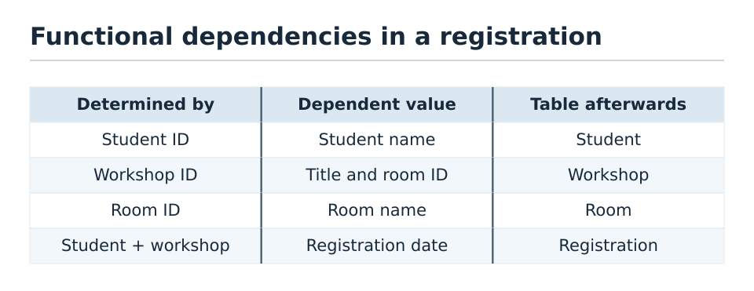

# M5-L4 – Normalisation and data integrity {#L4}

**Course area:** M5 – Databases and data models

**Level:** Upper secondary (advanced level)

**Prior knowledge:** [M5-L3 – SQL joins, groups and missing values](M5-L3.md)

**Learning objective:** Analyse redundancy and functional dependencies and justify a key-preserving decomposition.

## The same room name in many rows {#S1}

A project week has a list of registrations. Each row records a person's name, the workshop and the room name. When “Studio” is renamed “Atelier”, a helper updates only two of the three rows. How can we design a data model in which this kind of inconsistency cannot arise?

## What depends on which key {#S2}

A **functional dependency** `X → Y` holds when rows with the same values for `X` must always have the same values for `Y`. It follows from the domain rules for all valid data, rather than an incidental pattern in a sample. A **candidate key** is a minimal set of columns that uniquely identifies a row. It is minimal if you cannot drop any of its columns.

Assume that a person can register only once per workshop. Each workshop has exactly one room, and each room ID has exactly one name. Columns contain single values here. The sole candidate key of the large table is the pair `(student_id, workshop_id)`.

- **First normal form (1NF):** Here each cell has one value and no list of workshops.
- **Second normal form (2NF):** Every non-key attribute must depend on the whole candidate key, rather than only part of it. Yet the person's name already depends on `student_id` and the workshop details on `workshop_id`. We therefore move those details out of the registrations.
- **Third normal form (3NF):** In the remaining simple workshop schema, the room name depends on `room_id` and therefore on `workshop_id` indirectly. We put rooms in their own table.

{alt="Student ID determines the name, workshop ID determines the title and room ID, room ID determines the room name, and the student–workshop pair determines the registration date. Values then belong in student, workshop, room and registration."}

## Decomposing and rejoining the tables {#S3}

The registration keeps its two key columns and the registration date. We get the name and room through joins when needed. The following example runs in a fresh SQLite database.

```sql
PRAGMA foreign_keys = ON;
CREATE TABLE student (
    student_id INTEGER PRIMARY KEY,
    student_name TEXT NOT NULL
);
CREATE TABLE room (
    room_id INTEGER PRIMARY KEY,
    room_name TEXT NOT NULL
);
CREATE TABLE workshop (
    workshop_id INTEGER PRIMARY KEY,
    workshop_title TEXT NOT NULL,
    room_id INTEGER NOT NULL REFERENCES room(room_id)
);
CREATE TABLE registration (
    student_id INTEGER NOT NULL REFERENCES student(student_id),
    workshop_id INTEGER NOT NULL REFERENCES workshop(workshop_id),
    registered_on TEXT NOT NULL,
    PRIMARY KEY (student_id, workshop_id)
);
INSERT INTO student VALUES (7, 'Kim'), (8, 'Noor');
INSERT INTO room VALUES (5, 'Studio');
INSERT INTO workshop VALUES (20, 'Sound', 5), (21, 'Light', 5);
INSERT INTO registration VALUES
    (7, 20, '2026-03-03'), (7, 21, '2026-03-03'),
    (8, 20, '2026-03-04');
UPDATE room SET room_name = 'Atelier' WHERE room_id = 5;
```

```sql
SELECT s.student_name, w.workshop_title, r.room_name
FROM registration AS a
JOIN student AS s ON a.student_id = s.student_id
JOIN workshop AS w ON a.workshop_id = w.workshop_id
JOIN room AS r ON w.room_id = r.room_id
ORDER BY a.student_id, a.workshop_id;
```

| student_name | workshop_title | room_name |
| --- | --- | --- |
| Kim | Sound | Atelier |
| Kim | Light | Atelier |
| Noor | Sound | Atelier |

Each join finds exactly one row for the relevant identifier because primary keys are unique and the required foreign keys refer to existing entries. Selecting the remaining original columns would let you reconstruct every original registration.

## Self-check {#S4}

### Exercises

1. Why does `registered_on` belong to the registration rather than to the person or the workshop?
2. What happens in the example if Kim registers for Sound a second time? What happens if someone registers for workshop 99?

### Solutions

1. A person can register for different workshops on different days. Different people can book the same workshop on different days. In this model, the pair is needed to determine the day.
2. Kim and Sound form the existing pair `(7, 20)`. The composite primary key rejects the duplicate. A registration for workshop 99 violates the foreign key because the workshop is missing and foreign key checks are enabled.

## Assumptions, errors and limitations {#S5}

The 3NF explanation covers this case of straightforward keys and dependencies. In general, for every non-trivial functional dependency with one column on the right, either the left side must be a superkey or the column on the right must belong to a candidate key. A superkey uniquely identifies a row and may contain extra columns. Changed rules, such as using several rooms for a workshop, require a revised model. A SQL foreign key enforces only the domain rules expressed in the schema.

## Summary {#S6}

Split the table according to dependencies supported by the domain rules. Store the room name with the room and the registration under the complete registration key. Primary and foreign keys make it possible to rejoin the information unambiguously.

## Sources and further reading {#S7}

### Further reading (internal)

- [M6-L1 – Classes, objects and interfaces](M6-L1.md)

### Sources (external)

- [Senatsverwaltung für Bildung, Jugend und Familie Berlin – Rahmenlehrplan für die gymnasiale Oberstufe – Informatik, Teil C](https://www.berlin.de/sen/bildung/unterricht/faecher-rahmenlehrplaene/rahmenlehrplaene/rahmenlehrplan-informatik-go-teil-c.pdf?ts=1705017673) · Lesson reference: §3.2 · Analyse redundancy and functional dependencies and justify a key-preserving decomposition. · Last accessed: 2026-11-22 · Content verified: 2026-11-22
- [SQLite – SQLite Foreign Key Support](https://www.sqlite.org/foreignkeys.html) · Lesson reference: Foreign key support · Analyse redundancy and functional dependencies and justify a key-preserving decomposition. · Last accessed: 2026-11-22 · Content verified: 2026-11-22
- [Sibel Adalı, Rensselaer Polytechnic Institute – CSCI 4380 Database Systems: Lecture 5 Normalization](https://www.cs.rpi.edu/~sibel/csci4380/fall2026/lecture_notes/lecture5.html) · Lesson reference: Formal Definition, BCNF and 3NF · Analyse redundancy and functional dependencies and justify a key-preserving decomposition. · Last accessed: 2026-11-22 · Content verified: 2026-11-22
