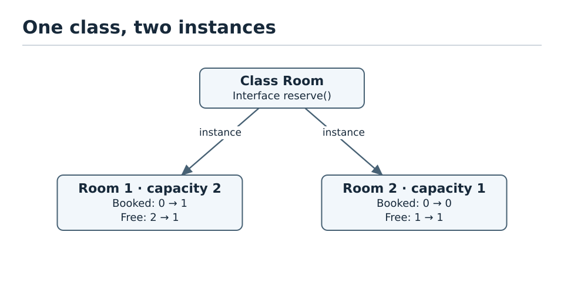

# M6-L1 – Classes, objects and interfaces {#L1}

**Course area:** M6 – Objects, algorithms and data structures

**Level:** Upper secondary (basic level)

**Prior knowledge:** [M3-L5 – Test cases and debugging](M3-L5.md)

**Learning objective:** Distinguish state, behaviour, instances and interfaces in an object model.

## Two rooms, one rule {#S1}

Groups can sign up for two workrooms at the computing fair. Room 1 has two places and room 2 has one. Both rooms follow the same rule: if no place is free, another booking is rejected. The rooms should respond independently. When someone books a place in room 1, the availability in room 2 stays the same. How can we write the shared rule once and use it for both rooms?

## Class, instance and interface {#S2}

In this model, a **class** describes the data and operations involved in booking a room. A concrete **object**, also called an **instance** of the class, has its own values. Its **state** comprises the capacity and the number of places already booked. Its **behaviour** consists of the supported operations used to inspect or change that state.

The **interface** is the agreement that calling code can rely on. Reading `free` gives the number of free places. `reserve()` returns `True` and books one free place or returns `False` and leaves the state unchanged. The internal representation can change as long as the promised behaviour is preserved.

{alt="Room creates room 1 with two places and room 2 with one. After booking one place in room 1, one place is booked there and none in room 2."}

An **invariant** is a condition that holds after the object has been created and after each operation has finished. Here the number of booked places always stays between zero and the room's capacity. **Encapsulation** here means arranging for the number of bookings to change through the defined operation. That lets us check the rule in one place.

## Run the state transition {#S3}

`Room(2)` creates a new instance and passes the capacity `2` to `__init__`. Within a method, Python associates `self` with the particular instance. `@property` lets callers read `free` like a value even though it is calculated from two stored values.

```python
class Room:
    def __init__(self, capacity):
        if type(capacity) is not int or capacity < 1:
            raise ValueError("capacity must be a positive integer")
        self._capacity = capacity
        self._booked = 0

    @property
    def free(self):
        return self._capacity - self._booked

    def reserve(self):
        if self.free == 0:
            return False
        self._booked += 1
        return True


first = Room(2)
second = Room(1)
assert (first.free, second.free) == (2, 1)
assert first.reserve() is True
assert (first.free, second.free) == (1, 1)
assert first.reserve() is True
assert (first.free, second.free) == (0, 1)
assert first.reserve() is False
assert (first.free, second.free) == (0, 1)
```

Before the first booking, room 1 has zero booked places. The first two calls raise that count to one and two. On the third call, `free` is zero, so the method returns before the assignment. Room 2 has zero booked places throughout.

## Check your understanding {#S4}

### Exercises

1. Use the two rooms in their final state from the example and call `second.reserve()` twice. Give the return values and the number of free places.
2. Design an interface for cancelling a booking. What precondition does a successful cancellation require to preserve the invariant?
3. After `alias = first`, a place is cancelled through `first`. What must `alias.free` show afterwards if the cancellation succeeds?

### Solutions

1. The first call returns `True` and the second returns `False`. Both rooms then have zero free places. Only the first call changes room 2.
2. `cancel()` can return `True` and decrease the number of booked places by one if at least one place is booked. If there are zero bookings, the method returns `False` and leaves the state as it is.
3. `alias.free` shows one free place. The assignment creates no second instance and both names refer to the same object.

## Mistakes and limitations {#S5}

The underscore in `_booked` signals internal use in Python. Assignment from outside the class remains possible and can break the invariant. The example assumes that calls occur one after another. With simultaneous requests, checking and changing the count require suitable synchronisation. Two numbers are also insufficient to represent named bookings or a schedule.

## Summary {#S6}

A class brings shared rules together and each new instance has its own state. A testable interface specifies return values and effects. For each state-changing method, test the successful case and at least one edge case in which the state should stay unchanged.

## Sources and further reading {#S7}

### Further reading (internal)

- [M6-L2 – Linear and binary search](M6-L2.md)

### Sources (external)

- [Gesellschaft für Informatik e. V. – Bildungsstandards Informatik für die Sekundarstufe II](https://informatikstandards.de/fileadmin/GI/Projekte/Informatikstandards/Dokumente/Bildungsstandards_SII.pdf) · Lesson reference: §3.2.2 · Distinguish state, behaviour, instances and interfaces in an object model. · Last accessed: 2026-11-22 · Content verified: 2026-11-22
- [Python Software Foundation – Python Tutorial – Classes](https://docs.python.org/3.13/tutorial/classes.html) · Lesson reference: §9.3 · Distinguish state, behaviour, instances and interfaces in an object model. · Last accessed: 2026-11-22 · Content verified: 2026-11-22
