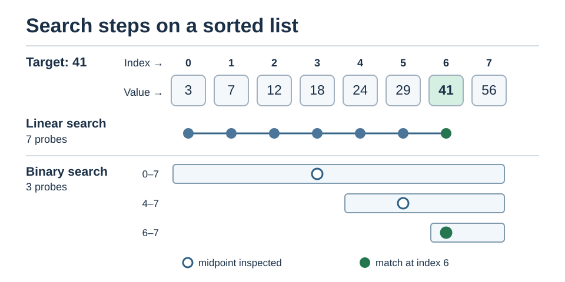

# M6-L2 – Linear and binary search {#L2}

**Course area:** M6 – Objects, algorithms and data structures

**Level:** Upper secondary (basic level)

**Prior knowledge:** [M3-L5 – Test cases and debugging](M3-L5.md)

**Learning objective:** Compare search invariants and preconditions and count logical steps.

## Which entries must be checked? {#S1}

A list records the numbers of material boxes that have been handed in. A particular number may be present or missing. Without a guarantee of order, we read the entries from the start and stop at the first match. When the list is sorted in ascending order, checking its middle can rule out a large portion of the remaining positions.

## Two search algorithms and their invariants {#S2}

**Linear search** checks one entry after another. Before checking position `i`, the target has not appeared at any earlier position. Reaching the end therefore establishes that the target is absent. This **invariant**, a statement that holds again at each check, requires no sorting.

Our **binary search** uses a closed search interval from `lo` to `hi`, including both endpoints. Before each step, if there is a match anywhere, at least one match lies in this interval. When the middle value is smaller than the target, we can rule out the midpoint and every position to its left. When it is larger, we rule out the midpoint and the right-hand portion. This reasoning requires the values to be sorted in ascending order. When `lo > hi`, the interval is empty.

{alt="For target 41, linear search checks indices 0 through 6. Binary search visits intervals 0 through 7, 4 through 7 and 6 through 7, checking midpoints 3, 5 and 6 respectively."}

The example counts **list positions inspected**. A step can use more than one comparison operator in Python. For lists that support direct access by index, the worst-case number of steps grows linearly or logarithmically with length `n`, respectively. We write this as $O(n)$ and $O(\log n)$. Linear search may need every entry. After an unsuccessful binary search step, at most about half the candidates remain.

## Trace a match and a miss {#S3}

The list `[3, 7, 12, 18, 24, 29, 41, 56]` has indices 0 to 7. To find 41, linear search reads the seven positions from 0 through 6. Binary search follows these intervals:

| Interval | Midpoint | Value | Result |
| --- | --- | --- | --- |
| 0–7 | 3 | 18 | Continue in 4–7 |
| 4–7 | 5 | 29 | Continue in 6–7 |
| 6–7 | 6 | 41 | Match |

For a target of 20, binary search checks 18, 29 and 24. After the final check, the interval from 4 to 3 is empty. Both functions return an index on success or `None` otherwise, together with the number of positions inspected.

```python
def linear_search(values, goal):
    for i, value in enumerate(values):
        if value == goal:
            return i, i + 1
    return None, len(values)


def binary_search(values, goal):
    lo, hi = 0, len(values) - 1
    probes = 0
    while lo <= hi:
        mid = (lo + hi) // 2
        value = values[mid]
        probes += 1
        if value == goal:
            return mid, probes
        if value < goal:
            lo = mid + 1
        else:
            hi = mid - 1
    return None, probes


values = [3, 7, 12, 18, 24, 29, 41, 56]
assert linear_search(values, 41) == (6, 7)
assert binary_search(values, 41) == (6, 3)
assert linear_search(values, 20) == (None, 8)
assert binary_search(values, 20) == (None, 3)
assert binary_search([], 20) == (None, 0)
```

## Check your understanding {#S4}

### Exercises

1. Search for 56 using binary search. Give the values inspected and the return value.
2. Use `[2, 9, 4]` and target 4 to show why binary search needs its precondition.
3. How do the guarantees of these implementations differ when the target occurs more than once?

### Solutions

1. The values inspected are 18, 29, 41 and 56. The return value is `(7, 4)`.
2. The midpoint value 9 causes binary search to discard the right-hand portion containing the match. After inspecting 2, binary search returns `(None, 2)`. Linear search returns `(2, 3)`.
3. Linear search returns the first matching index. The binary search shown returns any matching index, depending on which midpoints are selected.

## Mistakes and limitations {#S5}

After a miss at the midpoint, exclude that position. Using `lo = mid` could leave the upper half the same size, for example when there is only one candidate. Sorting an unsorted list first requires extra work and can change the original position numbers. Index `0` is a valid match. Use `index is not None` to test whether a match was found.

## Summary {#S6}

Linear search works without ordering. Binary search relies on sorted input and direct positional access, and shrinks its interval after every unsuccessful check. To compare the algorithms in an experiment, state the target, the return contract and what you are counting.

## Sources and further reading {#S7}

### Further reading (internal)

- [M6-L3 – Sorting, correctness and cost](M6-L3.md)

### Sources (external)

- [Gesellschaft für Informatik e. V. – Bildungsstandards Informatik für die Sekundarstufe II](https://informatikstandards.de/fileadmin/GI/Projekte/Informatikstandards/Dokumente/Bildungsstandards_SII.pdf) · Lesson reference: §3.2.2 · Compare search invariants and preconditions and count logical steps. · Last accessed: 2026-11-22 · Content verified: 2026-11-22
- [Senatsverwaltung für Bildung, Jugend und Familie Berlin – Rahmenlehrplan für die gymnasiale Oberstufe – Informatik, Teil C](https://www.berlin.de/sen/bildung/unterricht/faecher-rahmenlehrplaene/rahmenlehrplaene/rahmenlehrplan-informatik-go-teil-c.pdf?ts=1705017673) · Lesson reference: §4 · Compare search invariants and preconditions and count logical steps. · Last accessed: 2026-11-22 · Content verified: 2026-11-22
