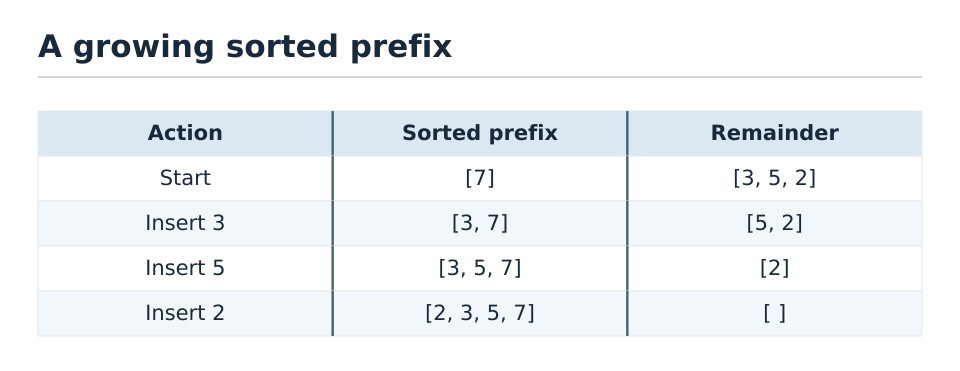

# M6-L3 – Sorting, correctness and cost {#L3}

**Course area:** M6 – Objects, algorithms and data structures

**Level:** Upper secondary (basic level)

**Prior knowledge:** [M6-L2 – Linear and binary search](M6-L2.md)

**Learning objective:** Trace insertion sort and justify its quadratic worst-case cost.

## Put an unordered sequence in order {#S1}

When filing index cards, you can take a card from an unsorted pile and put it in its place among the cards that are already in order. A list can be sorted using the same idea. In **insertion sort**, the ordered prefix grows from left to right.

## The sorted prefix {#S2}

A **prefix** is a contiguous initial part of a list. Just before round `i`, the prefix at positions `0` through `i - 1` is sorted in ascending order and contains exactly the elements processed so far. This is the loop invariant. Before the first round that prefix contains one position. A single element is already sorted.

Each round saves the new value at position `i` temporarily. Larger values in the prefix are shifted one position to the right, working from right to left. The saved value goes into the resulting gap. Since all values remaining farther to the left are no larger than the new value, the extended prefix is sorted. Keeping the value in a separate variable prevents it from being lost as elements move. After the final round, the prefix covers the entire list. This establishes both the order and the preservation of the elements.

{alt="The prefix grows from 7 to 3 and 7, then to 3, 5 and 7. After the final step, the full list is 2, 3, 5 and 7."}

The number of shifts depends on the input. When the list is already sorted, each round checks the immediate neighbour and shifts nothing. With a strictly descending input, round `i` must shift all `i` previous values. In a list of `n` entries, this gives $1 + 2 + \cdots + (n-1) = n(n-1)/2$ shifts. Worst-case growth is quadratic, or $O(n^2)$.

## Insert values and count the steps {#S3}

For `[7, 3, 5, 2]`, the sorted portion starts with `[7]`. The rest of the sort proceeds as follows:

| New value | Prefix afterwards | Shifts | Value comparisons |
| --- | --- | --- | --- |
| 3 | [3, 7] | 1 | 1 |
| 5 | [3, 5, 7] | 1 | 2 |
| 2 | [2, 3, 5, 7] | 3 | 3 |

When inserting 5, the algorithm first shifts 7. The second value comparison, against 3, ends the search for the insertion position. We count only comparisons between list values and leave index checks out of the count. The Python example works on a copy of the supplied list.

```python
def insertion_sort(values):
    items = values.copy()
    comparisons = shifts = 0
    for i in range(1, len(items)):
        value = items[i]
        j = i
        while j > 0:
            comparisons += 1
            if items[j - 1] <= value:
                break
            items[j] = items[j - 1]
            shifts += 1
            j -= 1
        items[j] = value
    return items, shifts, comparisons


values = [7, 3, 5, 2]
assert insertion_sort(values) == ([2, 3, 5, 7], 5, 6)
assert values == [7, 3, 5, 2]
assert insertion_sort([]) == ([], 0, 0)
assert insertion_sort([1, 2, 3, 4]) == ([1, 2, 3, 4], 0, 3)
assert insertion_sort([4, 3, 2, 1]) == ([1, 2, 3, 4], 6, 6)
```

## Check your understanding {#S4}

### Exercises

1. Sort `[4, 1, 3]`. Give both new prefixes and the total numbers of shifts and value comparisons.
2. Why does the result contain exactly the same elements as the original list? Why would checking only that the result is in ascending order be insufficient?
3. Two labelled cards A and B have the same sort key of 5. A appears first. What does the stopping condition mean for their relative order?

### Solutions

1. The prefixes are `[1, 4]` and `[1, 3, 4]`. Each round needs one shift, and the rounds use 1 and 2 comparisons respectively. The totals are 2 shifts and 3 comparisons.
2. Each round saves the current element, shifts other elements into the gap and puts the saved element back. A sequence such as `[1, 1, 1]` is in order but might still contain the wrong elements.
3. A remains before B. The algorithm stops shifting when it encounters an equal value. Preserving the relative order of equal keys is called **stability**. An implementation for labelled cards would need to compare their keys.

## Mistakes and limitations {#S5}

Comparisons and shifts contribute to cost in different ways. Here a shift means an assignment from the sorted prefix. Placing the saved value is a separate assignment and is excluded from this count. Because the function makes a copy at the start, it uses extra memory for the result list.

## Summary {#S6}

Insertion sort preserves a sorted prefix and extends it one item at a time. The invariant establishes correctness and the sum of shifts in the worst case explains the quadratic cost. The sorted list can then be used for [binary search](M6-L2.md).

## Sources and further reading {#S7}

### Further reading (internal)

- [M6-L4 – Recursion, stacks and queues](M6-L4.md)

### Sources (external)

- [Gesellschaft für Informatik e. V. – Bildungsstandards Informatik für die Sekundarstufe II](https://informatikstandards.de/fileadmin/GI/Projekte/Informatikstandards/Dokumente/Bildungsstandards_SII.pdf) · Lesson reference: §3.2.2 · Trace insertion sort and justify its quadratic worst-case cost. · Last accessed: 2026-11-22 · Content verified: 2026-11-22
- [Rheinland-Pfalz, Lehrplan Informatik für Grund- und Leistungsfach in der Mainzer Studienstufe – Lehrplan Informatik – Grund- und Leistungsfach, gymnasiale Oberstufe](https://bildung.rlp.de/fileadmin/user_upload/informatik.bildung.rlp.de/Lehrplaene/Informatik_LP_SekII.pdf) · Lesson reference: §3.4, S. 54–55 · Trace insertion sort and justify its quadratic worst-case cost. · Last accessed: 2026-11-22 · Content verified: 2026-11-22
