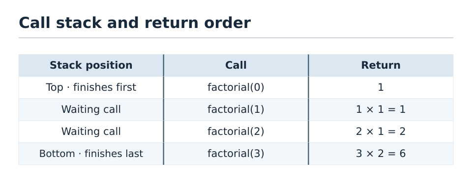

# M6-L4 – Recursion, stacks and queues {#L4}

**Course area:** M6 – Objects, algorithms and data structures

**Level:** Upper secondary (basic level)

**Prior knowledge:** [M6-L3 – Sorting, correctness and cost](M6-L3.md)

**Learning objective:** Connect base cases and recursive progress with LIFO and FIFO interfaces.

## Make the problem smaller one step at a time {#S1}

How many different orders are possible for three different robot models? There are three choices for the first place. After making that choice, two models remain and their orders can be counted in the same way. Each choice leaves a smaller task. The question is which input lets us give an immediate answer.

## Recursion, stacks and queues {#S2}

In **recursion**, a function calls itself on a smaller subproblem. The **base case** returns a result directly. With valid inputs, the recursive step must make progress towards the base case. For the number of possible orders, the rule is $n! = n \cdot (n-1)!$ for $n>0$. There is exactly one way to arrange the empty sequence, so $0!=1$.

A call that has not finished retains its local values and the point at which it should resume. To trace calls, we can represent those records on a **call stack**. The most recent call finishes first and is removed. This is LIFO (*last in, first out*). A **queue** removes the entry that has been waiting the longest first. This is FIFO (*first in, first out*).

{alt="The calls start at 3 and continue through 2 and 1 down to 0. Then the stack returns 1, 1, 2 and 6 from top to bottom."}

An **abstract data type** specifies the operations offered and their guarantees independently of how items are stored. A stack, for example, adds and removes at the same end. A FIFO queue adds at the back and removes from the front. A Python list can implement a stack. With a list as a queue, removing the front item can require moving many entries. Python supplies `collections.deque` for frequent removals at either end.

## Trace calls and returns {#S3}

`factorial(3)` waits for `factorial(2)`, that call waits for `factorial(1)`, and that call waits for `factorial(0)`. From bottom to top, the stack then holds arguments 3, 2, 1 and 0. The top call returns 1. The waiting calls then return $1\cdot1=1$, $2\cdot1=2$ and $3\cdot2=6$, in that order.

```python
from collections import deque


def factorial(n):
    if type(n) is not int or n < 0:
        raise ValueError("n must be a nonnegative integer")
    if n == 0:
        return 1
    return n * factorial(n - 1)


assert factorial(0) == 1
assert factorial(3) == 6
assert factorial(5) == 120

stack = ["A", "B"]
stack.append("C")
assert stack.pop() == "C"
assert stack == ["A", "B"]

queue = deque(["A", "B"])
queue.append("C")
assert queue.popleft() == "A"
assert list(queue) == ["B", "C"]
```

Both collections start with A before B and accept C. The stack then removes C. The queue removes A. The top of the call stack is the end where new calls are added.

## Check your understanding {#S4}

### Exercises

1. Write down the call arguments for `factorial(2)` and the returned values in chronological order.
2. A and B arrive in an empty queue. Remove one job. C then arrives and a further job is removed. Give the two jobs removed and the one that remains. Repeat with a stack.
3. An incorrect function makes the recursive call `factorial(n + 1)`. Why does a correctly written base case fail to help with positive starting values?

### Solutions

1. The call arguments are 2, 1, 0. The returns are 1 from the call with 0, 1 from the call with 1, and 2 from the call with 2, in that order.
2. FIFO removes A and B. C remains. LIFO removes B first and C after it has been added. A remains.
3. The argument increases instead of moving down towards zero. The base case is never reached. In Python the call eventually fails at the recursion depth limit.

## Mistakes and limitations {#S5}

Even correct recursion can hit Python's recursion depth limit on large inputs. A loop with a running product can also compute a factorial. Large integers can take time and memory even in the loop version. An interface for either a stack or a queue must also specify what happens when someone tries to remove an item from an empty collection. Here `pop()` and `popleft()` raise `IndexError`.

## Summary {#S6}

For recursion, check the base case, progress towards it and the way the partial result is combined. On the call stack, the most recent call finishes first. A FIFO queue removes the oldest waiting entry. In [breadth-first search](M6-L5.md), this ordering determines which vertices are examined next.

## Sources and further reading {#S7}

### Further reading (internal)

- [M6-L5 – Trees, graphs and breadth-first search](M6-L5.md)

### Sources (external)

- [Gesellschaft für Informatik e. V. – Bildungsstandards Informatik für die Sekundarstufe II](https://informatikstandards.de/fileadmin/GI/Projekte/Informatikstandards/Dokumente/Bildungsstandards_SII.pdf) · Lesson reference: §3.2.2 · Connect base cases and recursive progress with LIFO and FIFO interfaces. · Last accessed: 2026-11-22 · Content verified: 2026-11-22
- [Bayern – Staatsinstitut für Schulqualität und Bildungsforschung (ISB) – LehrplanPLUS Gymnasium 12 – Informatik, grundlegendes Niveau](https://www.lehrplanplus.bayern.de/fachlehrplan/gymnasium/12/informatik/grundlegend) · Lesson reference: Inf12 LB1–3 · Connect base cases and recursive progress with LIFO and FIFO interfaces. · Last accessed: 2026-11-22 · Content verified: 2026-11-22
- [Rheinland-Pfalz, Lehrplan Informatik für Grund- und Leistungsfach in der Mainzer Studienstufe – Lehrplan Informatik – Grund- und Leistungsfach, gymnasiale Oberstufe](https://bildung.rlp.de/fileadmin/user_upload/informatik.bildung.rlp.de/Lehrplaene/Informatik_LP_SekII.pdf) · Lesson reference: §3.4 · Connect base cases and recursive progress with LIFO and FIFO interfaces. · Last accessed: 2026-11-22 · Content verified: 2026-11-22
