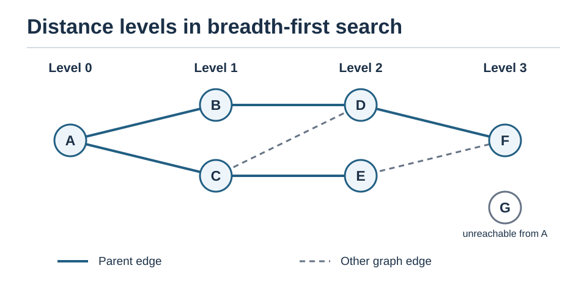

# M6-L5 – Trees, graphs and breadth-first search {#L5}

**Course area:** M6 – Objects, algorithms and data structures

**Level:** Upper secondary (advanced level)

**Prior knowledge:** [M6-L4 – Recursion, stacks and queues](M6-L4.md)

**Learning objective:** Represent graphs and explain shortest unweighted paths using breadth-first search.

## Find a route with few steps {#S1}

A map of the school grounds shows locations and direct footpaths. We want to travel from entrance A to room F in as few segments as possible. A search can inspect A's immediate neighbours before reaching places two or more steps away. The map needs no distances because the task counts transitions.

## Graphs, trees and distance levels {#S2}

A **graph** consists of **vertices**, here locations, and **edges**, here connections. If every path can be used in both directions, the graph is undirected. An **adjacency list** records which other vertices are directly accessible from each vertex. In an undirected representation, each connection is recorded at both endpoints.

A **tree** is a connected undirected graph with no cycle. Between any two vertices, it has exactly one simple path, which repeats no vertex. In **breadth-first search**, a general graph gives rise to a tree containing the vertices reachable from the start. Each newly discovered vertex gets exactly one predecessor, called its **parent**. The original graph can have extra edges and cycles.

{alt="A is at level 0, B and C at level 1, D and E at level 2, and F at level 3. Solid edges join A with B and C, B with D, C with E, and D with F. Extra edges C–D and E–F are dashed. G is unreachable."}

The search stores discovered vertices in a FIFO queue. Starting vertex A opens level 0. When the search removes a vertex at level $d$, it marks its undiscovered neighbours and adds them at the back as level $d+1$. They wait behind any remaining vertices at level $d$. Each level is therefore fully processed before the next one gets its turn. A vertex first reached at level $d+1$ has a path with $d+1$ edges via its parent. If a shorter path existed, its penultimate vertex would have triggered the discovery from an earlier level. The level therefore gives the smallest number of edges from the start.

## Derive the visit order and a path {#S3}

Neighbours are examined in the order in which they appear in the lists. New vertices are marked **when they are added**. This keeps D from entering the queue twice even though both B and C connect to it.

| Removed | Newly discovered | Queue afterwards |
| --- | --- | --- |
| A | B, C | B, C |
| B | D | C, D |
| C | E | D, E |
| D | F | E, F |
| E | none | F |
| F | none | empty |

```python
from collections import deque


def breadth_first(graph, start):
    parents = {start: None}
    order = []
    queue = deque([start])
    while queue:
        node = queue.popleft()
        order.append(node)
        for neighbor in graph[node]:
            if neighbor not in parents:
                parents[neighbor] = node
                queue.append(neighbor)
    return parents, order


def path_to(parents, target):
    if target not in parents:
        return None
    path = []
    while target is not None:
        path.append(target)
        target = parents[target]
    return path[::-1]


graph = {
    "A": ["B", "C"],
    "B": ["A", "D"],
    "C": ["A", "D", "E"],
    "D": ["B", "C", "F"],
    "E": ["C", "F"],
    "F": ["D", "E"],
    "G": [],
}
parents, order = breadth_first(graph, "A")
assert order == ["A", "B", "C", "D", "E", "F"]
assert path_to(parents, "F") == ["A", "B", "D", "F"]
assert path_to(parents, "A") == ["A"]
assert path_to(parents, "G") is None
```

From F, the parents lead backwards to D, B and A. Reversing this order gives A–B–D–F with three edges. G is a single vertex with no connections to the rest of the graph. It does not appear in the results of the search from A.

## Check your understanding {#S4}

### Exercises

1. Start at B. Give the removal order and the path found from B to F.
2. Reverse the order of B and C only in A's adjacency list. Which path to F results, and what stays the same?
3. What extra information could make the shortest route from A to F different from the route with the fewest edges?

### Solutions

1. The order is B, A, D, C, F, E. B adds D directly and D later discovers F. The path B–D–F has two edges.
2. A now adds C before B. C discovers D ahead of B and also discovers E in the same step. D is removed before E and discovers F first. The path A–C–D–F still has three edges.
3. If path lengths or travel times are assigned as edge weights, a path with more edges can have a shorter total distance or travel time. Unweighted breadth-first search guarantees only the minimum number of edges in that case.

## Mistakes and limitations {#S5}

Marking a vertex only at removal can cause duplicate entries in the queue. The immediate entry in `parents` prevents this even when cycles exist. The implementation expects both the start and every listed neighbour to exist as keys. Vertex labels are strings. `None` is reserved for the start vertex’s missing parent. With adjacency lists and fast dictionary access on average, we can account for both time and storage: every reachable vertex is visited once and every associated adjacency entry is examined once. Thus the time is $O(|V|+|E|)$ for reachable vertices and edges and the additional storage is $O(|V|)$, excluding the input and reconstruction of further paths.

## Summary {#S6}

Breadth-first search inspects reachable vertices in increasing order of distance measured in edges. Marking vertices when they join the queue prevents duplicate visits. Parents form a tree from which we can read a path with the fewest edges. If paths of equal length exist, the particular path found can depend on adjacency order.

## Sources and further reading {#S7}

### Further reading (internal)

- [M7-L1 – Propositional logic and digital circuits](M7-L1.md)

### Sources (external)

- [Gesellschaft für Informatik e. V. – Bildungsstandards Informatik für die Sekundarstufe II](https://informatikstandards.de/fileadmin/GI/Projekte/Informatikstandards/Dokumente/Bildungsstandards_SII.pdf) · Lesson reference: §3.2.2 · Represent graphs and explain shortest unweighted paths using breadth-first search. · Last accessed: 2026-11-22 · Content verified: 2026-11-22
- [Bayern – Staatsinstitut für Schulqualität und Bildungsforschung (ISB) – LehrplanPLUS Gymnasium 11 – Informatik (NTG)](https://www.lehrplanplus.bayern.de/fachlehrplan/gymnasium/11/informatik/ntg) · Lesson reference: Inf11 LB1 (BFS mit Adjazenzmatrix) · Represent graphs and explain shortest unweighted paths using breadth-first search. · Last accessed: 2026-11-22 · Content verified: 2026-11-22
- [Bayern – Staatsinstitut für Schulqualität und Bildungsforschung (ISB) – LehrplanPLUS Gymnasium 12 – Informatik, grundlegendes Niveau](https://www.lehrplanplus.bayern.de/fachlehrplan/gymnasium/12/informatik/grundlegend) · Lesson reference: Inf12 LB1–3 · Represent graphs and explain shortest unweighted paths using breadth-first search. · Last accessed: 2026-11-22 · Content verified: 2026-11-22
