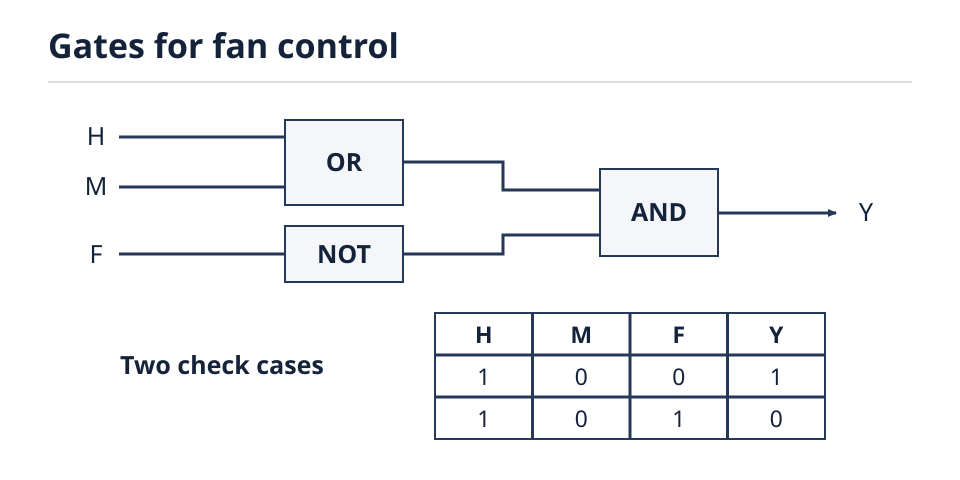

# M7-L1 – Propositional logic and digital circuits {#L1}

**Course area:** M7 – Logic, automata and computability

**Level:** Upper secondary (basic level)

**Prior knowledge:** [M3-L2 – Conditions and branches](M3-L2.md)

**Learning objective:** Represent Boolean expressions with truth tables and gates.

## When should a fan start? {#S1}

A fan should start when a room is too warm or when someone requests ventilation. If a fault sensor reports a fault, the fan should stay off in this model. These three inputs determine the output. To apply the rule consistently, we express it as a logical formula, check its truth table and draw the corresponding circuit.

## Truth values and gates {#S2}

A **proposition** has a truth value in the model: true ($1$) or false ($0$). We use $H$ for a heat request, $M$ for a manual request and $F$ for a fault. A **gate** implements a logical operation using digital signals.

- **AND** ($\land$) outputs $1$ when both inputs are $1$.
- **OR** ($\lor$) outputs $1$ when at least one input is $1$. That includes the case where both inputs are $1$.
- **NOT** ($\neg$) reverses a single truth value.

The output is $Y=(H\lor M)\land\neg F$. The parentheses make the first sub-decision visible. The circuit calculates $H\lor M$ and $\neg F$ in parallel. Both results feed the AND gate.

{alt="H and M feed OR. F feeds NOT. Both gates feed AND with output Y. With H=1 and M=0, a fault gives Y=0 and no fault gives Y=1."}

## Checking all inputs to the control rule {#S3}

Three independent inputs give $2^3=8$ assignments. List them in binary order and evaluate the sub-expressions first. In `011`, a manual request is active and a fault has been reported. Therefore $H\lor M=1$, $\neg F=0$ and $Y=0$.

| $H$ | $M$ | $F$ | $H\lor M$ | $\neg F$ | $Y$ |
| --- | --- | --- | --- | --- | --- |
| 0 | 0 | 0 | 0 | 1 | 0 |
| 0 | 0 | 1 | 0 | 0 | 0 |
| 0 | 1 | 0 | 1 | 1 | 1 |
| 0 | 1 | 1 | 1 | 0 | 0 |
| 1 | 0 | 0 | 1 | 1 | 1 |
| 1 | 0 | 1 | 1 | 0 | 0 |
| 1 | 1 | 0 | 1 | 1 | 1 |
| 1 | 1 | 1 | 1 | 0 | 0 |

In Python, `and`, `or` and `not` represent these operations on Boolean values. The example checks all eight cases.

```python
from itertools import product

inputs = list(product((False, True), repeat=3))
outputs = [(hot or manual) and not fault for hot, manual, fault in inputs]
assert outputs == [False, False, True, False, True, False, True, False]
assert [int(value) for value in outputs] == [0, 0, 1, 0, 1, 0, 1, 0]
```

## Check your understanding {#S4}

### Exercises

1. Find the output for `110`. Use this row to explain why exclusive OR would change the model.
2. Express $\neg Y$ using only $\neg H$, $\neg M$ and $F$, combined with AND and OR. Check the result using `101`.
3. Add an enable input $E$. Which formula turns the fan on exactly when the original condition holds and the enable input is active?

### Solutions

1. $H\lor M=1$ and $\neg F=1$. Therefore $Y=1$. Exclusive OR would give $0$ for two true inputs and leave the output off.
2. De Morgan's laws give $\neg(A\land B)=\neg A\lor\neg B$ and $\neg(A\lor B)=\neg A\land\neg B$. Thus $\neg Y=(\neg H\land\neg M)\lor F$. For `101`, $F=1$ makes the negation true. The table agrees and gives $Y=0$.
3. $Y'=(H\lor M)\land\neg F\land E$. Whenever $E=0$, the output is $0$ regardless of the other inputs.

## Assumptions and common errors {#S5}

All variables here are truth values available at the same time. A sensor needs a threshold rule to turn a measured value into such a signal. The truth table accounts for neither delays nor stored earlier states. Real circuits require separate checks for propagation delay, voltage levels and failure modes. The table alone cannot establish that a circuit is safe.

When a negation covers several inputs, De Morgan's laws also change the operators. In a Python expression involving integers, `&` and `|` are bitwise operators. The spelling with `and`, `or` and `not` is clearer for the Boolean inputs used here.

## Summary {#S6}

A truth table assigns one output to every combination of inputs. The structure of the formula shows how the basic gates are connected. When decisions also depend on earlier inputs, the model needs a state.

## Sources and further reading {#S7}

### Further reading (internal)

- [M7-L2 – States and finite automata](M7-L2.md)

### Sources (external)

- [Gesellschaft für Informatik e. V. – Bildungsstandards Informatik für die Sekundarstufe II](https://informatikstandards.de/fileadmin/GI/Projekte/Informatikstandards/Dokumente/Bildungsstandards_SII.pdf) · Lesson reference: §3.2.4 · Represent Boolean expressions with truth tables and gates. · Last accessed: 2026-11-22 · Content verified: 2026-11-22
- [Bayern – Staatsinstitut für Schulqualität und Bildungsforschung (ISB) – LehrplanPLUS Gymnasium 12 – Informatik, erhöhtes Niveau](https://www.lehrplanplus.bayern.de/fachlehrplan/gymnasium/12/informatik/erhoeht) · Lesson reference: Inf12 LB4 · Represent Boolean expressions with truth tables and gates. · Last accessed: 2026-11-22 · Content verified: 2026-11-22
