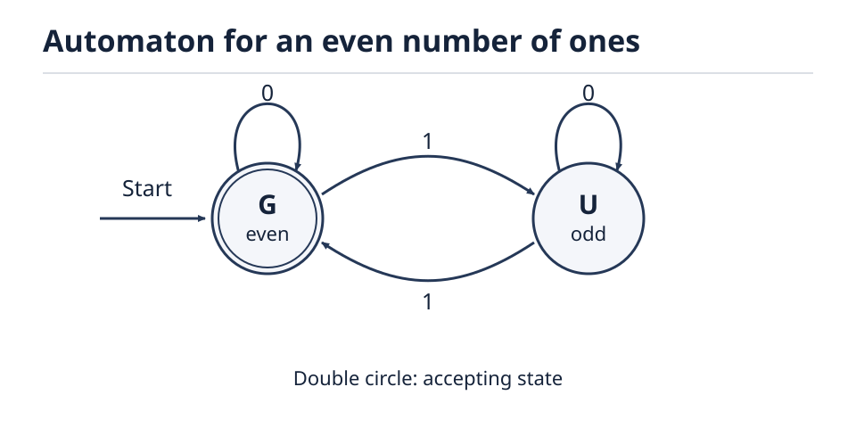

# M7-L2 – States and finite automata {#L2}

**Course area:** M7 – Logic, automata and computability

**Level:** Upper secondary (basic level)

**Prior knowledge:** [M1-L3 – Precise instructions, flowcharts and blocks](M1-L3.md)

**Learning objective:** Design a transition table and a deterministic finite automaton for input strings.

## A two-option note {#S1}

Imagine reading a long sequence of zeros and ones. At the end, you must decide whether it contains an even number of ones. Counting them would work. Keeping track of whether the count is even or odd is enough. A zero leaves the answer unchanged, and a one flips it. Two states capture all the memory that this task requires.

## From behaviour to a finite automaton {#S2}

A **deterministic finite automaton** (DFA) has finitely many states and a finite **alphabet** of allowed input symbols. A **word** is a finite sequence of these symbols. The automaton begins in its **start state** and reads the word from left to right. Every combination of state and input symbol has exactly one next state. If the automaton is in an **accepting state** after the last symbol, it accepts the word.

For the alphabet $\{0,1\}$, choose $G$ and $U$: an even or odd number of ones read so far. $G$ is the start state and the only accepting state. The double circle in the diagram denotes acceptance if the input ends there.

{alt="Start arrow into the double-ringed state G. G and U have loops labelled 0. Each directed link between G and U is labelled 1."}

| State | on `0` | on `1` |
| --- | --- | --- |
| $G$ | $G$ | $U$ |
| $U$ | $U$ | $G$ |

## Tracing a word and testing the rule {#S3}

For the word `10110` the path is $G \to U \to U \to G \to U \to U$. The final state $U$ rejects the word. There are indeed three ones. For `101`, the same table leads to $G$, so the automaton accepts the word.

The **invariant** is a statement that holds after reading every prefix: the state names the parity of the number of ones seen so far, meaning whether it is even or odd. Initially it holds because zero ones have been read. On reading `0`, neither the count of ones nor the state changes. On reading `1`, both the parity and the state change. The invariant therefore holds to the end.

```python
transitions = {
    ("E", "0"): "E", ("E", "1"): "O",
    ("O", "0"): "O", ("O", "1"): "E",
}

def accepts(word):
    state = "E"
    for symbol in word:
        if symbol not in ("0", "1"):
            raise ValueError("Expected a binary word")
        state = transitions[state, symbol]
    return state == "E"

assert not accepts("10110")
assert accepts("101")
assert accepts("")
assert accepts("000")
```

The code uses `E` for `even` and `O` for `odd`. The states have the same meanings as $G$ and $U$.

## Check your understanding {#S4}

### Exercises

1. Trace `0111`, `000` and the empty word $\varepsilon$. Which words are accepted?
2. Change only the set of accepting states so that exactly the words with an odd number of ones are accepted. Does the automaton still accept the empty word?
3. A classmate proposes moving from $U$ to $G$ on `0`. Find a shortest possible counterexample.

### Solutions

1. `0111` visits $G,U,G,U$, ending in $U$, and is rejected. `000` stays in $G$ and is accepted. The empty word triggers no transition. $G$ accepts it.
2. Make $U$ the only accepting state. Transitions and the start state stay the same. The empty word still ends in $G$ and is now rejected.
3. `10` must be rejected because it contains exactly one one. The proposed change takes the automaton from $G$ via $U$ to $G$ and accepts it. Words of length zero or one never use the altered transition.

## Assumptions and common errors {#S5}

An accepting state can have outgoing transitions. Acceptance is decided only at the end of the word. A symbol such as `2` falls outside the alphabet and is an input error in the example. `0` is a valid word of length one, whereas $\varepsilon$ has length zero. A DFA stores only its current state. This limitation matters for tasks that need unbounded memory.

## Summary {#S6}

States summarise the features of the input read so far that matter for the future. The diagram and table describe the same transition function. The set of accepted words leads to the concept of a formal language.

## Sources and further reading {#S7}

### Further reading (internal)

- [M7-L3 – Formal languages, patterns and grammar](M7-L3.md)

### Sources (external)

- [Gesellschaft für Informatik e. V. – Bildungsstandards Informatik für die Sekundarstufe II](https://informatikstandards.de/fileadmin/GI/Projekte/Informatikstandards/Dokumente/Bildungsstandards_SII.pdf) · Lesson reference: §3.2.3 · Design a transition table and a deterministic finite automaton for input strings. · Last accessed: 2026-11-22 · Content verified: 2026-11-22
- [Bayern – Staatsinstitut für Schulqualität und Bildungsforschung (ISB) – LehrplanPLUS Gymnasium 13 – Informatik, grundlegendes Niveau](https://www.lehrplanplus.bayern.de/fachlehrplan/gymnasium/13/informatik/grundlegend) · Lesson reference: Inf13 LB1 · Design a transition table and a deterministic finite automaton for input strings. · Last accessed: 2026-11-22 · Content verified: 2026-11-22
