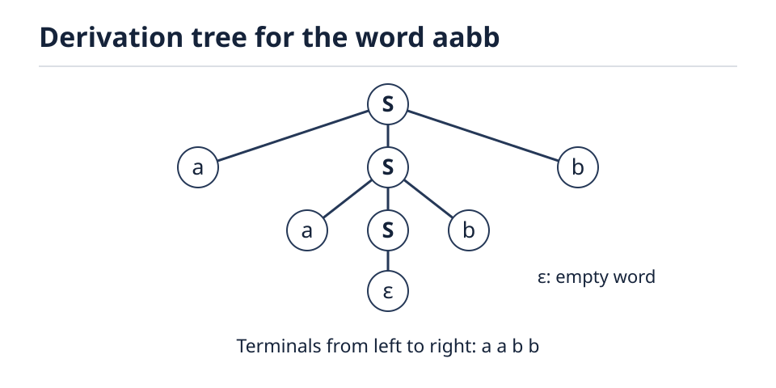

# M7-L3 – Formal languages, patterns and grammar {#L3}

**Course area:** M7 – Logic, automata and computability

**Level:** Upper secondary (basic level)

**Prior knowledge:** [M7-L2 – States and finite automata](M7-L2.md)

**Learning objective:** Compare syntax, semantics, regular patterns and a small grammar.

## Which sequence is allowed? {#S1}

A program reads a short command from a device. Before executing the command, it needs to decide whether the text has the agreed form. “Does the sequence belong to the allowed set?” and “What does this command mean?” are separate questions. The first needs a description of the structure.

## Alphabet, language and grammar {#S2}

An **alphabet** $\Sigma$ consists of the available symbols, for example $\{a,b\}$. $\Sigma^*$ contains all finite words over that alphabet, including the empty word $\varepsilon$. A **formal language** $L$ is a subset of $\Sigma^*$. Its **syntax** determines which words are allowed. **Semantics** concerns the meaning assigned to valid words, such as an action or a numeric value.

The regular pattern `a*b` here stands for zero or more copies of `a` followed by exactly one `b`. A DFA can recognise this pattern. It reads any number of `a` symbols in the start state, enters the accepting state on the first `b` and goes to a rejecting sink state on any subsequent symbol. It stays in the sink on either alphabet symbol.

A **grammar** describes a language using replacement rules. It starts from the start symbol $S$. A **nonterminal** such as $S$ can be replaced according to a rule. **Terminals** such as `a` and `b` appear unchanged in the finished word. The rules $S\to aSb$ and $S\to\varepsilon$ add one `a` on the left and one `b` on the right as a pair. Derivation trees show which rule creates a branch and where replacement ends.

{alt="The start symbol S branches into a, S and b. The middle S branches again into a, S and b. The innermost S derives the empty word ε."}

## Deriving a word step by step {#S3}

The derivation for `aabb` is $S \Rightarrow aSb \Rightarrow aaSbb \Rightarrow aabb$. The first two steps use the first rule. The last step replaces the remaining $S$ with the empty word. Every word generated this way therefore contains $n$ copies of `a` followed by $n$ copies of `b`, for any non-negative integer $n$. Conversely, applying the enclosing rule exactly $n$ times and then the empty rule produces $a^n b^n$. The word `abab` is excluded despite the equal counts. Every enclosing replacement places all `a` symbols to the left of all `b` symbols.

The grammar generates a **non-regular language**. Among the $k+1$ prefixes $\varepsilon,a,\ldots,a^k$, a DFA with $k$ states must take at least two distinct prefixes, $a^i$ and $a^j$, to the same state. After appending $i$ copies of `b` to each, it gives the same result for both words. However, it would need to accept $a^i b^i$ and reject $a^j b^i$. That is impossible.

## Check your understanding {#S4}

### Exercises

1. Which of `b`, `aab`, `abb`, `aa` and $\varepsilon$ match the pattern `a*b` in full?
2. Derive `aaabbb` from the grammar. Then check `aabbb` and `ba`.
3. How do the rules change if at least one pair of `a` and `b` must occur?

### Solutions

1. `b` matches because zero copies of `a` are allowed, and `aab` matches with two copies. `abb` has one `b` too many. `aa` and $\varepsilon$ lack a final `b`.
2. $S\Rightarrow aSb\Rightarrow aaSbb\Rightarrow aaaSbbb\Rightarrow aaabbb$. `aabbb` has different counts of `a` and `b`. `ba` puts them in the wrong order. Both are excluded.
3. Replace the empty rule with $S\to ab$. The final replacement always forms the first pair. Further pairs can be added using $S\to aSb$ as before.

## Assumptions and common errors {#S5}

The pattern is applied to the **whole** word. Searching for a matching substring would give a different result for `abb` because it contains `ab`. In a formal word, $\varepsilon$ denotes length zero. The symbol $\varepsilon$ itself is not entered. Pattern libraries for programming languages can provide extra features beyond the regular languages studied here.

## Summary {#S6}

Finite automata can recognise regular languages. A grammar specifies valid words through derivation steps and can also generate non-regular languages. The choice of model depends on which dependencies the words must express.

## Sources and further reading {#S7}

### Further reading (internal)

- [M7-L4 – The Turing model and limits of computability](M7-L4.md)

### Sources (external)

- [Gesellschaft für Informatik e. V. – Bildungsstandards Informatik für die Sekundarstufe II](https://informatikstandards.de/fileadmin/GI/Projekte/Informatikstandards/Dokumente/Bildungsstandards_SII.pdf) · Lesson reference: §3.2.3 · Compare syntax, semantics, regular patterns and a small grammar. · Last accessed: 2026-11-22 · Content verified: 2026-11-22
- [Senatsverwaltung für Bildung, Jugend und Familie Berlin – Rahmenlehrplan für die gymnasiale Oberstufe – Informatik, Teil C](https://www.berlin.de/sen/bildung/unterricht/faecher-rahmenlehrplaene/rahmenlehrplaene/rahmenlehrplan-informatik-go-teil-c.pdf?ts=1705017673) · Lesson reference: §3.2 · Compare syntax, semantics, regular patterns and a small grammar. · Last accessed: 2026-11-22 · Content verified: 2026-11-22
