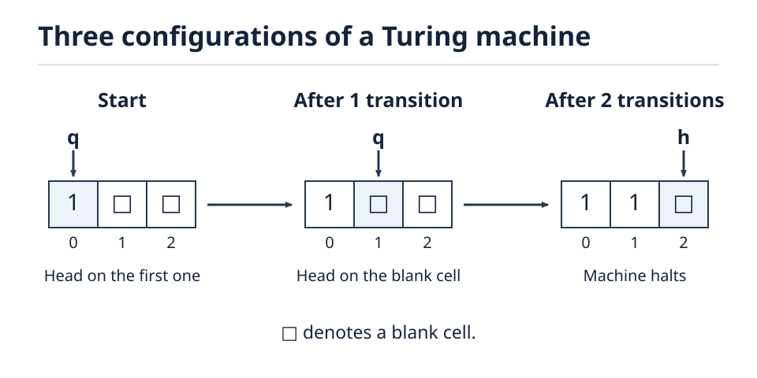

# M7-L4 – The Turing model and limits of computability {#L4}

**Course area:** M7 – Logic, automata and computability

**Level:** Upper secondary (advanced level)

**Prior knowledge:** [M7-L3 – Formal languages, patterns and grammar](M7-L3.md)

**Learning objective:** Simulate an abstract machine and distinguish the halting problem from time cost.

## What can a computer decide in principle? {#S1}

A program has been running for several minutes without a result. The input might require a lot of time, or the program might never stop. Can another program distinguish these cases for **every** input and program? We use a simple model of executable programs to state that question precisely.

## A tape with changeable contents {#S2}

A **Turing machine** has finitely many control states and a tape made of cells. Its head reads and overwrites one cell at a time. A rule for the current state and symbol can specify what to write, where to move the head and which state comes next. The tape in the model can extend as far as needed. Any finite run still visits only finitely many cells. We use a tape unbounded to the right, start at position $0$ and need only rightward moves in the example. The symbol $\square$ denotes a blank cell.

A **halting state** ends the run. A **configuration** records the tape contents, head position and control state at one moment. Existing tape contents can be overwritten later. This feature distinguishes the model from a DFA that reads its input word once.

{alt="Initially q is at position 0 and the tape is 1 blank blank. After one transition q is at position 1, with the tape unchanged. Then h is at position 2, with tape 1 1 blank."}

## Adding one tally mark {#S3}

We encode a number $n$ as $n$ consecutive ones starting at position $0$. A machine for adding $1$ uses a scanning state $q$ and a halting state $h$.

| State | Read | Write | Move | Next state |
| --- | --- | --- | --- | --- |
| $q$ | 1 | 1 | right | $q$ |
| $q$ | $\square$ | 1 | right | $h$ |

1. For input `1`, the head starts at position $0$. The machine reads `1`, leaves the cell unchanged and moves right to position $1$.
2. The cell at position $1$ is blank. The machine writes `1`, moves to position $2$ and enters its halting state. The written tape word is `11`, which encodes $2$.

In general the machine scans past $n$ ones and writes to one blank cell. The run takes $n+1$ transitions. That gives a concrete time estimate for this procedure.

## Check your understanding {#S4}

### Exercises

1. Trace the same machine on the empty input word and on `11`. Give the output word and number of transitions for each run.
2. Suppose a program $H(p,x)$ always says “yes” correctly if program $p$ halts on input $x$, and “no” otherwise. Define $D(p)$ so that it runs forever when $H(p,p)$ says “yes” and halts when $H(p,p)$ says “no”. What would $H(D,D)$ have to return?
3. Why can a time limit of 1000 steps not replace $H$ from exercise 2?

### Solutions

1. For empty input, the first transition writes a one and halts. The result is `1` after one transition. On `11`, the machine scans past two ones and writes a third. The result is `111` after three transitions.
2. Programs are encoded as input words, so the description of $D$ itself can be its input. If the answer is “yes”, $D(D)$ runs forever and the answer is wrong. If the answer is “no”, $D(D)$ halts and the answer is also wrong. The assumed general decider $H$ that always halts therefore cannot exist.
3. A program that halts after step 1001 would still be running after 1000 steps. The time limit only detects that the run did not end within that window.

## Assumptions and common errors {#S5}

The contradiction concerns a procedure for **all** programs and inputs. Termination can often be proved for specific programs. In the tape example, each scanning step moves the head one cell further and the first blank cell ends the scan. Very long running time and undecidability are different properties. The unbounded tape is a modelling assumption about available storage, separate from the properties of any physical device.

## Summary {#S6}

A Turing machine describes a run in terms of transition rules and configurations. The halting problem places a fundamental limit on general automatic decisions. For decidable problems, we can then ask how the cost grows with the input.

## Sources and further reading {#S7}

### Further reading (internal)

- [M7-L5 – Growth rates, P and NP](M7-L5.md)

### Sources (external)

- [Gesellschaft für Informatik e. V. – Bildungsstandards Informatik für die Sekundarstufe II](https://informatikstandards.de/fileadmin/GI/Projekte/Informatikstandards/Dokumente/Bildungsstandards_SII.pdf) · Lesson reference: §3.2.3 · Simulate an abstract machine and distinguish the halting problem from time cost. · Last accessed: 2026-11-22 · Content verified: 2026-11-22
- [Senatsverwaltung für Bildung, Jugend und Familie Berlin – Rahmenlehrplan für die gymnasiale Oberstufe – Informatik, Teil C](https://www.berlin.de/sen/bildung/unterricht/faecher-rahmenlehrplaene/rahmenlehrplaene/rahmenlehrplan-informatik-go-teil-c.pdf?ts=1705017673) · Lesson reference: §3.2 · Simulate an abstract machine and distinguish the halting problem from time cost. · Last accessed: 2026-11-22 · Content verified: 2026-11-22
- [Bayern – Staatsinstitut für Schulqualität und Bildungsforschung (ISB) – LehrplanPLUS Gymnasium 13 – Informatik, erhöhtes Niveau](https://www.lehrplanplus.bayern.de/fachlehrplan/gymnasium/13/informatik/erhoeht) · Lesson reference: Inf13 LB3–4 · Simulate an abstract machine and distinguish the halting problem from time cost. · Last accessed: 2026-11-22 · Content verified: 2026-11-22
- [Bayern – Staatsinstitut für Schulqualität und Bildungsforschung (ISB) – LehrplanPLUS Gymnasium 13 – Informatik, grundlegendes Niveau](https://www.lehrplanplus.bayern.de/fachlehrplan/gymnasium/13/informatik/grundlegend) · Lesson reference: Inf13 LB3 · Simulate an abstract machine and distinguish the halting problem from time cost. · Last accessed: 2026-11-22 · Content verified: 2026-11-22
