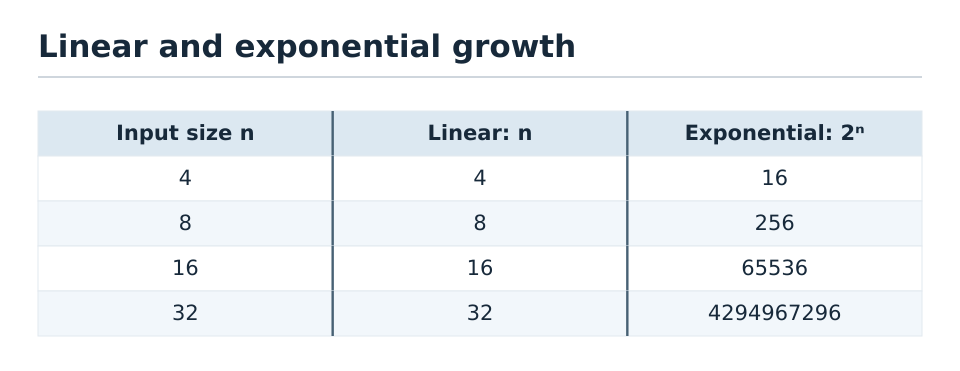

# M7-L5 – Growth rates, P and NP {#L5}

**Course area:** M7 – Logic, automata and computability

**Level:** Upper secondary (advanced level)

**Prior knowledge:** [M6-L5 – Trees, graphs and breadth-first search](M6-L5.md), [M7-L4 – The Turing model and limits of computability](M7-L4.md)

**Learning objective:** Distinguish practical runtime, asymptotic upper bounds and decision problem classes.

## Does the work grow with the input or with its possibilities? {#S1}

A planner needs to decide whether someone can visit every place in a network of paths exactly once. A proposed order is quick to check. Trying all possible orders can take many attempts. These activities, **deciding** and **checking a proposed solution**, lead to different notions of complexity.

## Cost as a function of input size {#S2}

For an algorithm, first choose an input size $n$ and an elementary operation, such as a comparison. In linear search, $n$ counts the list elements and the worst case compares $n$ values. Iterating over all subsets of a set of $n$ elements examines $2^n$ candidates. Each element may be included or left out.

The notation $T(n)\in O(g(n))$ describes an asymptotic upper bound. There are constants $c>0$ and $n_0$ such that $T(n)\leq c\,g(n)$ for all $n\geq n_0$. The bound abstracts away constant factors and small inputs. For example, $5n+7$ is in $O(n)$ and also in $O(n^2)$. The first is more informative here. An upper bound alone gives neither exact seconds nor an automatic matching lower bound.

{alt="At n equal to 4, 8, 16 and 32, n grows linearly. Two to the power of n takes the values 16, 256, 65536 and 4294967296."}

## Decision problems and certificates {#S3}

A **decision problem** has a “yes” or “no” answer for each valid input. If input size is measured by the length of its agreed encoding:

- **P** contains decision problems with a deterministic decision algorithm that runs in polynomial time in the worst case. Its cost is bounded above by $O(n^k)$ for some fixed exponent $k$.
- **NP** contains decision problems whose yes-instances have certificates of polynomially bounded length that a deterministic algorithm can check in polynomial time. No certificate may be accepted for a no-instance.
- $P \subseteq NP$. A decider can dispense with the certificate and decide the input directly. Whether $P=NP$ is an open question.

In an undirected network, a certificate for a **Hamiltonian path** lists all places in visit order. Given edges $\{A,B\}$, $\{B,C\}$ and $\{C,D\}$ and vertices $A,B,C,D$, `A B C D` passes. The length is correct, each place occurs exactly once and each consecutive pair is connected. `A C B D` fails at $\{A,C\}$. A checker can build the adjacency matrix once and then look up each consecutive pair. Building the matrix and checking the vertices also take only polynomial time overall. That explains why the decision problem lies in NP. It does not supply an algorithm that decides every instance of the problem in polynomial time.

## Check your understanding {#S4}

### Exercises

1. Compare $n$ and $2^n$ for $n=16$ and $n=32$. Why are these numbers separate from measured running times?
2. In a star with centre $A$, the only edges are $\{A,B\}$, $\{A,C\}$ and $\{A,D\}$. Check `B A C D` as a certificate. Can any order visit all four places exactly once?
3. Why does the cost of the “try all orders” procedure fail to prove that the Hamiltonian path problem lies outside P?

### Solutions

1. The linear model gives $16$ and $32$. The exponential model gives $65536$ and $4294967296$. The actual time depends in part on the work per counted operation and on the implementation.
2. The edge $\{C,D\}$ is missing. Each of the three outer vertices has only one neighbour, so it can occur only at an endpoint of a Hamiltonian path. There are only two endpoints, though. No order passes.
3. The cost describes one particular algorithm. To show that the **problem** lies outside P, one would have to rule out any polynomial-time decider for it.

## Assumptions and common errors {#S5}

“NP” stands for “nondeterministic polynomial”. Membership in NP does not force a problem to require non-polynomial time. Problems in P are also in NP. A polynomial algorithm can still be impractical when its exponent or constant costs are high. Comparing two algorithms fairly requires the same input encoding, counted operations and choice of case.

## Summary {#S6}

Growth rates describe the cost of a procedure on large inputs. P and NP classify decision problems in terms of efficient decisions and efficient checking of yes-certificates, respectively.

## Sources and further reading {#S7}

### Further reading (internal)

- [M7-L6 – Declarative rules and queries](M7-L6.md)

### Sources (external)

- [Bayern – Staatsinstitut für Schulqualität und Bildungsforschung (ISB) – LehrplanPLUS Gymnasium 13 – Informatik, erhöhtes Niveau](https://www.lehrplanplus.bayern.de/fachlehrplan/gymnasium/13/informatik/erhoeht) · Lesson reference: Inf13 LB4 · Distinguish practical runtime, asymptotic upper bounds and decision problem classes. · Last accessed: 2026-11-22 · Content verified: 2026-11-22
- [Gesellschaft für Informatik e. V. – Bildungsstandards Informatik für die Sekundarstufe II](https://informatikstandards.de/fileadmin/GI/Projekte/Informatikstandards/Dokumente/Bildungsstandards_SII.pdf) · Lesson reference: §3.2.2 · Distinguish practical runtime, asymptotic upper bounds and decision problem classes. · Last accessed: 2026-11-22 · Content verified: 2026-11-22
- [Clay Mathematics Institute – P vs NP](https://www.claymath.org/millennium/p-vs-np/) · Lesson reference: Problem statement · Distinguish practical runtime, asymptotic upper bounds and decision problem classes. · Last accessed: 2026-11-22 · Content verified: 2026-11-22
