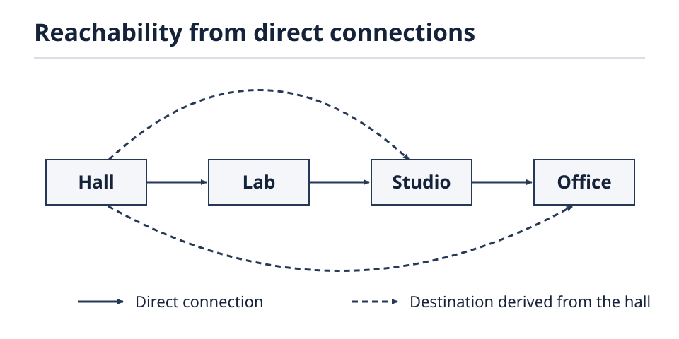

# M7-L6 – Declarative rules and queries {#L6}

**Course area:** M7 – Logic, automata and computability

**Level:** Upper secondary (advanced level)

**Prior knowledge:** [M5-L3 – SQL joins, groups and missing values](M5-L3.md), [M7-L3 – Formal languages, patterns and grammar](M7-L3.md)

**Learning objective:** Use facts, rules and queries to express a declarative model.

## Deriving connections from known facts {#S1}

A building directory contains direct connections between named rooms. You want to ask which rooms you can reach from the hall using at least one connection. In an imperative program, you specify which intermediate steps the computer takes. Here you describe which facts are available and under what conditions a further relation holds. An evaluator derives the matching statements.

## Facts, rules and queries {#S2}

A **fact** describes a known relation, for example `edge(hall, lab)`. A **rule** has a head and a body. Its head gives the fact that can be derived. Each subgoal in the body must hold for the same assignment of variables. A **query** asks whether one particular fact can be derived, or asks for all assignments to its free variables. In the Datalog-style notation below, uppercase letters denote variables, `:-` means “holds if”, and a comma in the body joins conditions with AND.

```text
edge(hall, lab).
edge(lab, studio).
edge(studio, office).

reachable(X, Y) :- edge(X, Y).
reachable(X, Z) :- reachable(X, Y), edge(Y, Z).
```

The base rule includes each direct connection. The recursive rule extends a previously derived path by one edge. The rules consider directed walks of at least one edge. A room may occur more than once. A simple path, by contrast, would forbid repeated vertices.

{alt="Three solid arrows link hall, lab, studio and office in that order. Dashed arrows lead from the hall to the studio and to the office."}

## Deriving facts until the fixed point {#S3}

1. The base rule gives `reachable(hall, lab)`. It also gives `reachable(lab, studio)` and `reachable(studio, office)`.
2. In the recursive rule, set $X=\text{hall}$, $Y=\text{lab}$ and $Z=\text{studio}$. Both conditions in the body hold, so `reachable(hall, studio)` follows. This also gives `reachable(lab, office)` when applied to the other connection.
3. From `reachable(hall, studio)` and `edge(studio, office)` we derive `reachable(hall, office)`. No new pair appears after this. The set is at the **fixed point**. Applying the rules again leaves it unchanged.

The query `reachable(hall, Z)` returns `lab`, `studio` and `office`. A `JOIN` query can combine exactly two direct edges:

```sql
CREATE TABLE edge (src TEXT NOT NULL, dst TEXT NOT NULL);
INSERT INTO edge VALUES ('hall', 'lab'), ('lab', 'studio'), ('studio', 'office');
SELECT e2.dst
FROM edge AS e1 JOIN edge AS e2 ON e1.dst = e2.src
WHERE e1.src = 'hall'
ORDER BY e2.dst;
```

| dst |
| --- |
| studio |

In this example, the two-edge join gives neither the direct path to the lab nor the three-edge path to the office. A recursive SQL query can express reachability for arbitrary path lengths. This comparison shows the difference between one fixed join and repeatedly applying the rule.

## Check your understanding {#S4}

### Exercises

1. What does `reachable(lab, Z)` return using the original facts? Justify the results using the rules.
2. Add `edge(office, hall)`. Can `reachable(hall, hall)` now be derived? Why can evaluation still finish?
3. Which condition ensures that the two edges in the SQL join form a continuous path?

### Solutions

1. `studio` follows directly from `edge(lab, studio)`. `office` follows because the path to the studio extends via `edge(studio, office)`.
2. Yes. From the hall, a path goes through the lab, studio and office back to the hall. There are only four room names and at most $4^2=16$ distinct ordered pairs. A set stores each pair only once. After finitely many additions, there are no new pairs.
3. `e1.dst = e2.src` connects the first edge's destination with the second edge's source. `e1.src = 'hall'` additionally fixes the starting place.

## Assumptions and common errors {#S5}

The fact `edge(hall, lab)` does not imply a reverse edge. A relation that cannot be derived from the given facts remains unsupported in this model. The real-world data may be incomplete. The fixed-point argument assumes finitely many room names, positive rules and storage without duplicates. Other rule systems may generate values or use different evaluation strategies.

## Summary {#S6}

Declarative rules specify the conditions for a solution. Base cases and a recursive rule generate the set of directed reachability pairs by repeated derivation. The join shown combines exactly two edges.

## Sources and further reading {#S7}

### Further reading (internal)

- [M8-L1 – Sensors, control and simulation](M8-L1.md)

### Sources (external)

- [Rheinland-Pfalz, Lehrplan Informatik für Grund- und Leistungsfach in der Mainzer Studienstufe – Lehrplan Informatik – Grund- und Leistungsfach, gymnasiale Oberstufe](https://bildung.rlp.de/fileadmin/user_upload/informatik.bildung.rlp.de/Lehrplaene/Informatik_LP_SekII.pdf) · Lesson reference: §3.7 · Use facts, rules and queries to express a declarative model. · Last accessed: 2026-11-22 · Content verified: 2026-11-22
- [Bayern – Staatsinstitut für Schulqualität und Bildungsforschung (ISB) – LehrplanPLUS Gymnasium 13 – Informatik, erhöhtes Niveau](https://www.lehrplanplus.bayern.de/fachlehrplan/gymnasium/13/informatik/erhoeht) · Lesson reference: Inf13 LB2 · Use facts, rules and queries to express a declarative model. · Last accessed: 2026-11-22 · Content verified: 2026-11-22
- [SQLite – The WITH Clause](https://www.sqlite.org/lang_with.html) · Lesson reference: Recursive Common Table Expressions · Use facts, rules and queries to express a declarative model. · Last accessed: 2026-11-22 · Content verified: 2026-11-22
