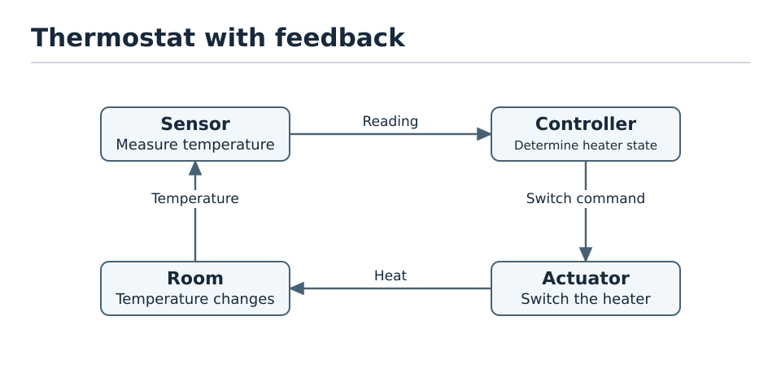

# M8-L1 – Sensors, control and simulation {#L1}

**Course area:** M8 – Systems and software projects

**Level:** Upper secondary (basic level)

**Prior knowledge:** [M2-L4 – From a measured signal to a table](M2-L4.md), [M7-L2 – States and finite automata](M7-L2.md)

**Learning objective:** Model sensor-actuator feedback and explain the limits of discrete simulation.

## When should a heater switch? {#S1}

A heater in a model room should switch according to measured temperatures. A rule with just one threshold might switch it on and off frequently when readings are close to that threshold. A **thermostat with hysteresis** uses two thresholds. The gap between them lets the heater retain its state for a while as readings fluctuate.

## Measuring, deciding and acting {#S2}

The **sensor** measures the temperature and reports a value. The **controller** knows the thresholds and the previous heater state. It determines the next state. The **actuator** carries out that decision by switching the heater on or off. This can change the room temperature. The next measurement captures the new conditions. The return path from the result to the next decision is called **feedback**.

{alt="Room temperature determines the sensor reading. The reading reaches the controller. The controller switches the heater, which affects the room."}

In this model, the heater switches on at or below 19 °C and off at or above 22 °C. Between those thresholds it retains its previous state. At 20 °C it can therefore be on while the room warms up or off while the room cools down. A reading within the band alone cannot predict the state.

## Testing with readings and with feedback {#S3}

Given a fixed series of readings, the heater starts off. At 20 °C it stays off. At 19 °C it turns on, then stays on at 20 °C and 21 °C. At 22 °C it switches off, stays off at 21 °C and switches back on at 19 °C.

A **discrete simulation** generates its own subsequent temperatures in equal time steps. We assume that the temperature rises by 2 °C per step while the heater is on and otherwise falls by 1 °C. The next reading occurs only after this change. The program checks the fixed readings and then simulates eight steps with feedback.

```python
def next_state(reading, heating):
    if reading <= 19:
        return True
    if reading >= 22:
        return False
    return heating


readings = [20, 19, 20, 21, 22, 21, 19]
heating = False
states = []
for reading in readings:
    heating = next_state(reading, heating)
    states.append(heating)
assert states == [False, True, True, True, False, False, True]

temperature = 19
heating = False
trace = []
for _ in range(8):
    heating = next_state(temperature, heating)
    trace.append((temperature, heating))
    temperature += 2 if heating else -1
assert trace == [
    (19, True), (21, True), (23, False), (22, False),
    (21, False), (20, False), (19, True), (21, True),
]
```

In the simulation, while the heater is on, one step takes the temperature from 21 °C to 23 °C. That reading switches the heater off at the next sampling instant.

## Self-check {#S4}

### Exercises

1. Start with the heater on. A sensor reports 20 °C, 22 °C, 21 °C and 19 °C in sequence. Record the state after each reading.
2. Change the model so that the temperature rises by 1 °C per step while the heater is on. Starting at 19 °C, at what temperature and in which step does the heater first switch off? Count from step 0.

### Solutions

1. On, off, off, on. The readings 20 °C and 21 °C are between the thresholds, so each preserves the previous state.
2. The readings at steps 0 through 3 are 19 °C, 20 °C, 21 °C and 22 °C. The heater first switches off at 22 °C, in step 3.

## Assumptions, errors and limits {#S5}

The two threshold values belong to their respective switching cases. If the code mistakenly used `<` and `>`, the results at 19 °C and 22 °C would change. Real rooms also warm and cool by varying amounts. Measurement errors and delays can affect switching. A good experiment keeps the step size fixed and checks whether changing assumptions changes the result.

## Summary {#S6}

A sensor, a control algorithm, an actuator and the environment form a feedback loop. Hysteresis explains why the previous state matters between the two thresholds. Simulation helps us trace these transitions and test their assumptions.

## Sources and further reading {#S7}

### Further reading (internal)

- [M8-L2 – Planning, documenting and versioning software](M8-L2.md)

### Sources (external)

- [Gesellschaft für Informatik e. V. – Bildungsstandards Informatik für die Sekundarstufe I](https://informatikstandards.de/fileadmin/FA/IBS/user_upload/GI-Bildungsstandards_Informatik_Sek_I__2025__-_blau.pdf) · Lesson reference: §5.4 · Model sensor-actuator feedback and explain the limits of discrete simulation. · Last accessed: 2026-11-22 · Content verified: 2026-11-22
- [Bildungsserver Berlin-Brandenburg · Senatsverwaltung Berlin und MBJS Brandenburg – Rahmenlehrplan Teil C – Informatik, Wahlpflichtfach, Jahrgangsstufen 7–10](https://bildungsserver.berlin-brandenburg.de/fileadmin/bbb/unterricht/rahmenlehrplaene/Rahmenlehrplanprojekt/amtliche_Fassung/Teil_C_Informatik_2015_11_10.pdf) · Lesson reference: §3.9 · Model sensor-actuator feedback and explain the limits of discrete simulation. · Last accessed: 2026-11-22 · Content verified: 2026-11-22
