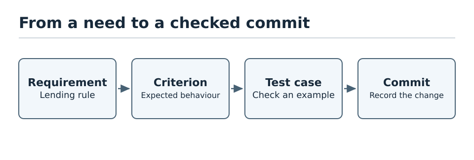

# M8-L2 – Planning, documenting and versioning software {#L2}

**Course area:** M8 – Systems and software projects

**Level:** Upper secondary (basic level)

**Prior knowledge:** [M3-L5 – Test cases and debugging](M3-L5.md), [M6-L1 – Classes, objects and interfaces](M6-L1.md)

**Learning objective:** Connect testable requirements, interfaces, tests and version history.

## What counts as done? {#S1}

A group is building a school lending display. “The display should work well” leaves the team without specific behaviour to check. “A known item with no active loan is shown as available” identifies a testable case. Two people can then work independently on implementation and testing.

## From a requirement to a recorded version {#S2}

A **requirement** describes the expected benefit or behaviour. An **acceptance criterion** expresses it as observable conditions. An **interface** specifies the inputs a software component expects and the output it provides. Other components can then use the function without knowing its internal representation.

{alt="Left to right: lending requirement, observable acceptance criterion, test case and a commit with the change and tests."}

A **version control system** such as Git records a selected set of file versions as a **commit**. Git distinguishes three states. The working directory contains the current files. The index or staging area holds the file versions selected for the next commit. The commit history contains the recorded versions of the project. A small, traceable commit connects a specific change with the corresponding tests.

## Making a lending rule testable {#S3}

We agree on the function `is_available(item_id, known_items, active_loans)`. It returns true when the identifier is known and has no active loan. In the example, `CAM1` and `CAM2` are known. `CAM2` is on loan. `CAM9` does not exist. When the result is false, the display can give a more specific reason if it also knows whether the identifier exists.

```python
def is_available(item_id, known_items, active_loans):
    return item_id in known_items and item_id not in active_loans


items = {"CAM1", "CAM2"}
loans = {"CAM2"}
assert is_available("CAM1", items, loans) is True
assert is_available("CAM2", items, loans) is False
assert is_available("CAM9", items, loans) is False
```

The team documents the inputs, the result and the assumption that identifiers are unique strings. In a new local Git practice directory it saves the function as `available.py` and the checks as `tests.py`. The first line in `tests.py` is `from available import is_available`. This sequence assumes that a local author identity is configured in Git.

```text
git init
python -B tests.py
git add available.py tests.py
git diff --staged
git commit -m "Define and test item availability"
git status --short
```

The successful test run ends without an assertion error. `git add` selects the two file versions. `git diff --staged` displays the staged changes before the commit. If these are the only files and they have remained unchanged, `git status --short` produces no output afterwards.

## Self-check {#S4}

### Exercises

1. For the requirement “An item on loan may not be lent out twice,” write an acceptance criterion giving the initial situation, action and observable result. Also check whether the data should remain unchanged.
2. You stage `available.py` with `git add` and then change it again. Which version will the next ordinary `git commit` contain? How can you include the new change in the commit?

### Solutions

1. Initially, `CAM2` is assigned to the fictional identifier `A17`. A second loan is requested for `A18`. The program reports the rejection and still shows exactly the original assignment to `A17`. The second identifier appears in no active loan for `CAM2`.
2. The commit contains the file version selected by the last `git add available.py`. Running `git add available.py` again stages the new version. `git diff --staged` shows what is then staged.

## Assumptions, errors and limits {#S5}

The three tests establish only the agreed examples for this function. The function reads two collections. It does not reserve an item or prevent simultaneous loans. A local commit records a version in the local repository. A separate backup or an approved shared location serves a different purpose. Test data and version history should contain no real personal data.

## Summary {#S6}

A testable criterion connects a requirement with a concrete test. The interface makes the behaviour available to other components. The commit records a checked change as a traceable version.

## Sources and further reading {#S7}

### Further reading (internal)

- [M8-L3 – Concurrency and consistent updates](M8-L3.md)

### Sources (external)

- [Gesellschaft für Informatik e. V. – Bildungsstandards Informatik für die Sekundarstufe II](https://informatikstandards.de/fileadmin/GI/Projekte/Informatikstandards/Dokumente/Bildungsstandards_SII.pdf) · Lesson reference: §3.1.4 · Connect testable requirements, interfaces, tests and version history. · Last accessed: 2026-11-22 · Content verified: 2026-11-22
- [Scott Chacon und Ben Straub – Pro Git – Recording Changes to the Repository](https://git-scm.com/book/en/v2/Git-Basics-Recording-Changes-to-the-Repository) · Lesson reference: Recording Changes · Connect testable requirements, interfaces, tests and version history. · Last accessed: 2026-11-22 · Content verified: 2026-11-22
