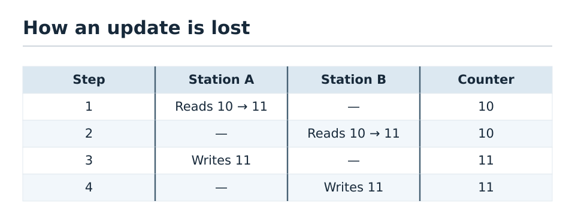

# M8-L3 – Concurrency and consistent updates {#L3}

**Course area:** M8 – Systems and software projects

**Level:** Upper secondary (advanced level)

**Prior knowledge:** [M8-L2 – Planning, documenting and versioning software](M8-L2.md), [M5-L4 – Normalisation and data integrity](M5-L4.md)

**Learning objective:** Explain a lost update and evaluate synchronisation as a model.

## When two people count at once {#S1}

Two stations record how many headphones have been returned to a storeroom. Both increment the same counter. One station may already have read its value while the other prepares its own update. With ten devices in stock, two returns should bring the total to twelve. Whether that result is reached depends on how the work steps interleave.

## Concurrent steps and shared data {#S2}

Two activities are **concurrent** if their processing periods overlap. Their individual steps may take turns. They are **parallel** if multiple steps actually run at the same time. Alternating execution on a single processor core is enough for the problem below.

In this model, each increment consists of reading, adding and writing. Reading and adding can be grouped into a local preparation step in this example. Writing replaces the shared value. A **lost update** occurs when a prepared, now outdated value later overwrites another change.

{alt="A reads 10 and prepares 11. B also reads 10 and prepares 11. A writes 11, then B writes 11 again. The two increments leave a total of 11 instead of 12."}

A **critical section** is a part of a program where shared data needs protection during processing. A common **lock** can ensure that at most one participating activity enters this section at a time. All participants must use the same lock for the entire read-modify-write section.

## Tracing two execution orders {#S3}

In the interleaved schedule A and B both read 10. Both prepare 11. A writes 11. B also writes 11. The result 11 reflects only one increment. In the serial schedule, A writes 11 first. B then reads 11 and writes 12. This model simulates both schedules and starts from 10 each time.

```python
def simulate(events):
    count = 10
    prepared = {}
    for worker, action in events:
        if action == "read":
            prepared[worker] = count + 1
        elif action == "write":
            count = prepared.pop(worker)
    return count


interleaved = [
    ("A", "read"), ("B", "read"), ("A", "write"), ("B", "write")
]
serial = [
    ("A", "read"), ("A", "write"), ("B", "read"), ("B", "write")
]
assert simulate(interleaved) == 11
assert simulate(serial) == 12
```

The program explicitly chooses the order in advance. This makes the fault reproducible without waiting for an operating system to make scheduling decisions.

## Self-check {#S4}

### Exercises

1. Now A adds 3 and B adds 2. Both read 10. A writes first and B writes second. What is the final value? Also give the final value for the same increments in serial execution.
2. A team locks only each write step. Show how an update can still be lost. Which steps must be protected together?

### Solutions

1. A prepares 13 and B prepares 12. B overwrites 13 with 12, so the final value in the interleaved schedule is 12. In serial execution the result is 15 regardless of which station increments first.
2. Both can read 10 before the first write lock is taken. A and B then each write 11 in turn even though each individual write is protected. Reading the shared value, computing the new value and writing it must occur under the same lock acquisition.

## Assumptions, errors and limits {#S5}

The simulation assumes that each simple read and write is indivisible. The composite update still consists of several steps. The programming language, library and database determine which operations are indivisible in practice. A lock works only if participants follow the same agreement. With multiple locks, activities can block one another indefinitely if each waits for a lock held by another.

## Summary {#S6}

Concurrent activities can base their calculations on the same starting value. Suitable synchronisation protects the update as a whole. A schedule table shows which order violates the data rule.

## Sources and further reading {#S7}

### Further reading (internal)

- [M8-L4 – Team project: a testable lending system](M8-L4.md)

### Sources (external)

- [Gesellschaft für Informatik e. V. – Bildungsstandards Informatik für die Sekundarstufe II](https://informatikstandards.de/fileadmin/GI/Projekte/Informatikstandards/Dokumente/Bildungsstandards_SII.pdf) · Lesson reference: §3.2.4 · Explain a lost update and evaluate synchronisation as a model. · Last accessed: 2026-11-22 · Content verified: 2026-11-22
- [Bayern – Staatsinstitut für Schulqualität und Bildungsforschung (ISB) – LehrplanPLUS Gymnasium 12 – Informatik, grundlegendes Niveau](https://www.lehrplanplus.bayern.de/fachlehrplan/gymnasium/12/informatik/grundlegend) · Lesson reference: Inf12 LB4 · Explain a lost update and evaluate synchronisation as a model. · Last accessed: 2026-11-22 · Content verified: 2026-11-22
