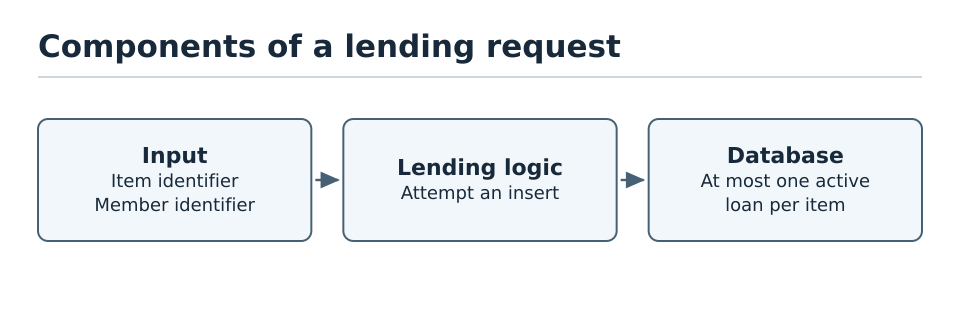

# M8-L4 – Team project: a testable lending system {#L4}

**Course area:** M8 – Systems and software projects

**Level:** Upper secondary (basic level)

**Prior knowledge:** [M8-L2 – Planning, documenting and versioning software](M8-L2.md), [M5-L3 – SQL joins, groups and missing values](M5-L3.md)

**Learning objective:** Develop a small application with test data, a test plan and a division of responsibilities.

## A small brief for a team {#S1}

A school club lends out cameras. It needs a prototype that assigns a known, available item to a fictional member identifier. An item on loan remains unavailable until it is returned. On paper it is easy to add a second row. A database should reliably prevent that conflicting assignment.

## Components and a data rule {#S2}

The input provides the item and member identifiers. The application logic processes them and reports whether the request was accepted. The database stores items and active loans. The `active_loan` table has at most one row per item. Its `item_id` primary key makes this rule enforceable. A foreign key ensures that each loan refers to a known item.

{alt="Input sends item and member identifiers to the lending logic. The logic attempts a database insert. The database allows at most one active loan per item."}

We divide responsibility among team members. One person implements the schema and data rules. A second implements the application functions. A third designs test cases and documents the observed results. Everyone agrees on the interface, test data and meaning of the return values before implementation. Then another person checks each proposed change against the agreed criteria.

## Running a testable prototype {#S3}

This example requires Python 3.11 or later with SQLite version 3.24 or later. It begins with two known, available items. `book` tries to record a loan for a matching item. Each `?` parameter binds a value. If the item identifier is unknown, the query selects no row. If an active loan already exists, the conflict on `item_id` also prevents a new row. Both cases return `False`.

```python
import sqlite3

db = sqlite3.connect(":memory:")
db.execute("PRAGMA foreign_keys = ON")
db.executescript("""
    CREATE TABLE item (
        item_id TEXT NOT NULL PRIMARY KEY
    );
    CREATE TABLE active_loan (
        item_id TEXT NOT NULL PRIMARY KEY REFERENCES item(item_id),
        member_id TEXT NOT NULL
    );
    INSERT INTO item VALUES ('CAM1'), ('CAM2');
""")


def book(connection, item_id, member_id):
    with connection:
        result = connection.execute("""
            INSERT INTO active_loan (item_id, member_id)
            SELECT item_id, ? FROM item WHERE item_id = ?
            ON CONFLICT(item_id) DO NOTHING
        """, (member_id, item_id))
    return result.rowcount == 1


assert book(db, "CAM2", "A17") is True
assert book(db, "CAM2", "A18") is False
assert book(db, "CAM9", "A18") is False
loans = db.execute("SELECT item_id, member_id FROM active_loan").fetchall()
assert loans == [("CAM2", "A17")]
db.close()
```

Only the first assignment is stored at the end. The tests check both the function's return values and the observable data state. This would reveal a defect where the program reports a rejection but overwrites the old assignment.

## Self-check {#S4}

### Exercises

1. Design a return function that takes an item identifier. Which table entries should it change? Give three checks with expected results for a return, a repeated return and a subsequent new loan.
2. The project report says “All test cases work.” Write a specific verification procedure for a duplicate loan that another person can repeat using the prototype.

### Solutions

1. The function runs `DELETE FROM active_loan WHERE item_id = ?` with the item identifier as a parameter inside a transaction. It reports, from the number of deleted rows, whether it removed an entry. `CAM2` remains in `item`. After the original loan, the first return gives true and the second gives false. A new loan to `A18` then gives true and leaves exactly `("CAM2", "A18")` in `active_loan`.
2. Start with available items. Call `book` for `CAM2` and `A17`, then for `CAM2` and `A18`. The expected results are `True` and `False`. The final query must return exactly `("CAM2", "A17")`. Record the inputs, expected and observed results, and the version tested.

## Assumptions, errors and limits {#S5}

The in-memory database disappears when the connection closes. The prototype assumes valid fictional member identifiers. It has no sign-in, due dates or loan history. Before real use the team would have to establish requirements for permissions, data retention, error handling and recovery. Tests with one local connection also do not cover a distributed system.

## Summary {#S6}

A small team can divide work on the data model, application logic and tests. A central data rule protects the assignment. A repeatable test demonstrates which output and table state each sample operation produces.

## Sources and further reading {#S7}

### Further reading (internal)

- [M8-L5 – Operating systems and connected devices](M8-L5.md)

### Sources (external)

- [Gesellschaft für Informatik e. V. – Bildungsstandards Informatik für die Sekundarstufe II](https://informatikstandards.de/fileadmin/GI/Projekte/Informatikstandards/Dokumente/Bildungsstandards_SII.pdf) · Lesson reference: §3.1.4 · Develop a small application with test data, a test plan and a division of responsibilities. · Last accessed: 2026-11-22 · Content verified: 2026-11-22
- [Bayern – Staatsinstitut für Schulqualität und Bildungsforschung (ISB) – LehrplanPLUS Gymnasium 12 – Informatik, grundlegendes Niveau](https://www.lehrplanplus.bayern.de/fachlehrplan/gymnasium/12/informatik/grundlegend) · Lesson reference: Inf12 LB6 · Develop a small application with test data, a test plan and a division of responsibilities. · Last accessed: 2026-11-22 · Content verified: 2026-11-22
