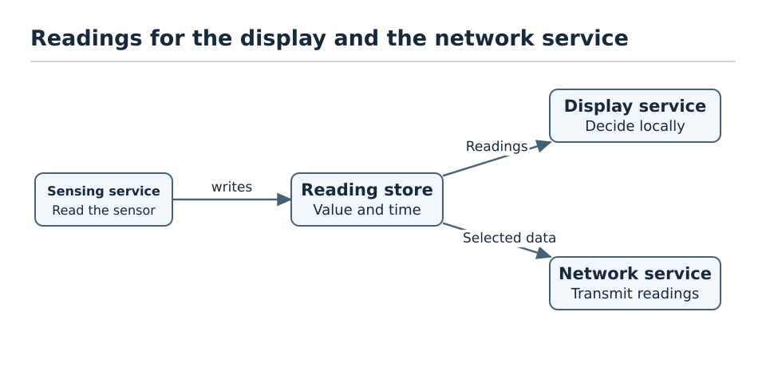

# M8-L5 – Operating systems and connected devices {#L5}

**Course area:** M8 – Systems and software projects

**Level:** Upper secondary (advanced level)

**Prior knowledge:** [M1-L2 – Hardware, software and operating systems](M1-L2.md), [M8-L3 – Concurrency and consistent updates](M8-L3.md), [M4-L3 – Protecting data and securing accounts](M4-L3.md)

**Learning objective:** Explain processes, permissions and device lifecycles for a sensor network.

## When the connection goes down {#S1}

A greenhouse model uses a local indicator to report if it is too warm. A network service can also send selected readings to a remote dashboard. If the internet connection goes down, the warning indicator should still work. If the sensor fails, the indicator should report the last known reading as stale once it is too old for a warning decision. The two situations require different responses.

## Processes, permissions and local decisions {#S2}

A **program** describes executable instructions. A **process** is a running instance with execution state and allocated resources, such as memory and open files. The **operating system** allocates processing time and enforces access permissions on a suitable system. Two processes can therefore have different permissions for the same reading store.

{alt="The sensing service reads the sensor and updates the reading store. The local display and network service read from it through separate paths. The network service does not control the display."}

In this model, the sensing service can read the sensor and update the local reading store. The display service can read that store and control the local indicator. The separate network service has read access to selected readings and can transmit them. It has no write access to thresholds or the indicator. The **principle of least privilege** grants each service the permissions it needs for its task.

## Checking data freshness independently of the internet {#S3}

We use whole seconds from a local time source that moves forwards during the experiment. A sample with a reading and a timestamp is fresh for up to 2 seconds, given the age condition `0 <= now - sampled_at <= 2`. For a fresh sample, the state is `WARN` at or above 30 °C and `OK` below that. With no fresh sample, it is `STALE`. The model assumes valid, finite readings.

```python
def local_status(now, sample):
    if sample is None:
        return "STALE"
    sampled_at, temperature = sample
    age = now - sampled_at
    if not 0 <= age <= 2:
        return "STALE"
    return "WARN" if temperature >= 30 else "OK"


last_sample = (8, 31)
assert local_status(8, last_sample) == "WARN"
assert local_status(10, last_sample) == "WARN"
assert local_status(11, last_sample) == "STALE"
assert local_status(12, (12, 29)) == "OK"
assert local_status(5, None) == "STALE"
```

At second 8 the sensor reports 31 °C. The internet goes down at second 9. At second 10 the same sample is still fresh. The local indicator continues to warn even though the dashboard receives no current readings. With no new sample, the local indicator reports stale data at second 11. A fresh sample of 29 °C at second 12 gives `OK` again, even if the internet is still down.

## Self-check {#S4}

### Exercises

1. The last sample was taken at second 20 and reports 30 °C. The internet connection goes down. Without a fresh sample, what states does the local indicator report at seconds 22 and 23?
2. In one design, the network service has write permissions for stored readings and thresholds. Propose more suitable permissions and two decisions to make when the device is retired.

### Solutions

1. At second 22 the sample is 2 seconds old and is still fresh. Exactly 30 °C meets the warning condition, so the indicator reports `WARN`. At second 23, the sample is 3 seconds old. The state is `STALE`.
2. Read access to the data needed for transmission is sufficient. Only the sensing service needs write access to the reading store. The threshold belongs in the protected local configuration. When retiring the device, the team can archive or delete its stored readings in line with agreed retention rules and revoke the device's network access.

## Assumptions, errors and limits {#S5}

A local control path helps during an internet outage if the sensor and indicator remain reachable locally. The model alone offers no protection against power loss or a sensor that reports plausible but incorrect fresh values. After a restart, the check begins with no valid sample. Device planning also includes a supported way to install updates and a decision on when to disconnect or replace a device that no longer receives security updates.

## Summary {#S6}

The operating system allocates resources and supports separate process permissions. Local decisions can remain independent of the internet. A separate stale-data state shows when the indicator no longer has a reliable temperature status.

## Sources and further reading {#S7}

### Further reading (internal)

- [M9-L1 – Analysing data and limiting conclusions](M9-L1.md)

### Sources (external)

- [Bayern – Staatsinstitut für Schulqualität und Bildungsforschung (ISB) – LehrplanPLUS Gymnasium 12 – Informatik, erhöhtes Niveau](https://www.lehrplanplus.bayern.de/fachlehrplan/gymnasium/12/informatik/erhoeht) · Lesson reference: Inf12 LB5 · Explain processes, permissions and device lifecycles for a sensor network. · Last accessed: 2026-11-22 · Content verified: 2026-11-22
- [Bayern – Staatsinstitut für Schulqualität und Bildungsforschung (ISB) – LehrplanPLUS Gymnasium 13 – Informatik, erhöhtes Niveau](https://www.lehrplanplus.bayern.de/fachlehrplan/gymnasium/13/informatik/erhoeht) · Lesson reference: Inf13 LB1 · Explain processes, permissions and device lifecycles for a sensor network. · Last accessed: 2026-11-22 · Content verified: 2026-11-22
