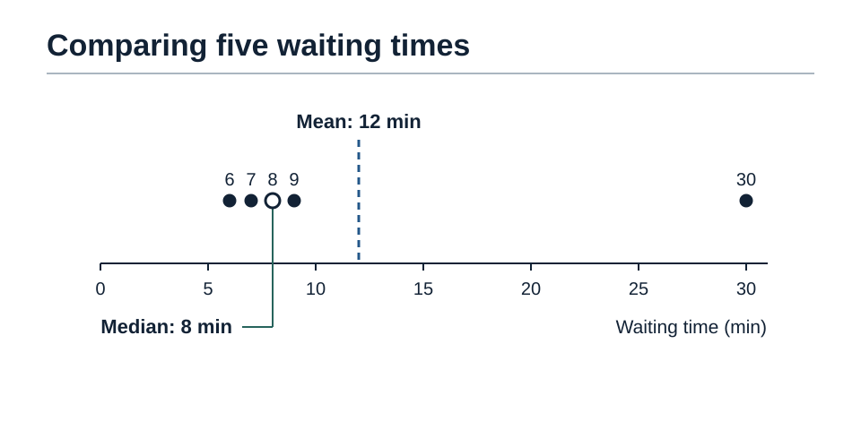

# M9-L1 – Analysing data and limiting conclusions {#L1}

**Course area:** M9 – Data analysis, AI and responsibility

**Level:** Lower secondary (core)

**Prior knowledge:** [M2-L4 – From a measured signal to a table](M2-L4.md)

**Learning objective:** Summarise a distribution and distinguish correlation from causation.

## Why one number does not tell the whole story {#S1}

Five people wait different lengths of time for a bus at the same stop. Could you decide when to leave home based on the statement ‘Our average wait is twelve minutes’ alone? You would also want to know whether almost everyone waits about twelve minutes or a single long wait pushes up the average.

## Mean, median and spread {#S2}

The **arithmetic mean** is the sum of all values divided by the number of values. The **median** is the middle value in the sorted list. If there is an even number of values, take the mean of the two middle values. The median splits the sorted observations into two halves. Both statistics are measured in minutes here.

An **outlier** is a value that stands out in comparison with the other observations. Standing out does not make it an error. The dot plot shows each measurement and the gap between the cluster and the longest wait.

{alt="Four points on the time scale are at 6, 7, 8 and 9 minutes, with another at 30. The median is 8 minutes and the mean is 12."}

## Analysing five waiting times {#S3}

The times are `6, 7, 8, 9, 30` minutes. They add up to 60 minutes. The mean is `60 / 5 = 12` minutes. The third sorted value, and therefore the median, is 8 minutes. The **range**, the gap from the smallest to the largest value, is `30 − 6 = 24` minutes.

```python
from statistics import mean, median

minutes = [6, 7, 8, 9, 30]
assert mean(minutes) == 12
assert median(minutes) == 8
assert max(minutes) - min(minutes) == 24
```

Four of the five waits are between 6 and 9 minutes. If the 30-minute wait is accurate because a bus service was cancelled, for instance, it describes a real risk. If the measurement record clearly shows that this person mistakenly started timing at home, the value is not comparable with the others. Document that reason before correcting the data.

## Self-check {#S4}

### Exercises

1. The following day, the observed waits were `6, 7, 8, 9, 10` minutes. Calculate the mean, median and range. Which measure stays the same?
2. Waiting times in a larger dataset tend to be longer on rainy days. Identify a possible third factor and describe a fairer comparison.

### Solutions

1. The sum is 40. Both the mean and median are 8 minutes, and the range is `10 − 6 = 4` minutes. Only the median stays the same compared with the first day.
2. Time of day may be associated with the recorded weather if many of the rainy observations happened to be made during rush hour. Compare the same stop and direction of travel during similar time slots in rainy and dry weather. This helps limit the influence of time of day. Other plausible influences would need to be investigated before claiming a causal relationship.

## Common mistakes and limitations {#S5}

A **correlation** is a statistical association. It can provide clues about a cause. A third factor, the way observations were selected, or chance can also produce the same observation. With only five observations, it is easy to overinterpret a pattern. Record the measurement location, period, unit and selection rule. If values stand out, explain how you checked them.

## Summary {#S6}

The mean incorporates the magnitude of each value. For the median, position in the sorted list matters. A dot plot and the number of observations help interpret both statistics. Explaining an observed pattern requires further evidence.

## Sources and further reading {#S7}

### Further reading (internal)

- [M9-L2 – Machine learning with a small model](M9-L2.md)

### Sources (external)

- [Gesellschaft für Informatik e. V. – Bildungsstandards Informatik für die Sekundarstufe I](https://informatikstandards.de/fileadmin/FA/IBS/user_upload/GI-Bildungsstandards_Informatik_Sek_I__2025__-_blau.pdf) · Lesson reference: §5.1, §5.5 · Summarise a distribution and distinguish correlation from causation. · Last accessed: 2026-11-22 · Content verified: 2026-11-22
