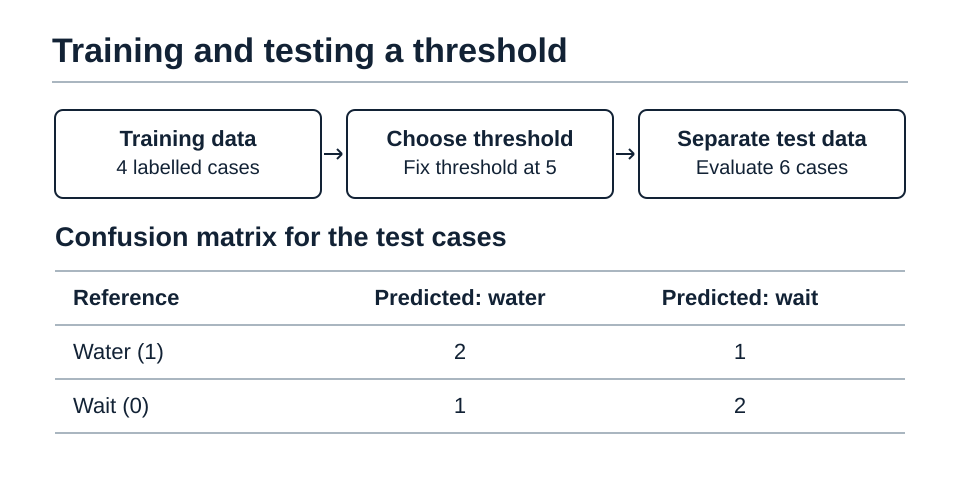

# M9-L2 – Machine learning with a small model {#L2}

**Course area:** M9 – Data analysis, AI and responsibility

**Level:** Upper secondary (basic level)

**Prior knowledge:** [M9-L1 – Analysing data and limiting conclusions](M9-L1.md), [M3-L4 – Lists, functions and decomposition](M3-L4.md)

**Learning objective:** Keep training and testing separate and assess the consequences of a threshold decision.

## Learning a decision from examples {#S1}

A fictional school garden wants to use a dryness score from 1 to 9 to estimate when a plant needs watering. For each example, the gardening team examines the plant directly and determines whether watering is needed independently of the sensor reading. A method that learns from such pairs of inputs and known target values is called **supervised learning**.

## Training and testing {#S2}

The small model has one parameter, the **threshold**. A dryness score at or above the threshold produces a prediction of `1` for ‘water’. A score below the threshold produces `0` for ‘wait’. Training chooses the threshold with the fewest errors on the training data from the candidates 4, 5 and 6. If there is a tie, the lower threshold is chosen. The test data are kept separate until evaluation.

A **confusion matrix** compares known target values with predictions. A **false positive** recommends watering when the reference says ‘wait’. A **false negative** recommends waiting when watering is needed.

{alt="Four training cases yield threshold 5. Six separate test cases yield two true positives, one false positive, one false negative and two true negatives."}

## Selecting and testing a threshold {#S3}

On the training cases `(2, 0), (4, 0), (6, 1), (8, 1)`, a threshold of 4 makes one error at the score 4. Thresholds 5 and 6 classify all four cases correctly. The tie-breaking rule selects 5. The test then produces two true positives (7 and 9), one false positive (6), one false negative (4) and two true negatives (3 and 2). The **accuracy** is `4 / 6`, or about 67%.

```python
train = [(2, 0), (4, 0), (6, 1), (8, 1)]
test = [(3, 0), (4, 1), (6, 0), (7, 1), (9, 1), (2, 0)]


def predict(score, threshold):
    return int(score >= threshold)


def training_errors(threshold):
    return sum(predict(score, threshold) != actual for score, actual in train)


threshold = min((4, 5, 6), key=lambda value: (training_errors(value), value))
counts = {(a, p): 0 for a in (0, 1) for p in (0, 1)}
for score, actual in test:
    counts[actual, predict(score, threshold)] += 1

assert threshold == 5
assert counts == {(0, 0): 2, (0, 1): 1, (1, 0): 1, (1, 1): 2}
assert sum(predict(score, 7) == actual for score, actual in test) == 5
```

## Self-check {#S4}

### Exercises

1. What kind of outcome is the test case `(4, 1)` at a threshold of 5? What could be the consequence of this mistake?
2. A team looks at the same test data, chooses a threshold of 7 and now gets five correct answers instead of four. What must it do before making a new claim about accuracy?

### Solutions

1. The prediction is `0` and the known value is `1`, so this is a false negative. The plant might remain dry for too long.
2. The same test has now influenced the choice of threshold. The team must fix the threshold at 7 and evaluate it on new cases that have not been examined. The five correct answers on the cases already examined describe only those cases.

## Common mistakes and limitations {#S5}

A single sensor score is a simplified description. A score of 6 can indicate watering in one training example and waiting in a test example. Different growing media or plant species could play a role. The datasets are synthetic and small. Higher accuracy alone does not establish which errors would have more serious consequences in practice. Consider the two types of error separately when choosing and evaluating a model.

## Summary {#S6}

Training data determine the threshold. Separate test data show how the fixed threshold affects new cases. The confusion matrix shows how mistakes are distributed across the two types of decision.

## Sources and further reading {#S7}

### Further reading (internal)

- [M9-L3 – Bias, generative AI and verification](M9-L3.md)

### Sources (external)

- [Gesellschaft für Informatik e. V. – Bildungsstandards Informatik für die Sekundarstufe I](https://informatikstandards.de/fileadmin/FA/IBS/user_upload/GI-Bildungsstandards_Informatik_Sek_I__2025__-_blau.pdf) · Lesson reference: §5.1 · Keep training and testing separate and assess the consequences of a threshold decision. · Last accessed: 2026-11-22 · Content verified: 2026-11-22
- [Bayern – Staatsinstitut für Schulqualität und Bildungsforschung (ISB) – LehrplanPLUS Gymnasium 11 – spät beginnende Informatik](https://www.lehrplanplus.bayern.de/fachlehrplan/gymnasium/11/informatik/mug_swg_sg) · Lesson reference: Inf11 LB4 · Keep training and testing separate and assess the consequences of a threshold decision. · Last accessed: 2026-11-22 · Content verified: 2026-11-22
- [Google for Developers – Datasets: Dividing the original dataset](https://developers.google.com/machine-learning/crash-course/overfitting/dividing-datasets) · Lesson reference: Training, validation and test sets · Keep training and testing separate and assess the consequences of a threshold decision. · Last accessed: 2026-11-22 · Content verified: 2026-11-22
- [Google for Developers – Classification: Accuracy, recall, precision, and related metrics](https://developers.google.com/machine-learning/crash-course/classification/accuracy-precision-recall) · Lesson reference: Accuracy · Keep training and testing separate and assess the consequences of a threshold decision. · Last accessed: 2026-11-22 · Content verified: 2026-11-22
