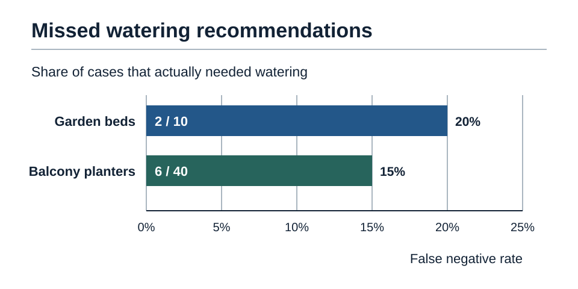

# M9-L3 – Bias, generative AI and verification {#L3}

**Course area:** M9 – Data analysis, AI and responsibility

**Level:** Upper secondary (basic level)

**Prior knowledge:** [M9-L2 – Machine learning with a small model](M9-L2.md)

**Learning objective:** Evaluate different error rates and unsupported generative AI outputs.

## Who is affected by a model error? {#S1}

A school garden tests the watering recommendation from the previous lesson on two groups of plants. More necessary recommendations are missed for the balcony planters than for the garden beds. Which group is more affected by missed watering recommendations? To answer, you also need to know how many cases in each group actually needed watering.

## Calculating an error rate for each group {#S2}

The team considers only actual positive cases and counts the **false negative** predictions among them. For the garden beds, 2 out of 10 are false negatives. For the balcony planters, the figure is 6 out of 40. The **false negative rate** is the number of missed recommendations divided by the number of actual positives. It is `2 / 10 = 20%` for the garden beds and `6 / 40 = 15%` for the balcony planters. In these data, the group with fewer missed recommendations has the higher rate.

{alt="Garden beds: 2 missed recommendations out of 10 actual positives, 20 percent. Balcony planters: 6 out of 40, 15 percent. Both bars start at zero."}

A difference can indicate **bias**. For example, a sensor may have been set up for one location while the other hardly featured during development. Investigate possible causes such as sample size, sensor position, growing medium and the quality of the reference labels. The error rate describes the cases observed so far.

## Checking an AI answer against evidence {#S3}

A generative AI system produces new outputs such as text. It can phrase an answer well while making a plausible but unsupported claim. In this exercise, the AI says, ‘The balcony planter and garden bed datasets each contained 40 cases that needed watering.’ It cites ‘Sensor report, Table 2’. The gardening team checks the exact location in the sample report:

| Table 2 · Entry | Garden beds | Balcony planters |
| --- | ---: | ---: |
| Test cases that needed watering | 10 | 40 |
| Missed recommendations among them | 2 | 6 |

The report exists within the exercise. The cited table supports the statement about the balcony planters and contradicts the statement about the garden beds. A correction supported by the evidence is: ‘Ten garden bed test cases and 40 balcony planter test cases needed watering (Sensor report, Table 2).’

## Self-check {#S4}

### Exercises

1. One more previously correctly identified positive garden bed case is mistakenly classified as ‘wait’. Calculate the new false negative rate. How many percentage points separate it from the unchanged rate for the balcony planters?
2. A generated record says, ‘Six of the balcony planter cases were positive.’ Which two figures from Table 2 has it confused?

### Solutions

1. The denominator is still 10, and the numerator rises to 3. The rate is 30%. The difference from 15% is 15 percentage points.
2. The model missed six out of 40 actual positive cases. Six is the number of false negative predictions. Forty is the number of actual positive cases.

## Common mistakes and limitations {#S5}

Only actual positive cases enter the calculation. The rate is undefined for a group with no actual positive cases. Dividing by all test cases answers a different question. When there are just ten positive cases, one mistake changes the rate by ten percentage points. A reliable assessment needs more cases collected in comparable ways. When checking a source, verify the document, the location and the specific content. A credible-sounding title by itself is insufficient.

## Summary {#S6}

Analyse mistakes using the denominator that matches your question. Next check whether differences persist in new cases collected in comparable ways. Treat an AI answer as a claim you can verify and record the exact place in the source that supports it.

## Sources and further reading {#S7}

### Further reading (internal)

- [M9-L4 – Participation, rights and sustainability](M9-L4.md)

### Sources (external)

- [Gesellschaft für Informatik e. V. – Bildungsstandards Informatik für die Sekundarstufe I](https://informatikstandards.de/fileadmin/FA/IBS/user_upload/GI-Bildungsstandards_Informatik_Sek_I__2025__-_blau.pdf) · Lesson reference: §5.5 · Evaluate different error rates and unsupported generative AI outputs. · Last accessed: 2026-11-22 · Content verified: 2026-11-22
- [Bayern – Staatsinstitut für Schulqualität und Bildungsforschung (ISB) – LehrplanPLUS Gymnasium 13 – Informatik, grundlegendes Niveau](https://www.lehrplanplus.bayern.de/fachlehrplan/gymnasium/13/informatik/grundlegend) · Lesson reference: Inf13 LB4 · Evaluate different error rates and unsupported generative AI outputs. · Last accessed: 2026-11-22 · Content verified: 2026-11-22
- [Google for Developers – Classification: Accuracy, recall, precision, and related metrics](https://developers.google.com/machine-learning/crash-course/classification/accuracy-precision-recall) · Lesson reference: Recall · Evaluate different error rates and unsupported generative AI outputs. · Last accessed: 2026-11-22 · Content verified: 2026-11-22
- [National Institute of Standards and Technology – Artificial Intelligence Risk Management Framework: Generative Artificial Intelligence Profile](https://nvlpubs.nist.gov/nistpubs/ai/NIST.AI.600-1.pdf) · Lesson reference: §2.2 Confabulation · Evaluate different error rates and unsupported generative AI outputs. · Last accessed: 2026-11-22 · Content verified: 2026-11-22
