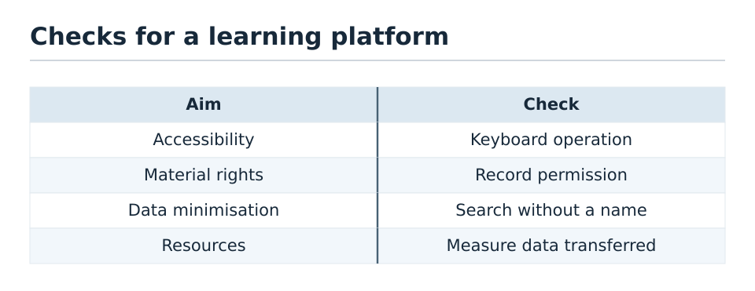

# M9-L4 – Participation, rights and sustainability {#L4}

**Course area:** M9 – Data analysis, AI and responsibility

**Level:** Upper secondary (basic level)

**Prior knowledge:** [M4-L3 – Protecting data and securing accounts](M4-L3.md), [M9-L1 – Analysing data and limiting conclusions](M9-L1.md)

**Learning objective:** Weigh accessibility, copyright, data minimisation and resource use.

## A platform for different learners {#S1}

A class publishes revision cards on a fictional school platform. The design presents each card as an image, automatically loads a preview video and asks for a name with every search. How can the page achieve the same learning goal while working well on limited mobile data, with a keyboard and with screen reading software?

## Turning requirements into tests {#S2}

**Accessibility** examines whether people with different abilities and assistive technologies can use the platform. A text alternative for an informative image conveys its main point. For complex graphics, a nearby text table can provide individual values. Reliable keyboard access means, for example, that you can reach and use the search and open cards with Tab and Enter. A visible focus indicator shows which element would be activated next.

**Data minimisation** asks which data are necessary for a specified purpose. Search terms are sufficient for this keyword search. Before publishing someone else’s learning materials, the group should determine what permission or licence applies and what attribution is required. A link to the source records its origin. Reuse is governed by the applicable terms.

{alt="The table matches four aims with tests: keyboard operation, permission records, keyword search without a name and measurement of transferred bytes."}

## Comparing two preview designs {#S3}

In the hypothetical test, design A loads a 6 MB video each time the page is opened. Design B loads only an 80 kB preview image. Both offer an accessible button to play the video by choice. In decimal units, 80 kB equals 0.08 MB. For 1,000 views with no caching or optional playback, the amount transferred is:

| Design | Data transferred per 1,000 views |
| --- | ---: |
| Automatically loaded video | 6,000 MB = 6 GB |
| Still image | 80 MB |

In this scenario, the second design saves `6,000 − 80 = 5,920` MB in preview transfers. If every video in the second design is subsequently loaded after all, the previews add 80 MB on top of the video data. Measure both the transferred bytes and how many videos users actually start. Bytes measure the amount of data. Energy use and environmental effects depend on further factors such as the device, network, caching and usage.

## Self-check {#S4}

### Exercises

1. A card contains a chart as an image, and the only download button is accessible only with a mouse. Suggest two improvements and one concrete test for each.
2. The class is scheduled to publish in a week. There is no record of permission to use a photo, searches store real names, and the preview video has no confirmed educational purpose. Propose a plan and justify it.

### Solutions

1. Put the main point of the chart in its alt text and supply the exact values in a text table. Check that both make sense with screen reading software. Use a standard focusable link with a visible focus indicator for the download and test it with Tab and Enter without a mouse.
2. Replace the photo with suitable original or authorised material until the rights are clear, and record its origin. Test the keyword search without a name field or name storage. Replace automatic video loading with a small still image, and offer optional playback only if there is evidence that it is useful. Agree who is responsible and what the acceptance test is for each point.

## Common mistakes and limitations {#S5}

A good result from an automated accessibility check cannot substitute for representative tests with a keyboard and assistive technology. Legitimate reasons for a login depend on its purpose. A smaller measured file by itself cannot establish a particular reduction in emissions. Record the assumptions and measurement limits for each comparison.

## Summary {#S6}

Base decisions on the learning purpose. Record the requirements and how to test them separately for accessibility, material rights, data minimisation and resource use. The same technical decision can involve different requirements in each of these areas.

## Sources and further reading {#S7}

### Further reading (internal)

- [M10-L1 – Task verbs and reasoned choice of models](M10-L1.md)

### Sources (external)

- [Gesellschaft für Informatik e. V. – Bildungsstandards Informatik für die Sekundarstufe I](https://informatikstandards.de/fileadmin/FA/IBS/user_upload/GI-Bildungsstandards_Informatik_Sek_I__2025__-_blau.pdf) · Lesson reference: §5.5 · Weigh accessibility, copyright, data minimisation and resource use. · Last accessed: 2026-11-22 · Content verified: 2026-11-22
- [Bildungsserver Berlin-Brandenburg · Senatsverwaltung Berlin und MBJS Brandenburg – Rahmenlehrplan Teil C – Informatik, Wahlpflichtfach, Jahrgangsstufen 7–10](https://bildungsserver.berlin-brandenburg.de/fileadmin/bbb/unterricht/rahmenlehrplaene/Rahmenlehrplanprojekt/amtliche_Fassung/Teil_C_Informatik_2015_11_10.pdf) · Lesson reference: §3.3 · Weigh accessibility, copyright, data minimisation and resource use. · Last accessed: 2026-11-22 · Content verified: 2026-11-22
- [W3C Web Accessibility Initiative – Understanding Success Criterion 1.1.1: Non-text Content](https://www.w3.org/WAI/WCAG22/Understanding/non-text-content.html) · Lesson reference: Non-text Content · Weigh accessibility, copyright, data minimisation and resource use. · Last accessed: 2026-11-22 · Content verified: 2026-11-22
- [W3C Web Accessibility Initiative – Understanding Success Criterion 2.1.1: Keyboard](https://www.w3.org/WAI/WCAG22/Understanding/keyboard.html) · Lesson reference: SC 2.1.1 · Weigh accessibility, copyright, data minimisation and resource use. · Last accessed: 2026-11-22 · Content verified: 2026-11-22
- [W3C Web Accessibility Initiative – Understanding Success Criterion 2.4.7: Focus Visible](https://www.w3.org/WAI/WCAG22/Understanding/focus-visible.html) · Lesson reference: SC 2.4.7 · Weigh accessibility, copyright, data minimisation and resource use. · Last accessed: 2026-11-22 · Content verified: 2026-11-22
